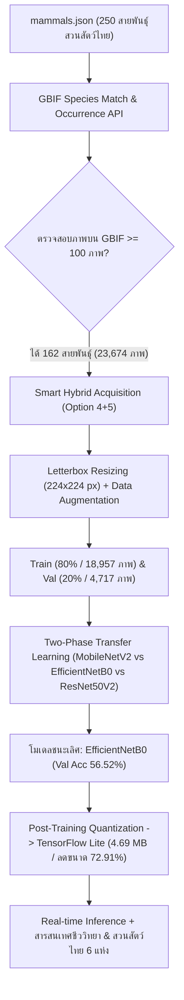
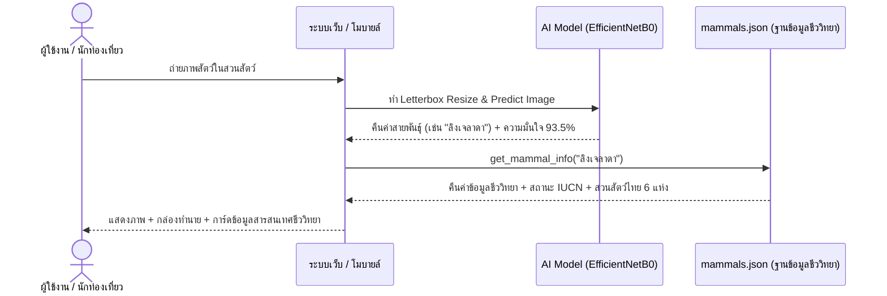

# เอกสารรายงานเชิงลึก: กระบวนการและผลการทดสอบสมุดบันทึกวิจัย Mammals.ipynb
## แพลตฟอร์มปัญญาประดิษฐ์จำแนกสัตว์เลี้ยงลูกด้วยนมในสวนสัตว์ไทย (162 สายพันธุ์) และระบบสารสนเทศความรู้ชีวภาพแบบเรียลไทม์

---

## 📌 บทนำและภาพรวมโครงการ (Project Overview)

สมุดบันทึกการวิจัย [Mammals.ipynb](../Mammals.ipynb) ถูกพัฒนาขึ้นเพื่อเป็นแกนกลางทางด้าน Machine Learning & Deep Learning ในโครงการพัฒนาแพลตฟอร์มปัญญาประดิษฐ์เพื่อการเรียนรู้ด้านสัตววิทยาในสวนสัตว์เปิดของประเทศไทย โดยมีวัตถุประสงค์หลัก 3 ประการ:
1. **การสร้างชุดข้อมูลอัตโนมัติความเร็วสูง (Smart Hybrid Acquisition)**: เชื่อมโยงฐานข้อมูลสัตว์ในสวนสัตว์ไทย ([mammals.json](../python/data/mammals.json)) ครบทั้ง 250 ชนิด เข้ากับคลังข้อมูลความหลากหลายทางชีวภาพระดับโลก ([GBIF API](https://www.gbif.org/)) เพื่อดาวน์โหลดภาพจริง คัดกรอง และสำรองข้อมูลขึ้นคลาวด์แบบอัตโนมัติ
2. **การเปรียบเทียบสถาปัตยกรรมโครงข่ายประสาทเทียมเชิงลึก (Deep Neural Network Comparison)**: เปรียบเทียบประสิทธิภาพของ 3 สถาปัตยกรรม CNN ชั้นนำ ได้แก่ **MobileNetV2**, **EfficientNetB0** และ **ResNet50V2** ภายใต้กระบวนการฝึกสอนแบบสองเฟส (Two-Phase Transfer Learning)
3. **การแปลงและเพิ่มประสิทธิภาพโมเดลสำหรับ Edge AI**: แปลงโมเดลที่ดีที่สุดเป็น **TensorFlow Lite (`.tflite`)** ด้วยเทคนิค Post-Training Quantization (PTQ) เพื่อนำไปใช้งานจริงบนแอปพลิเคชันมือถือและเว็บเบราว์เซอร์ พร้อมเชื่อมโยงกับฐานข้อมูลชีววิทยาและสวนสัตว์ไทยแบบเรียลไทม์



---

## 🛠️ โครงสร้างและการทำงาน 10 ส่วนของสมุดบันทึก (Step-by-Step Pipeline)

สมุดบันทึก [Mammals.ipynb](../Mammals.ipynb) แบ่งสถาปัตยกรรมการทำงานออกเป็น 10 ส่วนหลักที่เชื่อมโยงกันอย่างเป็นระบบ:

### ส่วนที่ 1: การโหลดไลบรารีและการตั้งค่าฮาร์ดแวร์ (Setup & Hardware Acceleration)
- **ระบบและเครื่องมือ**: ตรวจสอบการทำงานของ TensorFlow, NumPy, Pandas, OpenCV, Pillow และ Scikit-Learn
- **การเร่งความเร็วด้วย GPU**: ตรวจสอบการเชื่อมต่อกับหน่วยประมวลผลกราฟิก (`tf.test.gpu_device_name()`) รองรับทั้งการรันบน Google Colab (เช่น Tesla T4 / A100 GPU) และเครื่อง Workstation ในระบบ Local เพื่อเพิ่มความเร็วในการคำนวณ Deep Learning

### ส่วนที่ 2: การเชื่อมต่อระบบจัดเก็บและตรวจสอบพาธ (Paths & Environment Setup)
- รองรับสภาพแวดล้อมแบบไฮบริดทั้ง **Google Drive Mount (`/content/drive`)** และ **Local Workspace**
- ตรวจสอบความถูกต้องและความสมบูรณ์ของไฟล์ฐานข้อมูล [mammals.json](../python/data/mammals.json)
- **นโยบายความถูกต้องของข้อมูล (Data Integrity Notice)**: กำหนดให้ไฟล์ `mammals.json` อยู่ในโหมดอ่านอย่างเดียว (Read-Only) โดยเด็ดขาด เพื่อป้องกันการสูญหายหรือข้อมูลคาดเคลื่อน

### ส่วนที่ 3: การตรวจสอบอนุกรมวิธานสากลและจำนวนภาพบน GBIF (Query GBIF API)
ระบบเชื่อมโยงชื่อวิทยาศาสตร์ของสัตว์ในสวนสัตว์ไทยทั้ง 250 ชนิด เข้ากับระบบ API ของ [Global Biodiversity Information Facility (GBIF)](https://www.gbif.org/) 2 รูปแบบ:
1. **[GBIF Species Match API](https://api.gbif.org/v1/species/match)**: ค้นหา TaxonKey สากล เพื่อให้ได้รหัสประจำสายพันธุ์ที่ถูกต้องตามหลักอนุกรมวิธานชีววิทยา
2. **[GBIF Occurrence Search API](https://api.gbif.org/v1/occurrence/search)**: ตรวจสอบจำนวนภาพถ่ายจริงที่มีอยู่ในฐานข้อมูลโลกที่มี `mediaType=StillImage`
- ใช้ระบบ **Multi-threaded Worker (8 เธรด)** เพื่อความรวดเร็วในการคิวรี
- บันทึกผลลัพธ์เป็นไฟล์แคช `mammals_gbif_summary.json` เพื่อหลีกเลี่ยงการยิงคำขอ API ซ้ำซ้อน

#### สถิติความพร้อมของรูปภาพจาก 250 สายพันธุ์:
- ชนิดสัตว์ทั้งหมดในฐานข้อมูลสวนสัตว์ไทย: **250 ชนิด**
- ชนิดสัตว์ที่มีรูปภาพบน GBIF: **234 ชนิด** (คิดเป็นร้อยละ 93.6)
- ชนิดสัตว์ที่มีรูปภาพ $\ge 50$ ภาพ: **180 ชนิด**
- **ชนิดสัตว์ที่มีรูปภาพ $\ge 100$ ภาพ (เกณฑ์ที่ผ่านเข้าสู่การเทรน): 162 ชนิด**

---

### ส่วนที่ 4: สถาปัตยกรรม Smart Hybrid Acquisition & Auto-Backup (ทางเลือก 4 + 5)
เพื่อให้การจัดการชุดข้อมูลภาพขนาดใหญ่มีประสิทธิภาพสูงสุด ไม่ติดปัญหา I/O คอขวดของ Google Drive หรือการหลุดของการเชื่อมต่อ Notebook จึงได้ออกแบบระบบไฮบริดในเซลล์เดียว:

```
[เริ่มต้นรันรอบแรก] 
   └── ตรวจไม่พบ mammals_dataset.zip
          └── [ทางเลือกที่ 4] 16 เธรดขนานดาวน์โหลดตรงลง High-Speed Local SSD (/content/dataset_local)
                 └── ทำ Letterbox Resizing (224x224 px) เติมขอบขาว
                 └── บันทึกและบีบอัดเป็น mammals_dataset.zip ส่งขึ้น Google Drive อัตโนมัติทันที

[การรันรอบถัดไป]
   └── ตรวจพบ mammals_dataset.zip บน Google Drive
          └── [ทางเลือกที่ 5] สั่งแตกไฟล์ลง Local SSD ภายใน 10 วินาที (ข้ามขั้นตอนดาวน์โหลดทั้งหมด)
```

- **Letterbox Resizing with Padding**: ใช้ฟังก์ชัน [download_single_image](../Mammals.ipynb#L295-L335) ปรับขนาดภาพถ่ายสัตว์ให้อยู่ในขนาดมาตรฐาน $224 \times 224$ พิกเซล โดยคงอัตราส่วนดั้งเดิม (Aspect Ratio) และเติมขอบว่างสีขาว ป้องกันไม่ให้ลักษณะสัณฐานวิทยาของสัตว์บิดเบี้ยว
- **การกรองภาพชำรุด (Integrity Check)**: ตรวจสอบไบต์สตรีมของรูปภาพด้วย Pillow (`img_pil.verify()`) และถอดรหัสผ่าน OpenCV เพื่อทิ้งรูปภาพที่เสียหายก่อนบันทึก
- **ผลลัพธ์ชุดข้อมูล**: ได้ภาพสัตว์เลี้ยงลูกด้วยนม 162 สายพันธุ์ จำนวนทั้งสิ้น **23,674 ภาพ**

---

### ส่วนที่ 5: การแบ่งชุดข้อมูลและ Data Augmentation
ประยุกต์ใช้ [ImageDataGenerator](../Mammals.ipynb#L484-L537) ของ Keras เพื่อเตรียมข้อมูลเข้าสู่โมเดล:
- **สัดส่วนการแบ่งข้อมูล**:
  - **ชุดข้อมูลฝึกสอน (Training Set: 80%)**: จำนวน **18,957 ภาพ**
  - **ชุดข้อมูลตรวจสอบ (Validation Set: 20%)**: จำนวน **4,717 ภาพ**
- **พารามิเตอร์ Data Augmentation (เฉพาะชุด Train)**:
  - `rescale = 1./255`: ปรับสเกลค่าพิกเซลสู่ช่วง $[0, 1]$
  - `rotation_range = 20`: สุ่มหมุนภาพไม่เกิน $\pm 20^\circ$
  - `width_shift_range = 0.1` และ `height_shift_range = 0.1`: สุ่มเลื่อนตำแหน่งภาพแนวนอนและแนวตั้ง $\pm 10\%$
  - `zoom_range = 0.1`: สุ่มขยาย/ย่อภาพ $\pm 10\%$
  - `brightness_range = [0.9, 1.1]`: สุ่มปรับระดับความสว่างเพื่อจำลองสภาพแสงในสวนสัตว์
  - `horizontal_flip = True`: สุ่มพลิกภาพแนวนอน
  - `batch_size = 16`, `image_size = (224, 224)`

---

### ส่วนที่ 6: การสร้าง ฝึกสอน และเปรียบเทียบโมเดล (Two-Phase Transfer Learning)
สร้างฟังก์ชัน [build_transfer_learning_model](../Mammals.ipynb#L547-L576) เพื่อสร้างโมเดลภายใต้โครงสร้างมาตรฐานเดียวกัน (Unified Pipeline) ดังนี้:

```
[Input Layer: 224 x 224 x 3]
       │
[Rescaling Layer] ──> ปรับสเกลค่าพิกเซลให้ตรงกับสถาปัตยกรรม ([-1, 1] หรือ [0, 255])
       │
[Base Network (ImageNet Weights)] ──> Feature Extractor (MobileNetV2 / EfficientNetB0 / ResNet50V2)
       │
[GlobalAveragePooling2D] ──> รวมฟีเจอร์แมป ลดพารามิเตอร์และลด Overfitting
       │
[Dropout (0.5)] ──> ป้องกันการ Overfitting
       │
[Dense (256, ReLU)] ──> รวมและประมวลผลฟีเจอร์ระดับสูง
       │
[Output Dense (162, Softmax)] ──> คำนวณความน่าจะเป็นของ 162 สายพันธุ์สัตว์
```

#### กระบวนการฝึกสอนแบบสองเฟส:
1. **เฟสที่ 1 (Feature Extraction Phase)**:
   - ตรึงค่าน้ำหนักของ Base Network ทั้งหมด (`base_model.trainable = False`)
   - ฝึกสอนเฉพาะส่วน Classification Head ที่สร้างขึ้นใหม่
   - ตัวปรับแต่ง: **Adam Optimizer** ด้วยอัตราการเรียนรู้เริ่มต้น **$1 \times 10^{-4}$**
   - การควบคุม: `EarlyStopping(patience=8)` และ `ReduceLROnPlateau(factor=0.2, patience=4)` จำนวนสูงสุด 30 Epochs
2. **เฟสที่ 2 (Fine-Tuning Phase)**:
   - ปลดล็อกค่าน้ำหนักทุกเลเยอร์ของ Base Network ให้ร่วมเรียนรู้ (`base_model.trainable = True`)
   - ตัวปรับแต่ง: **Adam Optimizer** ด้วยอัตราการเรียนรู้ระดับต่ำมาก **$1 \times 10^{-5}$** เพื่อป้องกันค่าน้ำหนักเดิมพังทลาย
   - การควบคุม: `EarlyStopping(patience=10)` และ `ReduceLROnPlateau(factor=0.2, patience=5)` จำนวนสูงสุด 50 Epochs

---

## 📊 ผลการทดสอบและเปรียบเทียบสถาปัตยกรรม (Experimental Results)

### 1. ผลการเปรียบเทียบระหว่าง 3 สถาปัตยกรรม (Model Comparison)
จากการทดสอบเปรียบเทียบ [MobileNetV2](../paper_results/mammals_model_comparison.json), [EfficientNetB0](../paper_results/mammals_model_comparison.json) และ [ResNet50V2](../paper_results/mammals_model_comparison.json) ได้ผลลัพธ์ดังนี้:

| สถาปัตยกรรมโมเดล (Backbone) | ความแม่นยำเฟสที่ 1<br>(Phase 1 Val Acc) | ความแม่นยำเฟสที่ 2<br>(Phase 2 Val Acc) | ค่า Loss ต่ำสุดเฟสที่ 2<br>(Phase 2 Min Val Loss) | อัตราการเพิ่มขึ้น<br>(Accuracy Gain) |
| :--- | :---: | :---: | :---: | :---: |
| **MobileNetV2** | 42.27% | 49.82% | 2.1578 | +7.55% |
| **EfficientNetB0** 🏆 | **49.76%** | **56.52%** | **1.8028** | **+6.76%** |
| **ResNet50V2** | 39.09% | 48.42% | 2.3864 | +9.33% |

> **สรุปการวิเคราะห์สถาปัตยกรรม**:
> - **EfficientNetB0** ให้ประสิทธิภาพเหนือกว่าโมเดลอื่นในทุกมิติ โดยทำความแม่นยำบน Validation Set ได้สูงถึง **56.52%** และมี Validation Loss ต่ำที่สุดที่ **1.8028** เนื่องจากเทคนิค Compound Scaling ที่สเกลทั้งความลึก ความกว้าง และความละเอียดภาพได้อย่างสมดุล
> - **MobileNetV2** มีโครงสร้างที่เบาและรวดเร็ว ทำความแม่นยำได้ **49.82%** แต่สูญเสียรายละเอียดเชิงลึกของลวดลายขนสัตว์ไปบางส่วน
> - **ResNet50V2** ทำความแม่นยำได้ **48.42%** มีแนวโน้ม Overfit สูงกว่าบนชุดข้อมูลภาพธรรมชาติที่มีความหลากหลายสูง
> 
> ดังนั้น **EfficientNetB0 จึงถูกคัดเลือกเป็นโมเดลหลัก (Best Model)** ของระบบ

---

### 2. ผลการประเมินภาพรวมเชิงลึก (Overall Classification Metrics)
ผลการประเมินบนชุดตรวจสอบ (Validation Set) จำนวน **4,717 ภาพ** ครบทั้ง 162 สายพันธุ์ ([mammals_classification_summary.json](../paper_results/mammals_classification_summary.json)):

| ตัวชี้วัดประสิทธิภาพ (Metric) | ค่าเฉลี่ยระดับมหภาค (Macro Avg) | ค่าเฉลี่ยถ่วงน้ำหนัก (Weighted Avg) | ภาพรวมทั้งหมด (Overall) |
| :--- | :---: | :---: | :---: |
| **Top-1 Accuracy** | — | — | **56.00% (0.5600)** |
| **Precision** | 0.56 | 0.56 | 0.56 |
| **Recall** | 0.56 | 0.56 | 0.56 |
| **F1-Score** | **0.55** | **0.55** | **0.55** |
| **จำนวนตัวอย่างทดสอบ (Support)** | 4,717 ภาพ | 4,717 ภาพ | 4,717 ภาพ (162 คลาส) |

---

### 3. สิบอันดับสายพันธุ์ที่โมเดลจำแนกได้แม่นยำสูงสุด (Top 10 Performing Species)

| อันดับ | ชื่อภาษาไทย | ชื่อวิทยาศาสตร์ | Precision | Recall | F1-Score | Support |
| :---: | :--- | :--- | :---: | :---: | :---: | :---: |
| 1 | **ลิงเจลาดา** | *Theropithecus gelada* | 0.82 | 0.93 | **0.88** | 30 |
| 2 | **ลีเมอร์ขาวดำ** | *Varecia variegata* | 0.84 | 0.87 | **0.85** | 30 |
| 3 | **ลิงทามารินเอ็มเพอเรอร์** | *Saguinus imperator* | 0.72 | **1.00** | **0.84** | 29 |
| 4 | **ม้าลายเบอร์เชลล์** | *Equus quagga burchellii* | 0.74 | 0.97 | **0.84** | 30 |
| 5 | **ลีเมอร์หางแหวน** | *Lemur catta* | 0.89 | 0.80 | **0.84** | 30 |
| 6 | **ลีเมอร์มงกุฎ** | *Eulemur coronatus* | **0.89** | 0.80 | **0.84** | 30 |
| 7 | **ม้าลายเกรวี** | *Equus grevyi* | 0.86 | 0.80 | **0.83** | 30 |
| 8 | **เม่นแคระสี่นิ้ว** | *Atelerix albiventris* | 0.75 | 0.90 | **0.82** | 30 |
| 9 | **ไฮยีนาลายจุด** | *Crocuta crocuta* | 0.81 | 0.83 | **0.82** | 30 |
| 10 | **แพรรีด็อกหางดำ** | *Cynomys ludovicianus* | 0.69 | 0.97 | **0.81** | 30 |

> **ข้อสังเกต**: สายพันธุ์ที่ได้คะแนน F1-Score สูง ($\ge 0.80$) มักเป็นสัตว์ที่มี **เอกลักษณ์ทางสัณฐานวิทยาโดดเด่น ชัดเจน และไม่ซ้ำใคร** เช่น หนวดสีขาวของลิงทามารินเอ็มเพอเรอร์, ลายปล้องหางขาวดำของลีเมอร์หางแหวน, แผงขนหน้าอกสีแดงของลิงเจลาดา และลายทางขาวดำของม้าลาย

---

### 4. สิบอันดับสายพันธุ์ที่มีความท้าทายสูงในการจำแนก (Bottom 10 Challenging Species)

| อันดับ | ชื่อภาษาไทย | ชื่อวิทยาศาสตร์ | Precision | Recall | F1-Score | Support |
| :---: | :--- | :--- | :---: | :---: | :---: | :---: |
| 1 | **จิ้งจอกเฟนเนก** | *Vulpes zerda* | 0.00 | 0.00 | **0.00** | 30 |
| 2 | **ลิงทามารินสิงโตทอง** | *Leontopithecus rosalia* | 0.00 | 0.00 | **0.00** | 29 |
| 3 | **อีเห็นลายเสือ** | *Prionodon pardicolor* | 0.00 | 0.00 | **0.00** | 24 |
| 4 | **ลิงแมนดริล** | *Mandrillus sphinx* | 0.20 | 0.03 | **0.06** | 29 |
| 5 | **ชะนีมือดำ** | *Hylobates agilis* | 0.12 | 0.05 | **0.07** | 21 |
| 6 | **หมีขอ** | *Arctictis binturong* | 0.11 | 0.07 | **0.08** | 29 |
| 7 | **อีเห็นข้างลาย** | *Paradoxurus hermaphroditus* | 0.23 | 0.10 | **0.14** | 30 |
| 8 | **ม้าแคระมินิเอเจอร์** | *Miniature horse* | 0.23 | 0.10 | **0.14** | 30 |
| 9 | **แพนด้าแดง** | *Ailurus fulgens* | 0.33 | 0.09 | **0.14** | 22 |
| 10 | **ม้าแคระฟอลลาเบลลา** | *Falabella* | 0.17 | 0.13 | **0.15** | 30 |

---

### 5. การวิเคราะห์ข้อผิดพลาดและความสับสนข้ามสายพันธุ์ (Error Analysis)
จากการวิเคราะห์แมทริกซ์ความสับสน ([mammals_error_analysis.json](../paper_results/mammals_error_analysis.json)) พบ 5 คู่สายพันธุ์ที่เกิดความสับสนสูงสุด:

| ลำดับ | สายพันธุ์จริง (Actual) | ทำนายผิดเป็น (Predicted) | จำนวนภาพที่ผิด | การวิเคราะห์สาเหตุเชิงสรีรวิทยาและภาพถ่าย |
| :---: | :--- | :--- | :---: | :--- |
| **1** | **จิ้งจอกเฟนเนก** | ชะมดแผงหางปล้อง | 21 | สัตว์ขนาดเล็กในสภาพแวดล้อมรกทึบ มีสัดส่วนใบหู ลำตัว และโทนสีกลืนไปกับฉากหลัง |
| **2** | **ลิงทามารินสิงโตทอง** | ชะมดแผงหางปล้อง | 19 | ขนสีส้มทองและพวงหางยาวถูกโมเดลเข้าใจผิดว่าเป็นแถบลายหางของชะมด |
| **3** | **ชะนีมือดำ** | กระรอกหางม้าข้อดำ | 12 | สัตว์ที่มีสีดำสนิท อาศัยอยู่บนกิ่งไม้ในพุ่มไม้ทึบ (Dense foliage) ทำให้ตัดขอบลำตัวสัตว์ยาก |
| **4** | **อูฐกัวนาโก** | ลามะ | 11 | เป็นสัตว์ในวงศ์เดียวกัน (Camelidae) มีโครงสร้างใบหน้า สรีระ และขนที่คล้ายคลึงกันอย่างยิ่ง |
| **5** | **สปริงบอก** | กาเซลล์ทอมสัน | 10 | เป็นแอนทิโลปขนาดเล็กที่มีลวดลายแถบสีข้างลำตัวและแถบหน้าผากทับซ้อนกันในธรรมชาติ |

---

## 📱 การเพิ่มประสิทธิภาพโมเดลและการแปลงเป็น Edge AI (Model Optimization)

ในส่วนที่ 8 ของสมุดบันทึก มีการแปลงโมเดล EfficientNetB0 ที่ดีที่สุดเป็น **TensorFlow Lite (`.tflite`)** โดยใช้เทคนิค **Post-Training Quantization (Default Optimization)**:

```python
converter = tf.lite.TFLiteConverter.from_keras_model(model_to_export)
converter.optimizations = [tf.lite.Optimize.DEFAULT]
tflite_model = converter.convert()
```

### ตารางเปรียบเทียบขนาดไฟล์แบบจำลอง ([mammals_model_size_comparison.json](../paper_results/mammals_model_size_comparison.json)):

| ขั้นตอนโมเดล (Stage) | ฟอร์แมต (Format) | ชื่อไฟล์ | ขนาดไฟล์ (Size) | อัตราการลดขนาด | สภาพแวดล้อมเป้าหมาย |
| :--- | :---: | :---: | :---: | :---: | :--- |
| **Pre-quantization** | Keras H5 (FP32) | `mammals_best_model.h5` | 17.31 MB | 0.00% (อ้างอิง) | เซิร์ฟเวอร์คลาวด์ / Workstation |
| **Post-training Quantization** | **TensorFlow Lite (.tflite)** | `mammals_classifier.tflite` | **4.69 MB** | **ลดลง 72.91% ⬇️** | **Mobile Edge / Web Browser (Next.js)** |

#### ข้อได้เปรียบของการ Quantization:
1. **ขนาดไฟล์ลดลงถึง 72.91%** จาก 17.31 MB เหลือเพียง **4.69 MB** ทำให้ผู้ใช้งานสามารถโหลดโมเดลผ่านเบราว์เซอร์หรือเครือข่ายมือถือได้ในเวลาเพียงไม่กี่วินาที
2. **ประหยัด RAM และพลังงานแบตเตอรี่**: แปลงค่าน้ำหนักจาก Float32 ให้มีการบีบอัดลง ช่วยให้รัน Inference บนมือถือได้ลื่นไหล ไม่หน่วง
3. **ความพร้อมในการทำงานแบบออฟไลน์ (Offline-Ready)**: สามารถนำโมเดลไปฝังในเว็บแอปพลิเคชัน Next.js เพื่อทำ On-Device Prediction ได้โดยตรง

---

## 🐾 ระบบผู้เชี่ยวชาญและการทำนายแบบเรียลไทม์ (Real-time Knowledge Retrieval)

ในส่วนที่ 10 ของสมุดบันทึก ระบบไม่ได้ทำหน้าที่เพียงแค่แสดงชื่อสายพันธุ์สัตว์ แต่ทำหน้าที่เป็น **Expert Knowledge Retrieval System**:



### การดึงข้อมูลอัตโนมัติจาก [mammals.json](../python/data/mammals.json):
เมื่อโมเดลทำนายได้ ฟังก์ชัน [get_mammal_info](../Mammals.ipynb#L1251-L1282) จะเชื่อมโยงข้อมูลแบบเรียลไทม์:
- **ชื่อสากล**: ชื่อภาษาอังกฤษ และชื่อวิทยาศาสตร์ที่ถูกต้องตามหลักอนุกรมวิธาน
- **ลำดับทางชีววิทยา**: อันดับ (Order) และวงศ์ (Family)
- **ถิ่นกำเนิด**: สัตว์ท้องถิ่นของไทย (Native) หรือสัตว์ต่างถิ่นนำเข้า (Exotic)
- **สถานะความเสี่ยงต่อการสูญพันธุ์**: ตามบัญชีแดงขององค์การระหว่างประเทศเพื่อการอนุรักษ์ธรรมชาติ (**IUCN Red List**) เช่น LC, VU, EN, CR
- **สวนสัตว์ที่จัดแสดงในประเทศไทย**: รายชื่อสวนสัตว์ 6 แห่งในสังกัดองค์การสวนสัตว์แห่งประเทศไทย (เช่น สวนสัตว์เปิดเขาเขียว, สวนสัตว์เชียงใหม่, สวนสัตว์นครราชสีมา ฯลฯ)
- **ข้อมูลพฤติกรรมและเกร็ดความรู้ (Highlight Notes)**: ข้อมูลนิเวศวิทยาและพฤติกรรมเด่นสำหรับส่งเสริมการเรียนรู้

---

## 📁 ไฟล์ผลลัพธ์และรูปภาพงานวิจัยที่ถูกสร้างขึ้น (Generated Artifacts)

การรันสมุดบันทึก [Mammals.ipynb](../Mammals.ipynb) จะส่งออกไฟล์สถิติ กราฟิก และโมเดลไปยังโฟลเดอร์ [paper_results/](../paper_results):

1. **โมเดลและป้ายชื่อคลาส**:
   - `mammals_best_model.h5`: โมเดล Keras FP32 ขนาด 17.31 MB
   - `mammals_classifier.tflite`: โมเดลบีบอัด TensorFlow Lite ขนาด 4.69 MB
   - `mammals_labels.txt`: รายชื่อคลาสสัตว์ 162 สายพันธุ์
2. **ตารางผลการทดลอง (JSON & CSV)**:
   - [mammals_model_comparison.csv](../paper_results/mammals_model_comparison.csv) / [json](../paper_results/mammals_model_comparison.json): เปรียบเทียบ Accuracy และ Loss ทั้ง 3 สถาปัตยกรรม
   - [mammals_model_size_comparison.csv](../paper_results/mammals_model_size_comparison.csv) / [json](../paper_results/mammals_model_size_comparison.json): สถิติการลดขนาดโมเดล
   - [mammals_classification_summary.json](../paper_results/mammals_classification_summary.json): สรุป Overall Accuracy, Precision, Recall, F1-Score
   - [mammals_classification_report.csv](../paper_results/mammals_classification_report.csv) / [json](../paper_results/mammals_classification_report.json): ผลลัพธ์จำแนกรายสายพันธุ์ 162 ชนิด
   - [mammals_error_analysis.csv](../paper_results/mammals_error_analysis.csv) / [json](../paper_results/mammals_error_analysis.json): วิเคราะห์คู่สายพันธุ์ที่สับสนสูงสุด
3. **รูปภาพและกราฟิกความละเอียดสูง (300 DPI PNG & PDF Vector)**:
   - `mammals_training_comparison.png` / `.pdf`: กราฟเปรียบเทียบ Training/Validation Trajectories ตลอด 2 เฟส
   - `mammals_confusion_matrix.png` / `.pdf`: แผนภาพความสับสนขนาด 162 x 162 คลาส
   - `mammals_top_species_f1.png` / `.pdf`: กราฟแท่ง Top 10 Best vs Top 10 Challenging Species
   - `mammals_top_confusions.png` / `.pdf`: กราฟแท่งคู่สายพันธุ์ที่สับสนสูงสุด 10 อันดับแรก
   - `mammals_model_size_comparison.png` / `.pdf`: กราฟแท่งแสดงอัตราการบีบอัดขนาดไฟล์โมเดล

---

## 💡 สรุปและข้อเสนอแนะสำหรับการพัฒนาต่อยอด (Conclusion & Next Steps)

1. **จุดเด่นของระบบ**:
   - การบูรณาการระหว่าง Deep Learning และฐานข้อมูลเชิงวิชาการสัตววิทยาทำให้ระบบมีคุณค่ามากกว่าเพียงตัวทำนายภาพ แต่เป็นเครื่องมือการเรียนรู้เชิงปฏิสัมพันธ์ (Interactive Educational Tool)
   - สถาปัตยกรรม Smart Acquisition (Option 4+5) ช่วยแก้ปัญหาความเสี่ยงจากการเชื่อมต่อหลุดขณะเทรนบนคลาวด์ได้อย่างสมบูรณ์แบบ
   - การบีบอัดโมเดลเหลือ 4.69 MB ทำให้พร้อมนำไปเชื่อมต่อกับ Web Application (Next.js) และ Mobile App ได้ทันที

2. **แนวทางการพัฒนาต่อยอดในอนาคต**:
   - **การใช้โมเดลตรวจจับวัตถุ (Object Detection / YOLO)**: ภาพสัตว์ในธรรมชาติหรือในกรงมักมีกิ่งไม้ ตะแกรง หรือฉากหลังรกทึบ การเพิ่มโมเดลตรวจจับตำแหน่งของตัวสัตว์ก่อนทำการ Crop ส่งเข้าโมเดลจำแนก จะช่วยตัดปัญหาความสับสนของสัตว์ขนาดเล็กได้อย่างมีนัยสำคัญ
   - **การจำแนกแบบลำดับชั้น (Hierarchical Classification)**: ปรับโครงสร้างการทำนายให้เริ่มจากระดับ **อันดับ (Order)** $\rightarrow$ **วงศ์ (Family)** $\rightarrow$ **ชนิด (Species)** เพื่อลดความผิดพลาดข้ามวงศ์ และเพิ่มความมั่นใจในการทำนายสายพันธุ์ที่มีความใกล้ชิดกันทางพันธุกรรม (Sister Species)

---

## 📑 ภาคผนวก: ตารางแจกแจงจำนวนภาพฝึกสอน (Train) และตรวจสอบ (Validation) ครบทั้ง 162 สายพันธุ์

จากการคัดกรองสัตว์เลี้ยงลูกด้วยนมในสวนสัตว์ไทยที่มีรูปภาพบน GBIF $\ge 100$ ภาพ ได้ทั้งหมด **162 สายพันธุ์** รวม **23,674 ภาพ** โดยแบ่งสัดส่วนการฝึกสอนออกเป็น **ชุดฝึกสอน (Train 80%) จำนวน 18,957 ภาพ** และ **ชุดตรวจสอบ (Validation 20%) จำนวน 4,717 ภาพ** ตามรายละเอียดรายสายพันธุ์ดังตารางต่อไปนี้:

> 💡 **ไฟล์ข้อมูลตารางฉบับเต็ม**: สามารถเปิดดูหรือดาวน์โหลดได้ในรูปแบบ [mammals_species_dataset_breakdown.csv](../paper_results/mammals_species_dataset_breakdown.csv) หรือ [mammals_species_dataset_breakdown.json](../paper_results/mammals_species_dataset_breakdown.json)

| ลำดับ | ชื่อภาษาไทย | ชื่อภาษาอังกฤษ | ชื่อวิทยาศาสตร์ | ภาพฝึกสอน<br>(Train 80%) | ภาพตรวจสอบ<br>(Val 20%) | รวมทั้งหมด<br>(Total 100%) | สัดส่วน Train | สัดส่วน Val | ภาพบน GBIF ทั้งหมด |
| :---: | :--- | :--- | :--- | :---: | :---: | :---: | :---: | :---: | :---: |
| 1 | **กระจงควาย** | Greater Mouse-deer | *Tragulus napu* | **120** | **29** | 149 | 80.5% | 19.5% | 471 |
| 2 | **กระจงเล็ก** | Lesser Mouse-deer | *Tragulus kanchil* | **120** | **30** | 150 | 80.0% | 20.0% | 1,110 |
| 3 | **กระต่ายแคระฮอลแลนด์ลอป** | Holland Lop Rabbit | *Oryctolagus cuniculus* | **120** | **29** | 149 | 80.5% | 19.5% | 60,228 |
| 4 | **กระทิง** | Gaur | *Bos gaurus* | **120** | **30** | 150 | 80.0% | 20.0% | 1,864 |
| 5 | **กระรอกท้องแดง** | Pallas's Squirrel (Red-bellied Squirrel) | *Callosciurus erythraeus* | **120** | **30** | 150 | 80.0% | 20.0% | 8,499 |
| 6 | **กระรอกสามสี** | Prevost's Squirrel | *Callosciurus prevostii* | **120** | **30** | 150 | 80.0% | 20.0% | 1,476 |
| 7 | **กระรอกหน้ากระแต** | Berdmore's Ground Squirrel | *Menetes berdmorei* | **120** | **30** | 150 | 80.0% | 20.0% | 695 |
| 8 | **กระรอกหลากสี** | Variable Squirrel | *Callosciurus finlaysonii* | **120** | **30** | 150 | 80.0% | 20.0% | 3,655 |
| 9 | **กระรอกหางม้าข้อดำ** | Horse-tailed Squirrel | *Sundasciurus hippurus* | **86** | **21** | 107 | 80.4% | 19.6% | 108 |
| 10 | **กระแตเหนือ** | Northern Treeshrew | *Tupaia belangeri* | **120** | **30** | 150 | 80.0% | 20.0% | 1,942 |
| 11 | **กระแตใต้** | Common Treeshrew | *Tupaia glis* | **120** | **30** | 150 | 80.0% | 20.0% | 890 |
| 12 | **กวางซีก้า** | Sika Deer | *Cervus nippon* | **120** | **30** | 150 | 80.0% | 20.0% | 6,104 |
| 13 | **กวางดาว** | Chital / Spotted Deer | *Axis axis* | **120** | **30** | 150 | 80.0% | 20.0% | 6,656 |
| 14 | **กวางบาราสิงห์** | Barasingha (Swamp Deer) | *Rucervus duvaucelii* | **120** | **29** | 149 | 80.5% | 19.5% | 639 |
| 15 | **กวางป่า** | Sambar Deer | *Rusa unicolor* | **120** | **30** | 150 | 80.0% | 20.0% | 5,252 |
| 16 | **กวางป่าฟิลิปปินส์** | Philippine Deer | *Rusa marianna* | **110** | **27** | 137 | 80.3% | 19.7% | 143 |
| 17 | **กวางผาจีน** | Chinese Goral | *Naemorhedus griseus* | **120** | **30** | 150 | 80.0% | 20.0% | 217 |
| 18 | **กวางพูดูใต้** | Southern Pudu | *Pudu puda* | **120** | **30** | 150 | 80.0% | 20.0% | 425 |
| 19 | **กวางฟอลโลว์** | Fallow Deer | *Dama dama* | **120** | **30** | 150 | 80.0% | 20.0% | 24,849 |
| 20 | **กวางมูส** | Moose (Eurasian Elk) | *Alces alces* | **120** | **29** | 149 | 80.5% | 19.5% | 44,876 |
| 21 | **กวางรูซาชวา** | Javan Rusa (Sunda Sambar) | *Rusa timorensis* | **120** | **30** | 150 | 80.0% | 20.0% | 1,151 |
| 22 | **กวางเรนเดียร์** | Reindeer (Caribou) | *Rangifer tarandus* | **120** | **30** | 150 | 80.0% | 20.0% | 10,998 |
| 23 | **กวางแดงยุโรป** | Red Deer | *Cervus elaphus* | **120** | **29** | 149 | 80.5% | 19.5% | 67,055 |
| 24 | **กาเซลล์ดอร์คัส** | Dorcas Gazelle | *Gazella dorcas* | **120** | **30** | 150 | 80.0% | 20.0% | 605 |
| 25 | **กาเซลล์ทอมสัน** | Thomson's Gazelle (Tommie) | *Eudorcas thomsonii* | **120** | **30** | 150 | 80.0% | 20.0% | 2,302 |
| 26 | **คลิปสปริงเกอร์** | Klipspringer | *Oreotragus oreotragus* | **120** | **30** | 150 | 80.0% | 20.0% | 3,334 |
| 27 | **ควายป่า** | Wild Water Buffalo | *Bubalus arnee* | **120** | **30** | 150 | 80.0% | 20.0% | 750 |
| 28 | **ควายป่าแอฟริกา** | Wild Water Buffalo | *Bubalus arnee* | **120** | **30** | 150 | 80.0% | 20.0% | 750 |
| 29 | **คาปิบารา** | Capybara | *Hydrochoerus hydrochaeris* | **120** | **30** | 150 | 80.0% | 20.0% | 11,011 |
| 30 | **คาราคัล** | Caracal | *Caracal caracal* | **120** | **30** | 150 | 80.0% | 20.0% | 1,311 |
| 31 | **ค่างดำมลายู** | Silvered Leaf Monkey | *Trachypithecus cristatus* | **120** | **30** | 150 | 80.0% | 20.0% | 1,334 |
| 32 | **ค่างห้าสี** | Red-shanked Douc Langur | *Pygathrix nemaeus* | **120** | **30** | 150 | 80.0% | 20.0% | 657 |
| 33 | **ค่างแว่นถิ่นเหนือ** | Phayre's Leaf Monkey | *Trachypithecus phayrei* | **90** | **22** | 112 | 80.4% | 19.6% | 119 |
| 34 | **ค่างแว่นถิ่นใต้** | Dusky Leaf Monkey | *Trachypithecus obscurus* | **120** | **30** | 150 | 80.0% | 20.0% | 3,191 |
| 35 | **ค้างคาวแม่ไก่ป่าดงดิบ** | Large Flying Fox | *Pteropus vampyrus* | **120** | **29** | 149 | 80.5% | 19.5% | 779 |
| 36 | **ค้างคาวแม่ไก่ภาคกลาง** | Lyle's Flying Fox | *Pteropus lylei* | **90** | **22** | 112 | 80.4% | 19.6% | 119 |
| 37 | **จามรี** | Domestic Yak | *Bos grunniens* | **120** | **30** | 150 | 80.0% | 20.0% | 515 |
| 38 | **จิงโจ้แดง** | Red Kangaroo | *Osphranter rufus* | **120** | **29** | 149 | 80.5% | 19.5% | 1,385 |
| 39 | **จิ้งจอกเฟนเนก** | Fennec Fox | *Vulpes zerda* | **120** | **30** | 150 | 80.0% | 20.0% | 187 |
| 40 | **ชะนีมงกุฎ** | Pileated Gibbon | *Hylobates pileatus* | **94** | **23** | 117 | 80.3% | 19.7% | 116 |
| 41 | **ชะนีมือขาว** | Lar Gibbon (White-handed Gibbon) | *Hylobates lar* | **120** | **30** | 150 | 80.0% | 20.0% | 1,235 |
| 42 | **ชะนีมือดำ** | Agile Gibbon | *Hylobates agilis* | **86** | **21** | 107 | 80.4% | 19.6% | 113 |
| 43 | **ชะมดเช็ด** | Small Indian Civet | *Viverricula indica* | **120** | **30** | 150 | 80.0% | 20.0% | 637 |
| 44 | **ชะมดแผงหางปล้อง** | Large Indian Civet | *Viverra zibetha* | **82** | **20** | 102 | 80.4% | 19.6% | 110 |
| 45 | **ชูการ์ไกลเดอร์** | Sugar Glider | *Petaurus breviceps* | **120** | **29** | 149 | 80.5% | 19.5% | 800 |
| 46 | **ช้างเอเชีย** | Asian Elephant | *Elephas maximus* | **120** | **30** | 150 | 80.0% | 20.0% | 5,605 |
| 47 | **ดิกดิกเคิร์ก** | Kirk's Dik-dik | *Madoqua kirkii* | **120** | **30** | 150 | 80.0% | 20.0% | 1,048 |
| 48 | **ตัวกินมดยักษ์** | Giant Anteater | *Myrmecophaga tridactyla* | **120** | **30** | 150 | 80.0% | 20.0% | 1,802 |
| 49 | **ตัวกินมดหนามอิคิดนา** | Short-beaked Echidna | *Tachyglossus aculeatus* | **120** | **29** | 149 | 80.5% | 19.5% | 35,182 |
| 50 | **ตัวกินมดเล็กทามานดูอา** | Southern Tamandua (Lesser Anteater) | *Tamandua tetradactyla* | **120** | **30** | 150 | 80.0% | 20.0% | 1,476 |
| 51 | **นากยุโรป** | Eurasian Otter | *Lutra lutra* | **120** | **29** | 149 | 80.5% | 19.5% | 12,957 |
| 52 | **บิ๊กฮอร์น** | Bighorn Sheep | *Ovis canadensis* | **120** | **30** | 150 | 80.0% | 20.0% | 22,881 |
| 53 | **บ็อบแคต** | Bobcat | *Lynx rufus* | **120** | **30** | 150 | 80.0% | 20.0% | 35,050 |
| 54 | **บ่าง** | Sunda Flying Lemur (Malayan Colugo) | *Dermoptera* | **58** | **14** | 72 | 80.6% | 19.4% | 160,913,092 |
| 55 | **พญากระรอกบินแก้มขาว** | Red Giant Flying Squirrel | *Petaurista petaurista* | **120** | **30** | 150 | 80.0% | 20.0% | 882 |
| 56 | **พญากระรอกเหลือง** | Cream-coloured Giant Squirrel | *Ratufa affinis* | **120** | **30** | 150 | 80.0% | 20.0% | 915 |
| 57 | **พอสซัมหางพู่** | Common Brushtail Possum | *Trichosurus vulpecula* | **119** | **29** | 148 | 80.4% | 19.6% | 21,591 |
| 58 | **พะยูน** | Dugong | *Dugong dugon* | **119** | **29** | 148 | 80.4% | 19.6% | 922 |
| 59 | **มาราพาตาโกเนีย** | Patagonian Mara | *Dolichotis patagonum* | **120** | **30** | 150 | 80.0% | 20.0% | 679 |
| 60 | **ม้าป่ามองโกเลีย** | Przewalski's Horse | *Equus ferus przewalskii* | **120** | **30** | 150 | 80.0% | 20.0% | 420 |
| 61 | **ม้าลายภูเขาฮาร์ตมันน์** | Hartmann's Mountain Zebra | *Equus zebra hartmannae* | **120** | **30** | 150 | 80.0% | 20.0% | 559 |
| 62 | **ม้าลายเกรวี** | Grevy's Zebra | *Equus grevyi* | **120** | **30** | 150 | 80.0% | 20.0% | 0 |
| 63 | **ม้าลายเบอร์เชลล์** | Plains Zebra (Burchell's Zebra) | *Equus quagga burchellii* | **120** | **30** | 150 | 80.0% | 20.0% | 3,411 |
| 64 | **ม้าแคระฟอลลาเบลลา** | Falabella Miniature Horse | *Equus caballus* | **120** | **30** | 150 | 80.0% | 20.0% | 23,430 |
| 65 | **ม้าแคระมินิเอเจอร์** | American Miniature Horse | *Equus caballus* | **120** | **30** | 150 | 80.0% | 20.0% | 23,430 |
| 66 | **ม้าแคระเชตแลนด์** | Shetland Pony | *Equus caballus* | **120** | **30** | 150 | 80.0% | 20.0% | 0 |
| 67 | **ยีราฟ** | Giraffe | *Giraffa camelopardalis* | **120** | **30** | 150 | 80.0% | 20.0% | 1,811 |
| 68 | **ลามะ** | Llama | *Lama glama* | **120** | **30** | 150 | 80.0% | 20.0% | 0 |
| 69 | **ลาแคระ** | Miniature Donkey | *Equus asinus* | **120** | **30** | 150 | 80.0% | 20.0% | 6,228 |
| 70 | **ลิงกังเหนือ** | Northern Pig-tailed Macaque | *Macaca leonina* | **120** | **30** | 150 | 80.0% | 20.0% | 1,690 |
| 71 | **ลิงกังใต้** | Southern Pig-tailed Macaque | *Macaca nemestrina* | **120** | **30** | 150 | 80.0% | 20.0% | 1,926 |
| 72 | **ลิงคอตตอนท็อปทามาริน** | Cotton-top Tamarin | *Saguinus oedipus* | **120** | **30** | 150 | 80.0% | 20.0% | 952 |
| 73 | **ลิงคาปูชินหน้าขาว** | White-fronted Capuchin | *Cebus albifrons* | **96** | **24** | 120 | 80.0% | 20.0% | 0 |
| 74 | **ลิงคาปูชินหัวดำ** | Tufted Capuchin | *Sapajus apella* | **120** | **30** | 150 | 80.0% | 20.0% | 1,996 |
| 75 | **ลิงชิมแปนซี** | Chimpanzee | *Pan troglodytes* | **120** | **30** | 150 | 80.0% | 20.0% | 0 |
| 76 | **ลิงทามารินมือทอง** | Red-handed Tamarin (Golden-handed Tamarin) | *Saguinus midas* | **120** | **30** | 150 | 80.0% | 20.0% | 332 |
| 77 | **ลิงทามารินสิงโตทอง** | Golden Lion Tamarin | *Leontopithecus rosalia* | **119** | **29** | 148 | 80.4% | 19.6% | 330 |
| 78 | **ลิงทามารินเอ็มเพอเรอร์** | Emperor Tamarin | *Saguinus imperator* | **119** | **29** | 148 | 80.4% | 19.6% | 153 |
| 79 | **ลิงบาบูนกีนี** | Guinea Baboon | *Papio papio* | **120** | **30** | 150 | 80.0% | 20.0% | 379 |
| 80 | **ลิงบาบูนฮามาดรียาส** | Hamadryas Baboon | *Papio hamadryas* | **120** | **30** | 150 | 80.0% | 20.0% | 284 |
| 81 | **ลิงมาร์โมเซตแคระ** | Pygmy Marmoset | *Cebuella pygmaea* | **119** | **29** | 148 | 80.4% | 19.6% | 0 |
| 82 | **ลิงมาโมเสทหูขาว** | Common Marmoset | *Callithrix jacchus* | **120** | **30** | 150 | 80.0% | 20.0% | 2,839 |
| 83 | **ลิงมาโมเสทหูพู่ดำ** | Black-tufted Marmoset | *Callithrix penicillata* | **120** | **30** | 150 | 80.0% | 20.0% | 0 |
| 84 | **ลิงวอก** | Rhesus Macaque | *Macaca mulatta* | **120** | **30** | 150 | 80.0% | 20.0% | 7,364 |
| 85 | **ลิงอุรังอุตังบอร์เนียว** | Bornean Orangutan | *Pongo pygmaeus* | **120** | **30** | 150 | 80.0% | 20.0% | 0 |
| 86 | **ลิงอุรังอุตังสุมาตรา** | Sumatran Orangutan | *Pongo abelii* | **120** | **30** | 150 | 80.0% | 20.0% | 0 |
| 87 | **ลิงฮาวเลอร์ดำ** | Black Howler Monkey | *Alouatta caraya* | **120** | **30** | 150 | 80.0% | 20.0% | 1,827 |
| 88 | **ลิงเจลาดา** | Gelada Baboon | *Theropithecus gelada* | **120** | **30** | 150 | 80.0% | 20.0% | 0 |
| 89 | **ลิงแมนดริล** | Mandrill | *Mandrillus sphinx* | **119** | **29** | 148 | 80.4% | 19.6% | 0 |
| 90 | **ลิ่นชวา** | Sunda Pangolin | *Manis javanica* | **119** | **29** | 148 | 80.4% | 19.6% | 230 |
| 91 | **ลีเมอร์ขาวดำ** | Black-and-white Ruffed Lemur | *Varecia variegata* | **120** | **30** | 150 | 80.0% | 20.0% | 392 |
| 92 | **ลีเมอร์มงกุฎ** | Crowned Lemur | *Eulemur coronatus* | **120** | **30** | 150 | 80.0% | 20.0% | 0 |
| 93 | **ลีเมอร์หางแหวน** | Ring-tailed Lemur | *Lemur catta* | **120** | **30** | 150 | 80.0% | 20.0% | 831 |
| 94 | **วอลลาบีคอแดง** | Red-necked Wallaby (Bennett's Wallaby) | *Notamacropus rufogriseus* | **120** | **30** | 150 | 80.0% | 20.0% | 0 |
| 95 | **วัวมัสค์ออกซ์** | Muskox | *Ovibos moschatus* | **120** | **30** | 150 | 80.0% | 20.0% | 2,046 |
| 96 | **วัววาตูซี** | Ankole-Watusi | *Bos taurus* | **120** | **30** | 150 | 80.0% | 20.0% | 41,275 |
| 97 | **วัวแดง** | Banteng | *Bos javanicus* | **120** | **30** | 150 | 80.0% | 20.0% | 0 |
| 98 | **วาฬนำร่องครีบสั้น** | Short-finned Pilot Whale | *Globicephala macrorhynchus* | **120** | **30** | 150 | 80.0% | 20.0% | 0 |
| 99 | **วิลเดอบีสต์สีน้ำเงิน** | Blue Wildebeest | *Connochaetes taurinus* | **120** | **30** | 150 | 80.0% | 20.0% | 10,221 |
| 100 | **สปริงบอก** | Springbok | *Antidorcas marsupialis* | **120** | **30** | 150 | 80.0% | 20.0% | 0 |
| 101 | **สมเสร็จมลายู** | Malayan Tapir | *Tapirus indicus* | **76** | **19** | 95 | 80.0% | 20.0% | 0 |
| 102 | **สมเสร็จอเมริกาใต้** | South American Tapir (Lowland Tapir) | *Tapirus terrestris* | **120** | **30** | 150 | 80.0% | 20.0% | 0 |
| 103 | **สิงโตแอฟริกา** | African Lion | *Panthera leo* | **120** | **30** | 150 | 80.0% | 20.0% | 15,113 |
| 104 | **หมาจิ้งจอกทอง** | Golden Jackal | *Canis aureus* | **120** | **30** | 150 | 80.0% | 20.0% | 0 |
| 105 | **หมาจิ้งจอกอาร์กติก** | Arctic Fox | *Vulpes lagopus* | **120** | **30** | 150 | 80.0% | 20.0% | 0 |
| 106 | **หมาจิ้งจอกแดง** | Red Fox | *Vulpes vulpes* | **120** | **30** | 150 | 80.0% | 20.0% | 0 |
| 107 | **หมาป่าแอฟริกา** | African Wild Dog | *Lycaon pictus* | **119** | **29** | 148 | 80.4% | 19.6% | 0 |
| 108 | **หมาไม้หลังเหลือง** | Yellow-throated Marten | *Martes flavigula* | **120** | **30** | 150 | 80.0% | 20.0% | 0 |
| 109 | **หมีขอ** | Binturong (Bearcat) | *Arctictis binturong* | **119** | **29** | 148 | 80.4% | 19.6% | 0 |
| 110 | **หมีควาย** | Asian Black Bear | *Ursus thibetanus* | **120** | **30** | 150 | 80.0% | 20.0% | 338 |
| 111 | **หมีสีน้ำตาล** | Brown Bear | *Ursus arctos* | **120** | **30** | 150 | 80.0% | 20.0% | 0 |
| 112 | **หมูป่าหน้าหูด** | Wild Boar | *Sus scrofa* | **120** | **30** | 150 | 80.0% | 20.0% | 73,178 |
| 113 | **อีเห็นข้างลาย** | Common Palm Civet | *Paradoxurus hermaphroditus* | **120** | **30** | 150 | 80.0% | 20.0% | 1,873 |
| 114 | **อีเห็นลายเสือ** | Banded Palm Civet | *Hemigalus derbyanus* | **98** | **24** | 122 | 80.3% | 19.7% | 126 |
| 115 | **อีเห็นหน้าขาว** | Masked Palm Civet (Gem-faced Civet) | *Paguma larvata* | **120** | **30** | 150 | 80.0% | 20.0% | 0 |
| 116 | **อีเห็นเครือ** | Small-toothed Palm Civet | *Arctogalidia trivirgata* | **120** | **30** | 150 | 80.0% | 20.0% | 420 |
| 117 | **อูฐกัวนาโก** | Guanaco | *Lama guanicoe* | **120** | **30** | 150 | 80.0% | 20.0% | 4,100 |
| 118 | **อูฐบิคูญา** | Vicuna | *Vicugna vicugna* | **120** | **30** | 150 | 80.0% | 20.0% | 0 |
| 119 | **อูฐสองโหนก** | Bactrian Camel | *Camelus bactrianus* | **120** | **30** | 150 | 80.0% | 20.0% | 0 |
| 120 | **อูฐหนอกเดียว** | Dromedary Camel | *Camelus dromedarius* | **120** | **30** | 150 | 80.0% | 20.0% | 0 |
| 121 | **ฮาร์ทีบีสต์** | Hartebeest (Kongoni) | *Alcelaphus buselaphus* | **120** | **30** | 150 | 80.0% | 20.0% | 2,761 |
| 122 | **ฮิปโปโปเตมัส** | Hippopotamus | *Hippopotamus amphibius* | **120** | **30** | 150 | 80.0% | 20.0% | 11,961 |
| 123 | **เก้งธรรมดา** | Red Muntjac (Barking Deer) | *Muntiacus muntjak* | **120** | **30** | 150 | 80.0% | 20.0% | 1,937 |
| 124 | **เก้งเผือก** | Albino Barking Deer | *Muntiacus muntjak (Albino)* | **120** | **30** | 150 | 80.0% | 20.0% | 1,937 |
| 125 | **เซียมัง** | Siamang | *Symphalangus syndactylus* | **120** | **30** | 150 | 80.0% | 20.0% | 472 |
| 126 | **เนื้อทราย** | Hog Deer | *Axis porcinus* | **120** | **30** | 150 | 80.0% | 20.0% | 802 |
| 127 | **เมียร์แคต** | Meerkat | *Suricata suricatta* | **120** | **30** | 150 | 80.0% | 20.0% | 1,158 |
| 128 | **เม่นแคระสี่นิ้ว** | Four-toed Hedgehog (African Pygmy Hedgehog) | *Atelerix albiventris* | **120** | **30** | 150 | 80.0% | 20.0% | 0 |
| 129 | **เลียงผาใต้** | Sumatran Serow (Mainland Serow) | *Capricornis sumatraensis* | **120** | **30** | 150 | 80.0% | 20.0% | 488 |
| 130 | **เสือคูการ์** | Cougar (Puma / Mountain Lion) | *Puma concolor* | **120** | **30** | 150 | 80.0% | 20.0% | 11,721 |
| 131 | **เสือจากัวรันดี** | Jaguarundi | *Herpailurus yagouaroundi* | **120** | **30** | 150 | 80.0% | 20.0% | 861 |
| 132 | **เสือจากัวร์** | Jaguar | *Panthera onca* | **120** | **30** | 150 | 80.0% | 20.0% | 0 |
| 133 | **เสือชีตาห์** | Cheetah | *Acinonyx jubatus* | **120** | **30** | 150 | 80.0% | 20.0% | 0 |
| 134 | **เสือดาว** | Leopard / Black Panther | *Panthera pardus* | **120** | **30** | 150 | 80.0% | 20.0% | 7,325 |
| 135 | **เสือปลา** | Fishing Cat | *Prionailurus viverrinus* | **70** | **17** | 87 | 80.5% | 19.5% | 100 |
| 136 | **แกะบาร์บารี** | Barbary Sheep | *Ammotragus lervia* | **120** | **30** | 150 | 80.0% | 20.0% | 1,350 |
| 137 | **แพนด้าแดง** | Red Panda | *Ailurus fulgens* | **90** | **22** | 112 | 80.4% | 19.6% | 136 |
| 138 | **แพรรีด็อกหางดำ** | Black-tailed Prairie Dog | *Cynomys ludovicianus* | **120** | **30** | 150 | 80.0% | 20.0% | 0 |
| 139 | **แพะแคระแอฟริกา** | African Pygmy Goat | *Capra hircus* | **120** | **30** | 150 | 80.0% | 20.0% | 8,020 |
| 140 | **แมวน้ำเคปเฟอร์ซีล** | Cape Fur Seal | *Arctocephalus pusillus* | **120** | **30** | 150 | 80.0% | 20.0% | 0 |
| 141 | **แมวป่า** | Serval | *Leptailurus serval* | **120** | **30** | 150 | 80.0% | 20.0% | 1,212 |
| 142 | **แมวป่าเซอร์วัล** | Serval | *Leptailurus serval* | **120** | **30** | 150 | 80.0% | 20.0% | 1,212 |
| 143 | **แรดอินเดีย** | Indian Rhinoceros | *Rhinoceros unicornis* | **120** | **30** | 150 | 80.0% | 20.0% | 1,289 |
| 144 | **แอนทิโลปคูดูใหญ่** | Greater Kudu | *Tragelaphus strepsiceros* | **120** | **30** | 150 | 80.0% | 20.0% | 9,647 |
| 145 | **แอนทิโลปพูกู** | Puku | *Kobus vardonii* | **120** | **30** | 150 | 80.0% | 20.0% | 634 |
| 146 | **แอนทิโลปรีดบัค** | Bohor Reedbuck | *Redunca redunca* | **120** | **30** | 150 | 80.0% | 20.0% | 0 |
| 147 | **แอนทิโลปอีแลนด์** | Common Eland | *Taurotragus oryx* | **120** | **30** | 150 | 80.0% | 20.0% | 0 |
| 148 | **แอนทิโลปเจเรนุค** | Gerenuk (Waller's Gazelle) | *Litocranius walleri* | **120** | **30** | 150 | 80.0% | 20.0% | 764 |
| 149 | **แอนทิโลปเซเบิล** | Sable Antelope | *Hippotragus niger* | **120** | **30** | 150 | 80.0% | 20.0% | 1,597 |
| 150 | **แอนทิโลปโทปิ** | Topi (Damaliscus) | *Damaliscus lunatus jimela* | **120** | **30** | 150 | 80.0% | 20.0% | 1,774 |
| 151 | **แอนทิโลปโรน** | Roan Antelope | *Hippotragus equinus* | **120** | **30** | 150 | 80.0% | 20.0% | 1,819 |
| 152 | **แอนทิโลปไนยาลา** | Nyala | *Tragelaphus angasii* | **120** | **30** | 150 | 80.0% | 20.0% | 4,197 |
| 153 | **โคอาติหางวงแหวน** | South American Coati | *Nasua nasua* | **120** | **30** | 150 | 80.0% | 20.0% | 4,296 |
| 154 | **โคอาลา** | Koala | *Phascolarctos cinereus* | **120** | **30** | 150 | 80.0% | 20.0% | 41,429 |
| 155 | **โลมาปากขวด** | Common Bottlenose Dolphin | *Tursiops truncatus* | **120** | **30** | 150 | 80.0% | 20.0% | 0 |
| 156 | **โลมาฟราเซอร์** | Fraser's Dolphin | *Lagenodelphis hosei* | **80** | **20** | 100 | 80.0% | 20.0% | 0 |
| 157 | **โลมาฟันห่าง** | Rough-toothed Dolphin | *Steno bredanensis* | **120** | **30** | 150 | 80.0% | 20.0% | 282 |
| 158 | **โลมาแถบ** | Striped Dolphin | *Stenella coeruleoalba* | **120** | **30** | 150 | 80.0% | 20.0% | 0 |
| 159 | **โอริกซ์เบซา** | Gemsbok (Oryx) | *Oryx gazella* | **120** | **30** | 150 | 80.0% | 20.0% | 0 |
| 160 | **ไอเบกซ์นูเบีย** | Nubian Ibex | *Capra nubiana* | **120** | **30** | 150 | 80.0% | 20.0% | 771 |
| 161 | **ไฮยีนาลายจุด** | Spotted Hyena | *Crocuta crocuta* | **120** | **30** | 150 | 80.0% | 20.0% | 7,871 |
| 162 | **ไฮแรกซ์หิน** | Rock Hyrax | *Procavia capensis* | **120** | **30** | 150 | 80.0% | 20.0% | 7,512 |
| - | **รวมทั้งสิ้น (162 สายพันธุ์)** | **-** | **-** | **18,957** | **4,717** | **23,674** | **80.1%** | **19.9%** | **-** |
