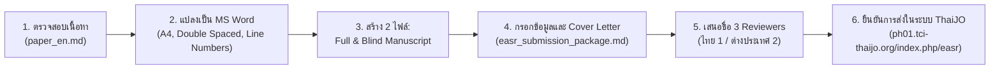

# คลังเอกสารและบทความวิจัย (Research Documentation & Paper Hub)
## แพลตฟอร์มปัญญาประดิษฐ์จำแนกสัตว์เลี้ยงลูกด้วยนมในสวนสัตว์ไทย (Thai Zoo Mammals AI Platform)
**เป้าหมายการตีพิมพ์**: วารสาร *Engineering and Applied Science Research (EASR)* | **SCOPUS Q3** / TCI กลุ่ม 1

---

## 📌 ภาพรวมของโฟลเดอร์ (Directory Overview)

โฟลเดอร์ `docs/` นี้เป็นศูนย์กลางการจัดเก็บเอกสารทางวิชาการ (Single Source of Truth) ทั้งหมดของโครงการวิจัยการจำแนกชนิดพันธุ์สัตว์เลี้ยงลูกด้วยนมในสวนสัตว์ไทย 162 สายพันธุ์ (23,674 ภาพ) ครอบคลุมตั้งแต่ต้นฉบับบทความวิจัยฉบับสมบูรณ์ (Full Manuscript), รายงานผลการทดลอง, รายงานการตรวจสอบความถูกต้องของบรรณานุกรม ไปจนถึงชุดเอกสารและคู่มือนำส่งวารสารวิชาการระดับนานาชาติ

---

## 🗺️ แผนผังเอกสารและการนำทาง (Documentation Sitemap)

```
docs/
 ├── 📄 README.md                        <-- ดัชนีและคู่มือนำทางหลัก (เอกสารนี้)
 │
 ├── 📚 ต้นฉบับบทความวิจัย (Research Manuscripts)
 │    ├── 📄 paper_en.md                 <-- บทความวิจัยฉบับภาษาอังกฤษ (Single Source of Truth สำหรับส่ง EASR)
 │    └── 📄 paper_th.md                 <-- บทความวิจัยฉบับภาษาไทย (โครงสร้างขนานกับฉบับภาษาอังกฤษ 100%)
 │
 ├── 🏛️ ข้อมูลวารสารและการส่งตีพิมพ์ (Journal Analysis & Submission Package)
 │    ├── 📄 target_journal_analysis_easr.md <-- ผลการวิเคราะห์วารสาร EASR (Scopus Q3, ค่า APC, เกณฑ์ประเมิน)
 │    ├── 📄 easr_submission_package.md  <-- ร่าง Cover Letter, รายชื่อ 3 Reviewers บังคับ, วิธีตั้งค่า Word
 │    ├── 📄 peer_review_simulation.md   <-- รายงานจำลองการตรวจประเมินแบบเข้มข้น (Major Revision) และแนวทางตอบ Rebuttal
 │    └── 📄 revision_action_log.md      <-- บันทึกสถานะการแก้ไขบทความ (Zero Data Fabrication): สรุปสิ่งที่แก้และไม่แก้พร้อมเหตุผล
 │
 ├── 🔍 การตรวจสอบความถูกต้องทางวิชาการ (Academic Integrity & References)
 │    └── 📄 references_audit_report.md  <-- ตารางตรวจสอบบรรณานุกรม 15 รายการ (Zero Hallucination, DOI จริง)
 │
 └── 🧪 ข้อมูลเชิงเทคนิคและผลการทดลอง (Technical & Dataset Reports)
      ├── 📄 Mammals.md                  <-- รายงานทางเทคนิคและตารางแจกแจงจำนวนภาพ 162 ชนิดพันธุ์ (23,674 รูป)
      ├── 📄 chapter4_1_dnn_model_results.md <-- รายละเอียดผลการทดสอบโครงข่ายประสาทเทียมเชิงลึก
      └── 📄 image_upload_system.md      <-- สถาปัตยกรรมระบบอัปโหลดและประมวลผลรูปภาพ
```

---

## 📖 รายละเอียดไฟล์สำคัญ (Key Documents Summary)

### 1. [paper_en.md](./paper_en.md) — ต้นฉบับภาษาอังกฤษสำหรับส่ง EASR ⭐
- **บทบาท**: เป็น **เอกสารหลักตัวจริง (Single Source of Truth)** สำหรับการส่งพิจารณาตีพิมพ์ในวารสาร EASR
- **มาตรฐานการจัดรูปเล่ม**:
  - โครงสร้าง IMRaD 7 ส่วน: `1. Introduction`, `2. Materials and methods`, `3. Results`, `4. Discussion`, `5. Conclusions`, `6. Acknowledgements`, `7. References`
  - บทคัดย่อ (Abstract) เป็นย่อหน้าเดียว ความยาว **256 คำ** (เกณฑ์วารสาร: $\le 300$ คำ)
  - คำสำคัญ (Keywords) มี **6 คำ** ขึ้นต้นด้วยตัวพิมพ์ใหญ่
  - ระบบอ้างอิงเป็น **Vancouver Style** เรียงตามลำดับการปรากฏจริงในเนื้อหา `[1]` ถึง `[15]` พร้อม DOI
  - มีกล่องข้อความแนะนำการบันทึกไฟล์เป็น `Blind_Manuscript.docx` เพื่อส่งประเมินแบบ Double-Blind โดยไม่ต้องแยกไฟล์ซ้ำซ้อน

### 2. [paper_th.md](./paper_th.md) — ต้นฉบับภาษาไทยฉบับสมบูรณ์
- **บทบาท**: เอกสารบทความวิจัยฉบับภาษาไทยที่มีเนื้อหา โครงสร้าง IMRaD 7 ส่วน ข้อมูลสถิติ ตาราง และภาพประกอบขนานกับ [paper_en.md](./paper_en.md) แบบ 1:1
- **ประโยชน์**: ใช้สำหรับนำเสนอในประเทศ การรายงานผลงานวิจัยต่อสถาบัน และใช้อ้างอิงร่วมกับอาจารย์ที่ปรึกษา/คณะผู้วิจัย

### 3. [revision_action_log.md](./revision_action_log.md) — บันทึกสถานะการแก้ไขบทความ (Zero Data Fabrication Protocol) 🛡️
- **บทบาท**: แผนกลยุทธ์การปรับปรุงบทความทางวิชาการโดยปราศจากการสร้างข้อมูลเท็จ สรุปชัดเจนว่า **แก้อะไรบ้างแล้ว** และ **ไม่แก้อะไร/ไม่ทดลองเพิ่ม พร้อมเหตุผลทางวิชาการและแนวทางตอบแก้ต่าง**
- **ประโยชน์**: เป็นแนวทางป้องกันการถูกปฏิเสธบทความหรือถูกถอดถอนจากข้อหาปลอมแปลงข้อมูล (Zero Fabrication of Top-5 or Latency)

### 4. [peer_review_simulation.md](./peer_review_simulation.md) — รายงานจำลองการประเมินแบบเข้มข้น (Peer Review Simulation) 🥊
- **บทบาท**: จำลองบทบาทผู้ทรงคุณวุฒิ (Reviewer) สายนานาชาติตรวจคอมเมนต์งานวิจัยแบบเจาะลึก เผยให้เห็นจุดเสี่ยงสำคัญ พร้อมร่างจดหมายตอบอย่างเป็นทางการ (Formal Response to Reviewers Template)
- **ประโยชน์**: มีตารางกลยุทธ์การตอบข้อวิจารณ์ (Author Rebuttal Strategy Table) เพื่อให้ผู้วิจัยใช้เตรียมตัวป้องกันการถูกปฏิเสธบทความ

### 5. [references_audit_report.md](./references_audit_report.md) — รายงานตรวจสอบความถูกต้องของบรรณานุกรม
- **บทบาท**: ตรวจสอบและพิสูจน์ความมีอยู่จริง (Zero Hallucination) ของเอกสารอ้างอิงทั้ง 15 รายการ ผ่านฐานข้อมูลสากล (IEEE, Elsevier, PNAS, Wiley, Springer, PMLR, arXiv, GBIF, IUCN)
- **ประเด็นสำคัญ**: บันทึกประวัติการแก้ไขข้อผิดพลาดของ DOI และชื่อบทความในฉบับร่างเดิม ยืนยันว่าทุกรายการในเปเปอร์มีอยู่จริงและคลิกเปิดได้ 100%

### 6. [easr_submission_package.md](./easr_submission_package.md) — ชุดเอกสารและคู่มือนำส่งวารสาร
- **บทบาท**: รวบรวมข้อมูลและเทมเพลตที่พร้อมคัดลอกไปใช้ในระบบ ThaiJO ของ EASR ทันที:
  - **Cover Letter Template**: จดหมายนำส่งถึงบรรณาธิการ เน้นย้ำจุดเด่นด้าน Applied Technology และ Edge AI
  - **Mandatory Suggested Reviewers**: รายชื่อผู้ประเมินบทความ 3 ท่านตามกฎเหล็กของ EASR (ผู้เชี่ยวชาญไทย 1 ท่าน, ต่างประเทศ 2 ท่าน) พร้อมอีเมลสถาบัน
  - **Word Formatting Guide**: คู่มือการจัดหน้า Microsoft Word (A4, 12pt, Double Spacing, Continuous Line Numbers)
  - **Pre-Submission Checklist**: รายการตรวจสอบความพร้อมขั้นตอนสุดท้าย

### 7. [target_journal_analysis_easr.md](./target_journal_analysis_easr.md) — บทวิเคราะห์วารสารเป้าหมาย
- **บทบาท**: ข้อมูลเชิงลึกของวารสาร *Engineering and Applied Science Research (EASR)*
- **ข้อมูลสำคัญ**: ขอบเขตวารสาร (Aims & Scope), ดัชนี Scopus Q3 / TCI กลุ่ม 1, อัตราค่าธรรมเนียมการตีพิมพ์ (APC 7,000 บาท จ่ายเมื่อได้รับการตอบรับเท่านั้น), วงรอบการออก 6 ฉบับต่อปี และกลยุทธ์การตอบรับบทความ

### 8. [Mammals.md](./Mammals.md) — เอกสารเทคนิคและการแจกแจงชุดข้อมูล
- **บทบาท**: เอกสารอธิบายระเบียบวิธีวิจัย การทำงานของ Smart Hybrid Acquisition และ **ตารางแจกแจงจำนวนภาพถ่ายของสัตว์ทั้ง 162 ชนิดพันธุ์ (23,674 ภาพ)** ครบทุกคลาส (ชุดฝึกสอน 18,957 ภาพ และชุดตรวจสอบ 4,717 ภาพ)

---

## 🚀 ขั้นตอนการดำเนินการส่งบทความ (Step-by-Step Submission Workflow)



1. **เปิดเอกสาร [paper_en.md](./paper_en.md)** คัดลอกเนื้อหาใส่โปรแกรม Microsoft Word
2. **จัดหน้าตามข้อกำหนด EASR**: ตั้งค่าระยะขอบ 2.54 ซม., ฟอนต์ Times New Roman 12 pt, ระยะห่างบรรทัด Double Spacing (2.0) และเปิด **Continuous Line Numbering**
3. **บันทึก 2 ไฟล์**:
   - `Full_Manuscript.docx` (มีชื่อผู้แต่ง สังกัด ทุนวิจัย)
   - `Blind_Manuscript.docx` (ตัดชื่อผู้แต่งออก และใช้ Inspect Document ล้าง Personal Properties)
4. **ล็อกอินเข้าสู่ระบบ ThaiJO** ที่ [EASR Submission Portal](https://ph01.tci-thaijo.org/index.php/easr/about/submissions)
5. **กรอก Cover Letter และ 3 Suggested Reviewers** โดยใช้ข้อมูลจาก [easr_submission_package.md](./easr_submission_package.md)
6. **อัปโหลดเอกสารทั้ง 2 ชุด** และยืนยันการส่งบทความ

---

## 🔗 ทรัพยากรสนับสนุนที่เกี่ยวข้อง (External & Internal Resources)

- **โฟลเดอร์ภาพผลลัพธ์ความละเอียดสูง (300 DPI)**: [../paper_results/](../paper_results/)
- **ตารางสรุปข้อมูลชุดข้อมูลรายคลาส (CSV & JSON)**: 
  - [../paper_results/mammals_species_dataset_breakdown.csv](../paper_results/mammals_species_dataset_breakdown.csv)
  - [../paper_results/mammals_species_dataset_breakdown.json](../paper_results/mammals_species_dataset_breakdown.json)
- **โค้ดการทดลองหลักบน Jupyter Notebook**: [../Mammals.ipynb](../Mammals.ipynb)
- **ฐานข้อมูลสัตว์เลี้ยงลูกด้วยนม 250 ชนิด**: [../python/data/mammals.json](../python/data/mammals.json)
