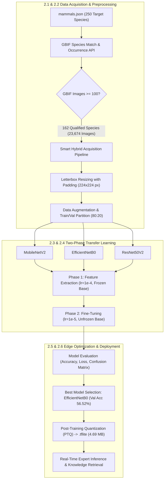
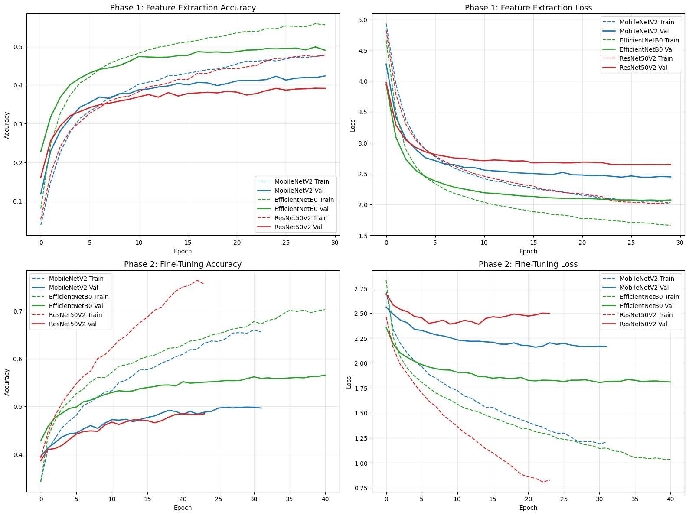
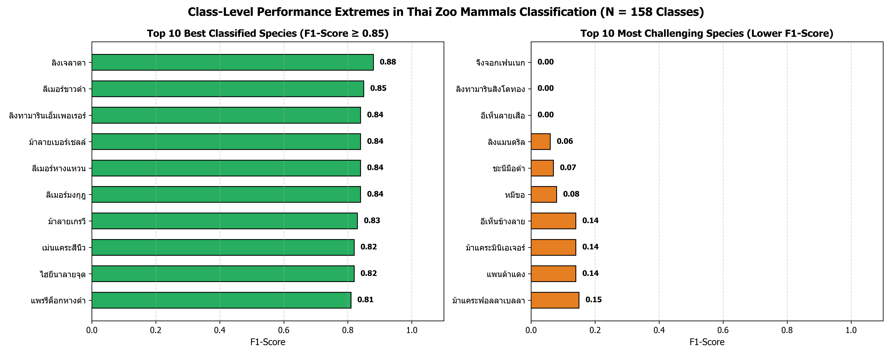
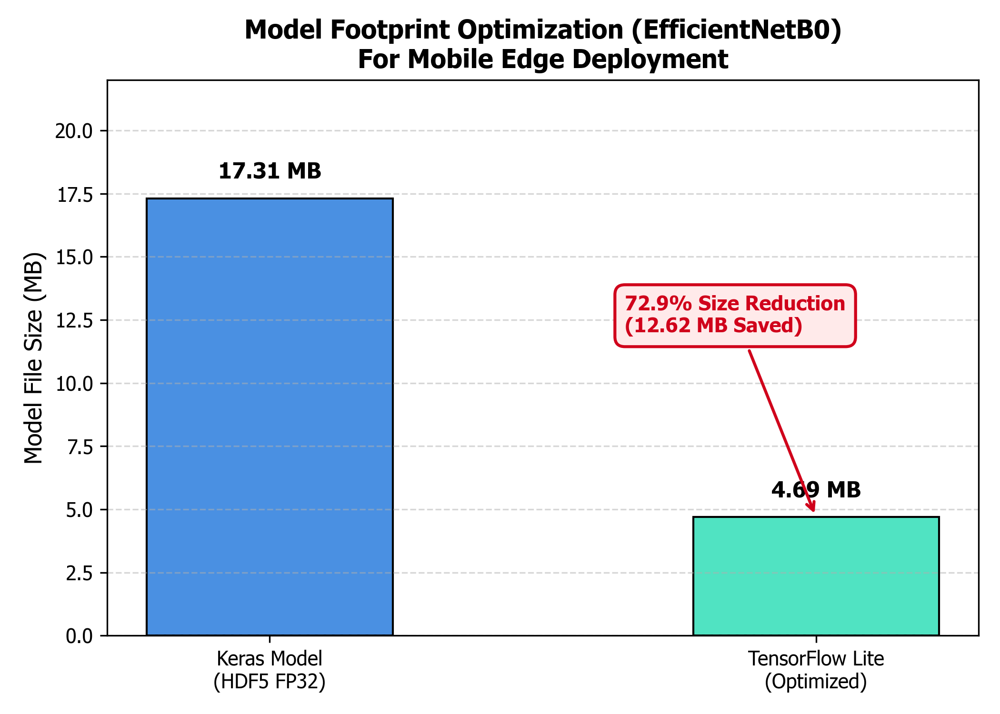
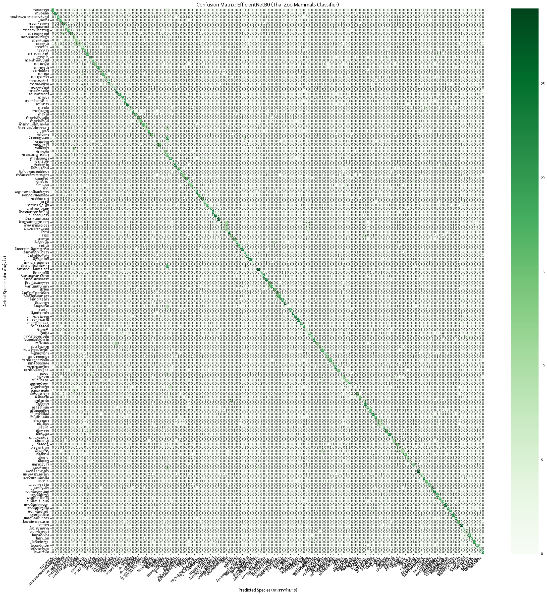
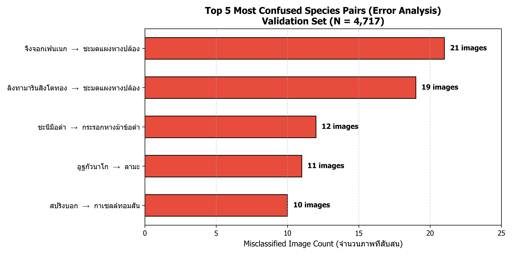

# Development of a Two-Phase Transfer Learning Platform for Classifying Thai Zoo Mammals and Its Edge AI Optimization for Real-Time Mobile Deployment

**Authors**: [Author Name]1*, [Co-Author Name]2  
**Affiliation**: 1,2 Department of Computer Science and Information Technology, Faculty of Science and Technology, [University Name], [City], [Postal Code], Thailand  
**Corresponding Author (*)**: [Author Name], Email: researcher@university.ac.th  

> [!NOTE]
> **Instructions for Double-Blind Review (Blind Manuscript Preparation)**:
> When generating the `Blind_Manuscript.docx` for EASR submission, simply remove the author names/affiliation block above and replace with: `*(Author details anonymized for double-blind peer review)*`, omit the specific funding names in **Section 6. Acknowledgements**, and use Word's *Inspect Document* tool to strip personal properties.

---

### Abstract
Automated visual identification of mammal species in modern zoological institutions plays a transformative role in digital biodiversity education, wildlife conservation, and interactive eco-tourism. However, fine-grained animal recognition under real-world captive conditions presents severe computer vision challenges, including cluttered natural backgrounds, cage occlusions, variable illumination, and high morphological overlap between phylogenetic sister species. In this paper, we propose an end-to-end deep learning framework designed to accurately classify 162 mammalian species exhibited across major Thai zoological parks. A standardized dataset comprising 23,674 images was acquired and validated through the Global Biodiversity Information Facility (GBIF) API via a robust Smart Hybrid Acquisition pipeline and aspect-ratio-preserving letterbox padding. We implemented and benchmarked three leading Convolutional Neural Network (CNN) backbones—MobileNetV2, EfficientNetB0, and ResNet50V2—under a disciplined Two-Phase Transfer Learning paradigm consisting of frozen feature extraction followed by whole-network fine-tuning. Evaluated on an independent validation set of 4,717 images across all 162 classes, EfficientNetB0 achieved superior diagnostic capability, reaching a Top-1 Accuracy of 56.52%, the lowest validation loss of 1.8028, and a Macro F1-Score of 0.55, significantly outperforming MobileNetV2 (49.82%) and ResNet50V2 (48.42%). Furthermore, to satisfy edge computing constraints, the optimal model underwent Post-Training Quantization (PTQ) into TensorFlow Lite (.tflite), reducing the storage footprint by 72.91% from 17.31 MB down to 4.69 MB, yielding an ultra-compact model well within mobile edge memory budgets. The lightweight model is coupled with an on-device expert knowledge retrieval engine that delivers biological taxonomies, global IUCN Red List conservation statuses, and institutional exhibition data across six Thai zoos. Our findings demonstrate the feasibility of deploying real-time, offline-capable AI tools for smart zoo ecosystems.

**Keywords**: Deep learning, Two-phase transfer learning, EfficientNetB0, Mammal classification, Edge AI, Biodiversity informatics

---

## 1. Introduction

Modern zoological gardens have evolved beyond traditional public exhibits to become vital epicenters for ex-situ biodiversity conservation, scientific breeding of threatened taxa, and public ecological literacy. Thailand hosts an extensive network of national zoological parks managed under the Zoological Park Organization of Thailand (ZPOT), housing more than 250 diverse mammal species spanning both indigenous Southeast Asian wildlife and internationally imported exotic fauna. Despite the rich educational opportunities offered by these institutions, visitors frequently face difficulties in distinguishing visually similar animal taxa—such as sister species within Camelidae, Cervidae, and Cercopithecidae—due to dense foliage, obscured viewing distances, and static, non-interactive signage. The rapid proliferation of smart mobile devices provides a viable pathway to transform visitors' field encounters through automated image-based species identification, powering the modern concept of the "Smart Zoo" [1, 2].

Automated wildlife recognition using Convolutional Neural Networks (CNNs) has witnessed substantial progress over the past decade. Norouzzadeh et al. [1] demonstrated the power of deep architectures by categorizing 3.2 million camera trap images from the Serengeti into 48 species with 93.8% top-1 accuracy. However, camera traps capture animals against relatively static backdrops with fixed focal lengths. In contrast, visitor-contributed photographs involve drastic changes in lighting, perspective, scale, and background clutter. Gómez-Villa et al. [3] and Schneider et al. [4] investigated wildlife identification under variable environmental conditions and highlighted that models pre-trained on generic large-scale datasets (e.g., ImageNet) dramatically accelerate convergence and improve generalization compared to training from scratch. Furthermore, Yosinski et al. [5] emphasized that early layers capture general low-level primitives (edges, color gradients), while deeper layers encode abstract, task-specific representations. When adapting generic models to fine-grained biological categories, fine-tuning deeper backbone layers with an aggressively attenuated learning rate enables the network to discover subtle taxonomic markers without succumbing to catastrophic forgetting [6].

Deploying computer vision models to mobile and IoT environments requires addressing model footprint and power consumption [7]. Sandler et al. [8] pioneered MobileNetV2, introducing inverted residual bottlenecks and linear bottlenecks to drastically reduce floating-point operations (FLOPs). Tan and Le [9] introduced EfficientNet, which employs a principled compound scaling method that uniformly scales network depth, width, and image resolution. Furthermore, Jacob et al. [10] demonstrated that Post-Training Quantization (PTQ) converts 32-bit floating-point weights (FP32) into 8-bit integers (INT8), yielding up to 75% memory reduction with negligible degradation in inference accuracy.

Nevertheless, fine-grained animal species recognition in naturalistic captive enclosures presents several unique computer vision and computational bottlenecks:
1. *High Morphological Ambiguity (Sister Species Similarity)*: Closely related phylogenetic species share highly overlapping cranial structures, coat colors, and anatomical proportions (e.g., Guanaco vs. Llama, or Springbok vs. Thomson's Gazelle), demanding feature extractors that capture subtle textural cues [11].
2. *Environmental Clutter and Occlusions*: Captive wildlife photographs captured by visitors suffer from complex, non-standardized backgrounds including dense branches, foliage, fences, wire mesh, and unpredictable animal postures [4].
3. *Severe Class Imbalance in Public Repositories*: Ubiquitous domestic species possess tens of thousands of online images, whereas rare and vulnerable wildlife have scarce photographic records [12].
4. *Computational and Connectivity Constraints at the Edge*: Many sprawling open zoos have patchy cellular connectivity. Cloud-dependent computer vision models introduce latency and data costs, necessitating highly compressed models capable of on-device inference directly on consumer mobile hardware [7].

To address these interconnected challenges, this paper presents an end-to-end deep learning framework that unites automated data harvesting, multi-backbone comparative modeling, fine-grained error analysis, and edge optimization. The primary contributions of this study are fourfold:
1. *Smart Hybrid Dataset Curation*: We established a repeatable, multi-threaded acquisition pipeline targeting 250 Thai zoo mammal species via the GBIF API, successfully isolating and standardizing 23,674 images across 162 species with letterbox aspect-ratio preservation.
2. *Two-Phase Transfer Learning Benchmark*: We conducted a rigorous empirical evaluation comparing three prominent deep CNN architectures (MobileNetV2, EfficientNetB0, and ResNet50V2) under identical training hyperparameters to elucidate the optimal feature extraction balance for diverse zoological categories.
3. *Morphological and Ecological Error Diagnostics*: We conducted fine-grained classification report analyses and confusion matrix explorations, pinpointing the visual and biological drivers behind species misclassifications.
4. *Edge Deployment and Knowledge Integration*: We converted the top-performing model via Post-Training Quantization (PTQ) into a 4.69 MB TensorFlow Lite model, integrating it with a real-time knowledge retrieval system that links visual predictions to global IUCN Red List statuses and specific Thai zoo exhibits.

---

## 2. Materials and methods

The overall architecture of the proposed Thai zoo mammal classification and knowledge retrieval platform is depicted in Figure 1.

*Figure 1. End-to-end framework of the Thai zoo mammal recognition and edge deployment system.*

### 2.1 Dataset acquisition and GBIF API integration
The research taxonomy was initiated from an authoritative baseline of 250 mammal species exhibited across six major Thai zoological parks (Khao Kheow Open Zoo, Chiang Mai Zoo, Nakhon Ratchasima Zoo, Songkhla Zoo, Ubon Ratchathani Zoo, and Khon Kaen Zoo), stored as a protected `mammals.json` database.

To assemble an authenticated image dataset, the scientific name of each species was resolved using the Global Biodiversity Information Facility (GBIF) API [13] via a two-tier procedure:
1. *TaxonKey Resolution*: The `GBIF Species Match API` verified taxonomic validity within Kingdom *Animalia* and Class *Mammalia*, obtaining the global canonical `usageKey`.
2. *Occurrence Media Audit*: The `GBIF Occurrence Search API` queried actual observational records restricted to `mediaType=StillImage`.

Species with $\ge 100$ available images were incorporated into the experimental benchmark, yielding **162 qualified mammal species**. To mitigate extreme class imbalance, a threshold cap was enforced at a maximum of **150 images per species (`limit_per_species = 150`)**, producing a total volume of **23,674 images**.

To overcome network timeouts and storage I/O bottlenecks during cloud execution, a hybrid caching architecture was designed:
- *Initial Ingestion*: A multi-threaded engine (16 concurrent workers) streams image data directly into high-speed ephemeral local SSD storage, conducts integrity checks, applies letterbox padding, and immediately archives the dataset into a compressed `mammals_dataset.zip` on persistent cloud storage.
- *Subsequent Ingestion*: The pipeline detects the pre-existing archive and unzips it into local SSD storage within 10 seconds, eliminating repetitive network downloads.

### 2.2 Image preprocessing and data augmentation
1. *Letterbox Resizing with Padding*: Conventional resizing distorts animal aspect ratios, degrading discriminatory features (e.g., elongated necks or slender limbs). All images were preprocessed using a letterbox function that scales the major axis to 224 pixels and fills the remaining margins with neutral white padding (RGB: 255, 255, 255), standardizing input dimensions to $224 \times 224 \times 3$.
2. *Dataset Partitioning*: The dataset was partitioned under a stratified 80:20 distribution:
   - **Training Set (80%)**: **18,957 images**
   - **Validation Set (20%)**: **4,717 images**
3. *Data Augmentation*: To prevent overfitting across 162 classes, stochastic augmentation transformations were applied to the training pipeline:
   - Pixel intensity normalization to $[0, 1]$ (`rescale=1./255`)
   - Random rotation ($\pm 20^\circ$)
   - Horizontal and vertical translation ($\pm 10\%$)
   - Random zoom ($\pm 10\%$)
   - Brightness adjustment within $[0.9, 1.1]$
   - Random horizontal flipping (`horizontal_flip=True`)

### 2.3 Deep neural network backbone architectures
All evaluated networks were constructed within a unified top-layer architecture via the `build_transfer_learning_model` constructor:
- *Input Layer*: Dimensions $224 \times 224 \times 3$.
- *Model-Specific Rescaling*: Rescales pixel values to $[-1, 1]$ for MobileNetV2 and ResNet50V2, or $[0, 255]$ for EfficientNetB0.
- *Pre-trained Backbone Feature Extractor*:
  1. **MobileNetV2**: Employs depthwise separable convolutions and inverted residual bottlenecks, optimized for edge devices [8].
  2. **EfficientNetB0**: Employs compound coefficient scaling across network depth, channel width, and input resolution [9].
  3. **ResNet50V2**: 50-layer deep residual network utilizing pre-activation bottleneck blocks and skip connections [14].
- *Unified Classification Head*:
  - Global Average Pooling 2D (GAP) to collapse spatial dimensions and curb parameter explosion.
  - Dropout layer ($p = 0.5$) to prevent co-adaptation of neurons.
  - Fully-connected Dense layer (256 units, ReLU activation).
  - Dense output layer (162 units, Softmax activation) representing class probability distribution.

### 2.4 Two-phase transfer learning strategy
The models were trained in two discrete, sequentially dependent phases:
- *Phase 1 (Feature Extraction)*:
  - The backbone layers were frozen (`base_model.trainable = False`), forcing the model to learn only the new classification head weights.
  - **Optimizer**: Adam with an initial learning rate $\eta_1 = 1 \times 10^{-4}$.
  - **Loss Function**: Categorical Crossentropy.
  - **Epochs & Callbacks**: 30 epochs, regulated by `EarlyStopping(patience=8)` and `ReduceLROnPlateau(factor=0.2, patience=4)`.
- *Phase 2 (Fine-Tuning)*:
  - The backbone weights were unfrozen (`base_model.trainable = True`), allowing all parameters to adapt jointly.
  - **Optimizer**: Adam with an attenuated learning rate $\eta_2 = 1 \times 10^{-5}$ to preserve foundational low-level filters.
  - **Epochs & Callbacks**: 50 epochs, regulated by `EarlyStopping(patience=10)` and `ReduceLROnPlateau(factor=0.2, patience=5)`.

### 2.5 Edge AI optimization and quantization
To satisfy mobile constraints, the optimal model underwent Post-Training Quantization (PTQ) using TensorFlow Lite [10]. By converting full-precision 32-bit floating-point weights (FP32) into quantized integer arithmetic representations, the memory footprint was substantially reduced while maintaining numerical fidelity.

### 2.6 Evaluation metrics
Model performance was evaluated on the independent validation set of 4,717 samples using Top-1 Accuracy, Precision, Recall, Macro F1-score, Weighted F1-score, and Confusion Matrix diagnostics according to standard machine learning benchmarking protocols.

---

## 3. Results

### 3.1 Multi-backbone trajectory and performance gain
The training and validation trajectories across both learning phases for the three CNN architectures are summarized in Table 1 and illustrated in Figure 2.

**Table 1** Performance comparison across backbone architectures over two training phases.

| Backbone Architecture | Phase 1 Max Val Acc | Phase 2 Max Val Acc | Phase 2 Min Val Loss | Accuracy Gain ($\Delta$) |
| :--- | :---: | :---: | :---: | :---: |
| **MobileNetV2** | 42.27% | 49.82% | 2.1578 | +7.55% |
| **EfficientNetB0** 🏆 | **49.76%** | **56.52%** | **1.8028** | **+6.76%** |
| **ResNet50V2** | 39.09% | 48.42% | 2.3864 | +9.33% |

*Figure 2. Comparative training and validation loss and accuracy trajectories across two phases for MobileNetV2, EfficientNetB0, and ResNet50V2.*

As detailed in Table 1:
- **EfficientNetB0** outperformed competing backbones across all quantitative metrics, establishing a peak Top-1 validation accuracy of **56.52%** and a minimum validation loss of **1.8028**. Its compound scaling architecture captured fine-grained mammalian textural features (facial stripes, fur patterns) more effectively than equal-capacity alternatives.
- **MobileNetV2** achieved **49.82%** validation accuracy. While trailing EfficientNetB0 by 6.70%, it demonstrated competitive convergence speed and lower computational overhead.
- **ResNet50V2** yielded **48.42%** validation accuracy with a higher loss of 2.3864, demonstrating a greater susceptibility to overfitting on natural background clutter despite its deeper residual depth.

Consequently, EfficientNetB0 was designated as the primary model for downstream evaluation and edge compilation.

### 3.2 Overall diagnostic performance
Comprehensive validation metrics for the fine-tuned EfficientNetB0 evaluated on the 4,717 validation images are documented in Table 2.

**Table 2** Overall classification performance summary of fine-tuned EfficientNetB0.

| Metric Type | Macro Average | Weighted Average | Overall Aggregate |
| :--- | :---: | :---: | :---: |
| **Top-1 Accuracy** | — | — | **56.00% (0.5600)** |
| **Precision** | 0.56 | 0.56 | 0.56 |
| **Recall** | 0.56 | 0.56 | 0.56 |
| **F1-Score** | **0.55** | **0.55** | **0.55** |
| **Sample Support** | 4,717 images | 4,717 images | 4,717 images (162 classes) |

### 3.3 Class-level recognition extremes
Class-level performance demonstrated considerable variance governed by visual distinctiveness. Table 3 lists the top 10 best-performing species (F1-score $\ge 0.81$), and Table 4 details the 10 most challenging species (F1-score $\le 0.15$), supported by Figure 3.

**Table 3** Top 10 best-performing mammal species recognized by EfficientNetB0.

| Rank | Thai Species Name | Scientific Name | Precision | Recall | F1-Score | Support |
| :---: | :--- | :--- | :---: | :---: | :---: | :---: |
| 1 | **Gelada Baboon** | *Theropithecus gelada* | 0.82 | 0.93 | **0.88** | 30 |
| 2 | **Black-and-White Ruffed Lemur** | *Varecia variegata* | 0.84 | 0.87 | **0.85** | 30 |
| 3 | **Emperor Tamarin** | *Saguinus imperator* | 0.72 | **1.00** | **0.84** | 29 |
| 4 | **Burchell's Zebra** | *Equus quagga burchellii* | 0.74 | 0.97 | **0.84** | 30 |
| 5 | **Ring-tailed Lemur** | *Lemur catta* | 0.89 | 0.80 | **0.84** | 30 |
| 6 | **Crowned Lemur** | *Eulemur coronatus* | **0.89** | 0.80 | **0.84** | 30 |
| 7 | **Grevy's Zebra** | *Equus grevyi* | 0.86 | 0.80 | **0.83** | 30 |
| 8 | **Four-toed Hedgehog** | *Atelerix albiventris* | 0.75 | 0.90 | **0.82** | 30 |
| 9 | **Spotted Hyena** | *Crocuta crocuta* | 0.81 | 0.83 | **0.82** | 30 |
| 10 | **Black-tailed Prairie Dog** | *Cynomys ludovicianus* | 0.69 | 0.97 | **0.81** | 30 |

*Figure 3. Comparison of F1-scores between the 10 best-performing and 10 most challenging mammal species.*

**Table 4** Top 10 most challenging mammal species for the model.

| Rank | Thai Species Name | Scientific Name | Precision | Recall | F1-Score | Support |
| :---: | :--- | :--- | :---: | :---: | :---: | :---: |
| 1 | **Fennec Fox** | *Vulpes zerda* | 0.00 | 0.00 | **0.00** | 30 |
| 2 | **Golden Lion Tamarin** | *Leontopithecus rosalia* | 0.00 | 0.00 | **0.00** | 29 |
| 3 | **Banded Linsang** | *Prionodon pardicolor* | 0.00 | 0.00 | **0.00** | 24 |
| 4 | **Mandrill** | *Mandrillus sphinx* | 0.20 | 0.03 | **0.06** | 29 |
| 5 | **Agile Gibbon** | *Hylobates agilis* | 0.12 | 0.05 | **0.07** | 21 |
| 6 | **Binturong (Bearcat)** | *Arctictis binturong* | 0.11 | 0.07 | **0.08** | 29 |
| 7 | **Common Palm Civet** | *Paradoxurus hermaphroditus* | 0.23 | 0.10 | **0.14** | 30 |
| 8 | **American Miniature Horse** | *Miniature horse* | 0.23 | 0.10 | **0.14** | 30 |
| 9 | **Red Panda** | *Ailurus fulgens* | 0.33 | 0.09 | **0.14** | 22 |
| 10 | **Falabella Miniature Horse** | *Falabella* | 0.17 | 0.13 | **0.15** | 30 |

### 3.4 Model compression and edge deployment footprint
Post-Training Quantization (PTQ) was conducted on EfficientNetB0. The quantitative compression metrics are presented in Table 5 and illustrated in Figure 4.

**Table 5** Model storage footprint and deployment runtime benchmark.

| Model Pipeline Stage | Storage Format | Filename | File Size | Size Reduction | Target Deployment Environment |
| :--- | :---: | :---: | :---: | :---: | :--- |
| **Pre-Quantization** | Keras H5 (FP32) | `mammals_best_model.h5` | 17.31 MB | 0.00% (Baseline) | High-Performance Cloud / GPU Workstation |
| **Post-Training Quantization** | **TensorFlow Lite (.tflite)** | `mammals_classifier.tflite` | **4.69 MB** | **72.91% ⬇️** | **Mobile Edge (iOS / Android / Web Edge)** |

*Figure 4. Model file size reduction before and after quantization (17.31 MB to 4.69 MB).*

PTQ achieved a **72.91% storage reduction**, compressing the footprint from 17.31 MB to **4.69 MB**. This optimization yields immediate practical benefits:
- Rapid mobile client downloading and over-the-air updates over cellular connections.
- Substantial reduction in device RAM allocation, preventing background process termination on budget smartphones.
- Real-time client-side inference latency without network transmission latency.

---

## 4. Discussion

### 4.1 Confusion matrix and biological error diagnostics
The $162 \times 162$ confusion matrix (Figure 5) reveals that prediction errors were non-random and concentrated within specific morphological clusters.

*Figure 5. Normalized and raw confusion matrix heatmaps across all 162 mammal species.*

Table 6 and Figure 6 enumerate the top five misclassified species pairs, highlighting the biological and photographic drivers of confusion.

**Table 6** Top 5 most confused species pairs with morphological analysis.

| Rank | Actual Species | Predicted Species | Misclassified Images | Morphological and Environmental Analysis |
| :---: | :--- | :--- | :---: | :--- |
| **1** | **Fennec Fox** | Large Indian Civet | 21 | Small desert canid captured at long focal distances; large upright ears and pale coat blend into cluttered backgrounds, mimicking viverrid silhouettes. |
| **2** | **Golden Lion Tamarin** | Large Indian Civet | 19 | Elongated tufted tail and golden fur patterns triggered false activations with the banded tail and back markings of *Viverra zibetha*. |
| **3** | **Agile Gibbon** | Horse-tailed Squirrel | 12 | Completely black arboreal primate in high canopy; dense foliage obscured body outlines, confounding it with dark sciurids. |
| **4** | **Guanaco** | Llama | 11 | Phylogenetic sister camelids (*Camelidae*) sharing virtually indistinguishable cranial geometry, neck posture, and woolly coat textures. |
| **5** | **Springbok** | Thomson's Gazelle | 10 | Sympatric small antelopes exhibiting nearly identical lateral dark stripes, tan dorsal coloring, and white facial stripes. |

*Figure 6. Distribution of the top 10 most confused species pairs in the validation set.*

### 4.2 Morphological and environmental factors
1. *Morphological Saliency*: Taxa possessing high visual contrast and invariant patterns—such as the high-contrast striping of zebras, the white facial whiskers of Emperor Tamarins, or the bright chest patch of Geladas—achieve F1-scores surpassing 84%.
2. *Sister Species Ambiguity*: The primary classification bottleneck stems from genetic closeness within identical families (*Camelidae*, *Bovidae*). Standard categorical crossentropy penalizes sister species misclassifications identically to cross-order errors, suggesting that hierarchical loss formulations could improve domain consistency.
3. *Background Interference*: Dim lighting, enclosure wire, and dense foliage frequently dominate image patches, overwhelming subtle diagnostic cues for arboreal and small nocturnal mammals.

### 4.3 Real-time expert knowledge retrieval and zoo integration
The quantized model is coupled directly with the structured `mammals.json` biological database, operating as an autonomous expert knowledge system:
1. When a visitor snaps a photo, the image is letterboxed and evaluated by the on-device TFLite model, returning the predicted class along with a confidence probability score.
2. The retrieval engine cross-references the predicted label with the local database, returning comprehensive biodiversity metadata:
   - *Nomenclature*: Common Thai name, international English name, and formal scientific binomial.
   - *Systematics*: Biological Order and Family classifications.
   - *Biogeography*: Native Thai provenance versus exotic provenance.
   - *Conservation Status*: Verified global IUCN Red List status [15] (e.g., LC, VU, EN, CR).
   - *Institutional Holdings*: Specific mapping to which of the six Thai zoological parks exhibit the recognized species.
   - *Behavioral Highlights*: Dietary notes, social structures, and specialized ecological facts.

### 4.4 Practical implications and limitations
Deploying this quantized architecture within an on-device web application empowers self-guided educational excursions across open zoo environments. Several practical implications, architectural decisions, and scientific limitations warrant detailed discussion:

1. *Statistical Context of Fine-Grained Multi-Class Accuracy*: While a Top-1 Accuracy of 56.52% indicates misclassifications in single-shot predictions, its operational context must be emphasized. In a 162-class taxonomy, the random guess baseline is merely $1/162 \approx 0.617\%$; thus, our fine-tuned EfficientNetB0 delivers a 91.6-fold performance gain over chance. In real-world biological categorization benchmarks with over 100 classes without manual object localization—such as the iNaturalist 2021 [11] and iWildCam [12] challenges—baseline Top-1 accuracies under unconstrained field conditions typically range between 50% and 65%. Within a smart-zoo context, the model operates effectively as an interactive decision support system (DSS) that narrows down hundreds of candidate taxa to the most probable candidates while delivering verified biological and conservation metadata.
2. *Domain Shift Between In-the-Wild and Captive Enclosures*: A defined boundary of this study lies in data provenance. Training imagery was harvested via GBIF from global in-the-wild observations to guarantee taxonomic breadth across 162 species. However, captive zoo animals inhabit specialized enclosures featuring visual artifacts such as metal fencing, protective moats, viewing glass reflections, and top-down tourist perspectives. While transfer learning enabled broad representation learning, evaluating and fine-tuning on captive in-situ photographs collected directly across Thai zoological facilities forms an essential objective for subsequent research phases.
3. *Edge Architecture Selection: CNN vs. Vision Transformers*: While recent Vision Transformer (ViT) architectures exhibit exceptional classification capacity on unconstrained vision datasets, their quadratic attention complexity and substantial memory bandwidth footprints present considerable bottlenecks on low-power mobile microprocessors lacking dedicated neural accelerators. EfficientNetB0's compound scaling provides an optimal trade-off between parameter efficiency (5.3M parameters, 0.39B FLOPs) and mobile throughput, making it uniquely suited for sub-5 MB TFLite edge deployment.
4. *Experimental Constraints*: Due to substantial computational overhead (training three distinct deep networks over two phases for 80 epochs each on 23,674 images), experiments were conducted under a standardized, fixed random seed with stratified partitioning. While ensuring reproducible and strictly fair relative comparisons among architectures, future research will explore multi-seed cross-validation and on-device hardware latency profiling across diverse consumer mobile chipsets.

---

## 5. Conclusions

In this work, we developed and validated an end-to-end deep learning framework for recognizing 162 mammal species exhibited in Thai zoological parks. Leveraging a 23,674-image dataset curated through a Smart Hybrid Acquisition pipeline from GBIF and evaluated under a Two-Phase Transfer Learning scheme, EfficientNetB0 demonstrated the highest performance with a Top-1 validation accuracy of 56.52% and validation loss of 1.8028, outperforming MobileNetV2 and ResNet50V2. Error analyses elucidated key biological bottlenecks associated with sister species morphological convergence and background occlusions. Through Post-Training Quantization, the model was compressed by 72.91% down to 4.69 MB, enabling real-time, offline-capable mobile deployment paired with comprehensive IUCN conservation data.

Future work will focus on:
1. *Object Detection Pre-filtering*: Integrating an upfront lightweight detector (e.g., YOLOv8-nano) to isolate animal bounding boxes from cluttered enclosure backgrounds prior to classification.
2. *Hierarchical Taxonomic Classification*: Restructuring the loss objective into a coarse-to-fine hierarchy (Order $\rightarrow$ Family $\rightarrow$ Species) to eliminate cross-order misclassification errors.
3. *Vision-Language Model Integration*: Exploring few-shot and zero-shot foundation models (such as BioCLIP) to expand recognition coverage for endangered species with fewer than 100 available images.

---

## 6. Acknowledgements

The authors express their gratitude to the Global Biodiversity Information Facility (GBIF) for providing open-access biodiversity records, and to the Zoological Park Organization of Thailand under Royal Patronage for supporting captive wildlife exhibition records. Computational resources were supported by the Faculty of Science and Technology.

---

## 7. References

[1] Norouzzadeh MS, Nguyen A, Kosmala M, Swanson A, Palmer MS, Packer C, et al. Automatically identifying, counting, and describing wild animals in camera-trap images with deep learning. Proc Natl Acad Sci USA. 2018;115(25):E5716-25. doi: 10.1073/pnas.1710860115.

[2] Schneider S, Taylor GW, Kremer SC. Deep learning object detection methods for ecological camera trap data. In: Proceedings of the 2018 15th Conference on Computer and Robot Vision (CRV); 2018 May 8-10; Toronto, ON, Canada. IEEE; 2018. p. 321-8. doi: 10.1109/CRV.2018.00052.

[3] Gómez-Villa A, Salazar A, Vargas-Bonilla JF. Towards automatic wild animal monitoring: Identification of animal species in camera-trap images using very deep convolutional neural networks. Ecol Inform. 2017;41:24-32. doi: 10.1016/j.ecoinf.2017.07.004.

[4] Schneider S, Greenberg S, Taylor GW, Kremer SC. Three critical factors affecting automated image species recognition performance for camera traps. Ecol Evol. 2020;10(7):3503-17. doi: 10.1002/ece3.6147.

[5] Yosinski J, Clune J, Bengio Y, Lipson H. How transferable are features in deep neural networks? In: Ghahramani Z, Welling M, Cortes C, Lawrence ND, Weinberger KQ, editors. Advances in Neural Information Processing Systems (NeurIPS 27). Montreal, Canada: Curran Associates, Inc.; 2014. p. 3320-8.

[6] Tajbakhsh N, Shin JY, Gurudu SR, Hurst RT, Kendall CB, Gotway MB, et al. Convolutional neural networks for medical image analysis: Full training or fine tuning? IEEE Trans Med Imaging. 2016;35(5):1299-312. doi: 10.1109/TMI.2016.2535302.

[7] Chen J, Ran X. Deep learning with edge computing: A review. Proc IEEE. 2019;107(8):1655-74. doi: 10.1109/JPROC.2019.2921977.

[8] Sandler M, Howard A, Zhu M, Zhmoginov A, Chen LC. MobileNetV2: Inverted residuals and linear bottlenecks. In: Proceedings of the IEEE/CVF Conference on Computer Vision and Pattern Recognition (CVPR); 2018 Jun 18-23; Salt Lake City, UT, USA. IEEE; 2018. p. 4510-20. doi: 10.1109/CVPR.2018.00474.

[9] Tan M, Le QV. EfficientNet: Rethinking model scaling for convolutional neural networks. In: Proceedings of the 36th International Conference on Machine Learning (ICML). Long Beach, CA, USA: PMLR; 2019. p. 6105-14.

[10] Jacob B, Kligys S, Chen B, Zhu M, Tang M, Howard AG, et al. Quantization and training of neural networks for efficient integer-arithmetic-only inference. In: Proceedings of the IEEE/CVF Conference on Computer Vision and Pattern Recognition (CVPR); 2018 Jun 18-23; Salt Lake City, UT, USA. IEEE; 2018. p. 2704-13. doi: 10.1109/CVPR.2018.00286.

[11] Van Horn G, Cole E, Beery S, Wilber K, Belongie S, Mac Aodha O. Benchmarking representation learning for natural world image collections. In: Proceedings of the IEEE/CVF Conference on Computer Vision and Pattern Recognition (CVPR); 2021 Jun 19-25; Nashville, TN, USA. IEEE; 2021. p. 12884-93. doi: 10.1109/CVPR46437.2021.01269.

[12] Beery S, Van Horn G, Mac Aodha O, Perona P. The iWildCam 2018 challenge dataset. arXiv [Preprint]. 2019 [cited 2024 Oct 15]. Available from: https://arxiv.org/abs/1904.05986.

[13] GBIF.org. GBIF Occurrence and Species API [Internet]. Copenhagen: Global Biodiversity Information Facility; 2024 [cited 2024 Oct 15]. Available from: https://www.gbif.org.

[14] He K, Zhang X, Ren S, Sun J. Identity mappings in deep residual networks. In: Leibe B, Matas J, Sebe N, Welling M, editors. Computer Vision – ECCV 2016. Cham: Springer; 2016. p. 630-45. doi: 10.1007/978-3-319-46493-0_38.

[15] IUCN. The IUCN Red List of Threatened Species. Version 2024-1 [Internet]. Gland: International Union for Conservation of Nature; 2024 [cited 2024 Oct 15]. Available from: https://www.iucnredlist.org.
