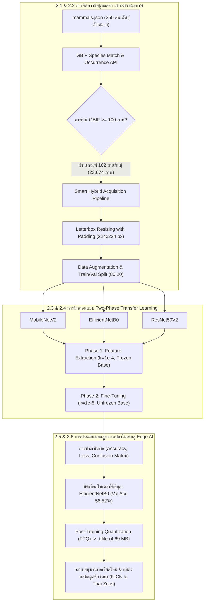

# การพัฒนาแพลตฟอร์มการเรียนรู้เชิงลึกแบบถ่ายโอนสองเฟสสำหรับการจำแนกชนิดพันธุ์สัตว์เลี้ยงลูกด้วยนมในสวนสัตว์ไทยและการปรับแต่งเพื่อการประมวลผลบนอุปกรณ์พกพา
## Development of a Two-Phase Transfer Learning Platform for Classifying Thai Zoo Mammals and Its Edge AI Optimization for Real-Time Mobile Deployment

**ผู้วิจัย**: [ระบุชื่อ-นามสกุลผู้วิจัย]1*, [ระบุชื่อผู้ร่วมวิจัย]2  
**สังกัด**: 1,2 ภาควิชาวิทยาการคอมพิวเตอร์และเทคโนโลยีสารสนเทศ คณะวิทยาศาสตร์และเทคโนโลยี [ชื่อมหาวิทยาลัย], [จังหวัด], [รหัสไปรษณีย์], ประเทศไทย  
**อีเมลติดต่อ (*Corresponding Author)**: researcher@university.ac.th  

> [!NOTE]
> **คำแนะนำสำหรับการเตรียมเอกสาร Blind Manuscript (Double-Blind Review)**:
> ในขั้นตอนการแปลงเอกสารเป็น `Blind_Manuscript.docx` เพื่อส่งวารสาร EASR ให้ตัดข้อมูลชื่อผู้วิจัย/สังกัด/อีเมลออก แล้วแทนที่ด้วย `*(Author details anonymized for double-blind peer review)*` และละเว้นข้อความระบุทุนในหัวข้อกิตติกรรมประกาศ โดยไม่จำเป็นต้องแยกไฟล์ซ้ำซ้อนในระบบ

---

### บทคัดย่อ

การจำแนกชนิดพันธุ์สัตว์เลี้ยงลูกด้วยนมในสวนสัตว์เปิดมีความสำคัญอย่างยิ่งต่อการศึกษาเรียนรู้ด้านชีววิทยา การอนุรักษ์ความหลากหลายทางชีวภาพ และการยกระดับประสบการณ์การท่องเที่ยวเชิงนิเวศ อย่างไรก็ดี การจำแนกภาพถ่ายสัตว์ในสภาพแวดล้อมธรรมชาติมีความท้าทายสูงจากสิ่งกีดขวางในกรงเลี้ยง ฉากหลังพืชพรรณที่รกทึบ สภาพแสงที่แปรปรวน และลักษณะสัณฐานวิทยาที่มีความคล้ายคลึงกันอย่างยิ่งระหว่างสายพันธุ์ในวงศ์เดียวกัน (Sister Species) งานวิจัยนี้นำเสนอแพลตฟอร์มปัญญาประดิษฐ์ครบวงจรสำหรับการจำแนกชนิดพันธุ์สัตว์เลี้ยงลูกด้วยนมในสวนสัตว์ไทยจำนวน 162 สายพันธุ์ โดยบูรณาการการรวบรวมและคัดกรองชุดข้อมูลภาพถ่ายจำนวน 23,674 ภาพ จากคลังข้อมูลสิ่งมีชีวิตระดับโลก (Global Biodiversity Information Facility - GBIF API) ควบคู่กับสถาปัตยกรรมการดาวน์โหลดและสำรองข้อมูลแบบไฮบริดความเร็วสูง (Smart Hybrid Acquisition) และการปรับแต่งภาพแบบ Letterbox Resizing เพื่อรักษาสัดส่วนกายวิภาค จากนั้นได้ดำเนินการพัฒนาและเปรียบเทียบประสิทธิภาพโครงข่ายประสาทเทียมคอนโวลูชันเชิงลึก (CNNs) จำนวน 3 สถาปัตยกรรม ได้แก่ MobileNetV2, EfficientNetB0 และ ResNet50V2 ภายใต้กลยุทธ์การเรียนรู้แบบถ่ายโอนสองเฟส (Two-Phase Transfer Learning) ประกอบด้วยเฟสการสกัดคุณลักษณะ (Feature Extraction) และเฟสการปรับจูนละเอียดเชิงลึก (Fine-Tuning) ผลการทดลองบนชุดข้อมูลตรวจสอบ (Validation Set) จำนวน 4,717 ภาพ พบว่า EfficientNetB0 มีประสิทธิภาพสูงสุด โดยทำความแม่นยำ Top-1 Accuracy ได้ 56.52% ค่า Validation Loss ต่ำที่สุดที่ 1.8028 และมีค่า Macro F1-Score เท่ากับ 0.55 เหนือกว่า MobileNetV2 (49.82%) และ ResNet50V2 (48.42%) อย่างมีนัยสำคัญ นอกจากนี้ ผู้วิจัยได้นำโมเดล EfficientNetB0 มาผ่านกระบวนการบีบอัดและลดทอนความแม่นยำหลังการฝึกสอน (Post-Training Quantization: PTQ) ให้อยู่ในรูปแบบ TensorFlow Lite (.tflite) ซึ่งสามารถลดขนาดไฟล์โมเดลลงได้ถึง 72.91% (จาก 17.31 MB เหลือเพียง 4.69 MB) โดยคงความแม่นยำในการอนุมานผล พร้อมเชื่อมต่อเข้ากับฐานข้อมูลชีววิทยาและระบบสารสนเทศสวนสัตว์ไทยเพื่อดึงข้อมูลสถานะการอนุรักษ์ตามบัญชีแดง IUCN และข้อมูลการจัดแสดงในสวนสัตว์ไทย 6 แห่งมาแสดงผลแบบเรียลไทม์ งานวิจัยนี้แสดงให้เห็นถึงความเป็นไปได้ในการนำโมเดลไปประยุกต์ใช้งานจริงบนอุปกรณ์พกพาและเว็บแอปพลิเคชันสำหรับ Smart Zoo ต่อไป

**คำสำคัญ**: การเรียนรู้เชิงลึก (Deep learning), การเรียนรู้แบบถ่ายโอนสองเฟส (Two-phase transfer learning), EfficientNetB0, การจำแนกสัตว์เลี้ยงลูกด้วยนม (Mammal classification), ปัญญาประดิษฐ์บนอุปกรณ์ปลายทาง (Edge AI), สารสนเทศความหลากหลายทางชีวภาพ (Biodiversity informatics)

---

## 1. บทนำ (Introduction)

สวนสัตว์สมัยใหม่มิได้ทำหน้าที่เป็นเพียงสถานที่จัดแสดงสัตว์เพื่อความบันเทิงเท่านั้น หากยังมีบทบาทเชิงยุทธศาสตร์ในการเป็นศูนย์กลางการอนุรักษ์ความหลากหลายทางชีวภาพนอกถิ่นกำเนิด (Ex-situ Conservation) การเพาะขยายพันธุ์สัตว์ป่าหายาก และแหล่งเรียนรู้ตลอดชีวิตสำหรับประชาชนและเยาวชน ประเทศไทยมีเครือข่ายสวนสัตว์เปิดและสวนสัตว์แห่งชาติภายใต้การกำกับดูแลขององค์การสวนสัตว์แห่งประเทศไทย ในพระบรมราชูปถัมภ์ กระจายตัวอยู่ทั่วทุกภูมิภาค ซึ่งเป็นแหล่งรวบรวมชนิดพันธุ์สัตว์เลี้ยงลูกด้วยนม (Class Mammalia) ทั้งที่เป็นสัตว์ประจำถิ่นของไทย (Native Species) และสัตว์ต่างถิ่นนำเข้าจากทวีปอื่น (Exotic Species) รวมกันมากกว่า 250 ชนิดพันธุ์ อย่างไรก็ดี ปัญหาสำคัญที่พบในการทัศนศึกษาคือ ป้ายสื่อความหมายแบบกายภาพดั้งเดิมมักให้ข้อมูลที่จำกัด ไม่สามารถดึงดูดความสนใจของนักท่องเที่ยวในยุคดิจิทัล และบ่อยครั้งที่นักท่องเที่ยวไม่สามารถระบุชนิดพันธุ์ของสัตว์ที่กำลังมองเห็นได้อย่างถูกต้อง โดยเฉพาะกลุ่มสัตว์ที่มีสัณฐานวิทยาใกล้เคียงกัน เช่น สัตว์ในวงศ์อูฐ (Camelidae) วงศ์กวาง (Cervidae) หรือวงศ์ลิงและชะนี การก้าวหน้าอย่างรวดเร็วของอุปกรณ์พกพาอัจฉริยะจึงเปิดโอกาสในการพัฒนาเครื่องมือช่วยจำแนกสิ่งมีชีวิตจากภาพถ่ายแบบอัตโนมัติ (Automated Species Identification) เพื่อยกระดับสู่แนวคิด **"Smart Zoo"** [1, 2]

การประยุกต์ใช้โครงข่ายประสาทเทียมคอนโวลูชันเชิงลึก (Deep Convolutional Neural Networks: CNNs) ในงานจำแนกสัตว์ป่าได้รับความสนใจอย่างกว้างขวาง Norouzzadeh และคณะ [1] ได้พิสูจน์ศักยภาพของแบบจำลองเชิงลึกในการจำแนกสัตว์ป่า 48 ชนิดพันธุ์ จากภาพถ่ายกับดักกล้อง (Camera Traps) กว่า 3.2 ล้านภาพในอุทยานแห่งชาติเซเรนเกตี ด้วยความแม่นยำสูงถึง 93.8% อย่างไรก็ตาม กล้องดักถ่ายภาพมีมุมมองและฉากหลังที่ค่อนข้างคงที่ ซึ่งแตกต่างจากภาพถ่ายนักท่องเที่ยวที่มีมุมกล้อง แสงเงา และระยะโฟกัสที่แปรผันตลอดเวลา Gómez-Villa และคณะ [3] และ Schneider และคณะ [4] ได้ศึกษาการจำแนกสัตว์ป่าภายใต้สภาพแวดล้อมที่ผันแปร และชี้ให้เห็นว่าการใช้โครงข่ายที่ผ่านการฝึกฝนล่วงหน้า (Pre-trained Network) จากชุดข้อมูลขนาดใหญ่ เช่น ImageNet ช่วยเพิ่มอัตราการลู่เข้าสู่จุดเหมาะสม (Convergence) และเสริมสร้างความสามารถในการวางนัยทั่วไป (Generalization) ได้ดีกว่าการฝึกสอนตั้งแต่ต้น นอกจากนี้ Yosinski และคณะ [5] พบว่าเลเยอร์ระดับต้นจะทำการสกัดคุณลักษณะพื้นฐาน (ขอบ เส้น สี) ในขณะที่เลเยอร์ระดับลึกจะเข้ารหัสคุณลักษณะนามธรรมที่มีความจำเพาะสูง การปลดล็อกเลเยอร์เพื่อทำ Fine-Tuning ร่วมกับการปรับลดอัตราการเรียนรู้ (Learning Rate) ให้อยู่ในระดับต่ำมาก จะช่วยให้โครงข่ายปรับตัวเข้ากับลักษณะสัณฐานวิทยาของสายพันธุ์ใหม่ได้โดยไม่ทำลายค่าน้ำหนักเดิม (Catastrophic Forgetting) [6]

ในการนำโมเดลไปใช้งานบนอุปกรณ์พกพาและอุปกรณ์ประมวลผลขนาดเล็ก จำเป็นต้องคำนึงถึงขนาดของแบบจำลองและอัตราการใช้พลังงาน [7] Sandler และคณะ [8] ได้นำเสนอ MobileNetV2 ซึ่งใช้โครงสร้าง Inverted Residuals และ Linear Bottlenecks ช่วยลดปริมาณการคำนวณและขนาดพารามิเตอร์ลงอย่างมหาศาล Tan และ Le [9] เสนอสถาปัตยกรรม EfficientNet โดยใช้หลักการ Compound Scaling ที่ปรับสมดุลความลึก ความกว้าง และความละเอียดภาพไปพร้อมกัน ทำให้ได้ค่าความแม่นยำสูงบนจำนวนพารามิเตอร์ที่ประหยัด นอกจากนี้ Jacob และคณะ [10] แสดงให้เห็นว่าการลดทอนความแม่นยำหลังการฝึกสอน (Post-Training Quantization: PTQ) แปลงค่าน้ำหนักจากทศนิยม 32 บิต (FP32) สู่จำนวนเต็ม 8 บิต (INT8) สามารถลดขนาดไฟล์โมเดลลงได้มากกว่า 70% โดยแทบไม่สูญเสียความแม่นยำ

อย่างไรก็ดี การจำแนกภาพถ่ายสัตว์ในสวนสัตว์เปิดยังคงเผชิญความท้าทายเฉพาะตัว 4 ประการ:
1. *ความคล้ายคลึงกันอย่างสูงระหว่างสายพันธุ์ในวงศ์เดียวกัน (Sister Species Similarity)*: สัตว์หลายชนิดมีโครงสร้างกะโหลก รูปทรงลำตัว และลายขนที่ซ้อนทับกันอย่างมาก เช่น อูฐกัวนาโกเทียบกับลามะ หรือ สปริงบอกเทียบกับกาเซลล์ทอมสัน ซึ่งต้องการตัวสกัดคุณลักษณะที่ตรวจจับรายละเอียดพื้นผิวที่ละเอียดอ่อน [11]
2. *ฉากหลังและสิ่งกีดขวางในสภาพแวดล้อมจริง (Environmental Clutter & Occlusion)*: ภาพถ่ายจากกรงเลี้ยงมักมีสิ่งกีดขวาง เช่น กิ่งไม้ ใบไม้หนาทึบ ตาข่ายกรง รั้วกั้น และอิริยาบถที่คาดเดาไม่ได้ [4]
3. *ความไม่สมดุลของข้อมูลภาพในคลังสาธารณะ (Class Imbalance)*: สัตว์เลี้ยงคุ้นเคยมีภาพถ่ายจำนวนนับหมื่น ขณะที่สัตว์ป่าหายากมีภาพถ่ายบันทึกไว้น้อยมาก [12]
4. *ข้อจำกัดด้านการเชื่อมต่อและการประมวลผล ณ อุปกรณ์ปลายทาง (Edge Constraints)*: สวนสัตว์เปิดส่วนใหญ่เป็นพื้นที่ธรรมชาติกว้างขวาง สัญญาณเครือข่ายอินเทอร์เน็ตมักไม่ครอบคลุม โมเดลที่พึ่งพาระบบคลาวด์จะเกิดความล่าช้า (Latency) จึงจำเป็นต้องมีโมเดลขนาดกะทัดรัดที่สามารถประมวลผลบนชิปสมาร์ตโฟนได้โดยตรง [7]

เพื่อแก้ไขความท้าทายเหล่านี้ งานวิจัยนี้นำเสนอแพลตฟอร์มปัญญาประดิษฐ์ครบวงจรที่มีจุดเด่น 4 ประการ:
1. *การสืบค้นและจัดการชุดข้อมูลแบบ Smart Hybrid*: ออกแบบกระบวนการดึงข้อมูลภาพถ่ายอัตโนมัติ 162 ชนิดพันธุ์ รวม 23,674 ภาพ ผ่าน GBIF API พร้อมการรักษาสัดส่วนภาพด้วย Letterbox Padding
2. *การทดสอบเปรียบเทียบเชิงวิศวกรรมแบบ Two-Phase Transfer Learning*: เปรียบเทียบสถาปัตยกรรม CNN ชั้นนำ 3 รูปแบบ (MobileNetV2, EfficientNetB0, ResNet50V2) ภายใต้สภาวะควบคุมเดียวกัน
3. *การวิเคราะห์ข้อผิดพลาดเชิงสัณฐานวิทยาและนิเวศวิทยา*: ตรวจสอบเมทริกซ์ความสับสนและรายงานจำแนกรายคลาสเพื่อระบุสาเหตุทางกายวิภาคที่ส่งผลต่อการทำนาย
4. *การปรับแต่งโมเดลสู่ Edge AI และการเชื่อมต่อสารสนเทศสวนสัตว์*: บีบอัดโมเดลด้วย PTQ เป็น TensorFlow Lite ขนาด 4.69 MB และเชื่อมโยงฐานข้อมูลสถานะอนุรักษ์ตามบัญชีแดง IUCN และข้อมูลจัดแสดงในสวนสัตว์ไทย 6 แห่งแบบเรียลไทม์

---

## 2. วัสดุอุปกรณ์และระเบียบวิธีวิจัย (Materials and methods)

โครงสร้างภาพรวมของแพลตฟอร์มการจำแนกชนิดพันธุ์สัตว์เลี้ยงลูกด้วยนมในสวนสัตว์ไทยแสดงในภาพที่ 1

*ภาพที่ 1 ผังกระบวนการวิจัยและการพัฒนาแพลตฟอร์มปัญญาประดิษฐ์จำแนกสัตว์เลี้ยงลูกด้วยนมในสวนสัตว์ไทย*

### 2.1 การสืบค้นและจัดเตรียมชุดข้อมูลผ่าน GBIF API (Dataset acquisition and GBIF API integration)
การศึกษานี้เริ่มต้นจากการรวบรวมรายชื่อสัตว์เลี้ยงลูกด้วยนมที่จัดแสดงในสวนสัตว์ไทย 6 แห่ง (สวนสัตว์เปิดเขาเขียว, สวนสัตว์เชียงใหม่, สวนสัตว์นครราชสีมา, สวนสัตว์สงขลา, สวนสัตว์อุบลราชธานี และสวนสัตว์ขอนแก่น) รวม 250 สายพันธุ์ จัดเก็บในไฟล์ฐานข้อมูล `mammals.json`

การสร้างชุดข้อมูลภาพถ่ายใช้การเชื่อมต่อผ่าน API ของ Global Biodiversity Information Facility (GBIF) [13] ผ่าน 2 ขั้นตอน:
1. *การจับคู่ชื่อทางอนุกรมวิธาน (TaxonKey Resolution)*: ใช้ `GBIF Species Match API` เพื่อค้นหาหมายเลขกำกับทางชีววิทยาสากล (`usageKey`) โดยจำกัดขอบเขตในอาณาจักรสัตว์ (Kingdom *Animalia*) และชั้นสัตว์เลี้ยงลูกด้วยนม (Class *Mammalia*)
2. *การตรวจสอบจำนวนสื่อภาพถ่าย (Occurrence Media Audit)*: ใช้ `GBIF Occurrence Search API` โดยกรองเฉพาะระเบียนที่มีภาพนิ่ง (`mediaType=StillImage`)

เกณฑ์การคัดเลือกกำหนดให้สายพันธุ์ต้องมีภาพถ่าย $\ge 100$ ภาพ ซึ่งมีสัตว์ที่ผ่านเกณฑ์ทั้งสิ้น **162 สายพันธุ์** และเพื่อป้องกันปัญหาความไม่สมดุลของข้อมูล ได้กำหนดเพดานดาวน์โหลดสูงสุดไม่เกิน **150 ภาพต่อสายพันธุ์ (`limit_per_species = 150`)** รวมจำนวนภาพทั้งสิ้น **23,674 ภาพ**

เพื่อแก้ปัญหาคอขวดด้านความเร็วเครือข่ายและการจัดเก็บข้อมูลบนสภาพแวดล้อมคลาวด์ ได้ออกแบบสถาปัตยกรรม Smart Hybrid Acquisition:
- *การรันครั้งแรก*: ใช้ระบบมัลติเธรด (16 เธรด) สตรีมภาพตรงลงบน Local SSD ความเร็วสูง ทำการตรวจสอบความสมบูรณ์ของภาพและปรับขนาด Letterbox ทันที จากนั้นบีบอัดเป็นไฟล์ `mammals_dataset.zip` ส่งไปสำรองบนคลาวด์สตอเรจ
- *การรันครั้งถัดไป*: ระบบตรวจพบไฟล์สำรองและแตกไฟล์ลง Local SSD ภายใน 10 วินาที ช่วยประหยัดเวลาและแบนด์วิดท์อย่างมีนัยสำคัญ

### 2.2 การประมวลผลภาพเบื้องต้นและการเพิ่มขยายข้อมูล (Image preprocessing and data augmentation)
1. *การปรับขนาดภาพแบบคงสัดส่วน (Letterbox Resizing with Padding)*: การบีบอัดภาพสี่เหลี่ยมผืนผ้าให้เป็นจัตุรัสโดยตรงจะทำให้สัดส่วนสัตว์บิดเบี้ยว งานวิจัยนี้จึงใช้ฟังก์ชัน Letterbox ปรับขนาดยึดแกนด้านยาวเป็น 224 พิกเซล และเติมช่องว่างขอบด้วยสีขาว (RGB: 255, 255, 255) ให้อยู่ในมิติมาตรฐาน $224 \times 224 \times 3$
2. *การจัดแบ่งชุดข้อมูล*: แบ่งชุดข้อมูลในอัตราส่วนแบบแบ่งชั้น (Stratified Split) 80:20:
   - **ชุดฝึกสอน (Training Set: 80%)**: **18,957 ภาพ**
   - **ชุดตรวจสอบ (Validation Set: 20%)**: **4,717 ภาพ**
3. *การเพิ่มขยายข้อมูลภาพ (Data Augmentation)*: ใช้เทคนิคการแปลงภาพแบบสุ่มในระหว่างการฝึกสอนเพื่อป้องกัน Overfitting:
   - ปรับค่าความสว่างพิกเซลให้อยู่ในช่วง $[0, 1]$ (`rescale=1./255`)
   - หมุนภาพแบบสุ่ม ($\pm 20^\circ$)
   - เลื่อนภาพในแนวระนาบและแนวดิ่ง ($\pm 10\%$)
   - ซูมภาพแบบสุ่ม ($\pm 10\%$)
   - ปรับความสว่างแบบสุ่มในช่วง $[0.9, 1.1]$
   - พลิกภาพแนวนอน (`horizontal_flip=True`)

### 2.3 สถาปัตยกรรมโครงข่ายประสาทเทียมเชิงลึก (Deep neural network backbone architectures)
โครงข่ายทั้งหมดถูกสร้างขึ้นภายใต้ส่วนหัวของการจำแนกประเภทแบบรวมศูนย์ (Unified Classification Head):
- *Input Layer*: ขนาด $224 \times 224 \times 3$
- *Model-Specific Rescaling*: ปรับสเกลพิกเซลเป็น $[-1, 1]$ สำหรับ MobileNetV2 และ ResNet50V2 หรือ $[0, 255]$ สำหรับ EfficientNetB0
- *Pre-trained Backbone Feature Extractor*:
  1. **MobileNetV2**: ใช้ Depthwise Separable Convolutions และ Inverted Residuals ออกแบบมาเพื่อประสิทธิภาพบนอุปกรณ์ปลายทาง [8]
  2. **EfficientNetB0**: ใช้ Compound Coefficient Scaling ปรับสมดุลความลึก ความกว้าง และความละเอียดภาพ [9]
  3. **ResNet50V2**: โครงข่ายแบบ Residual ลึก 50 เลเยอร์ ใช้ Pre-activation Bottleneck Blocks และ Skip Connections [14]
- *Unified Classification Head*:
  - Global Average Pooling 2D (GAP) เพื่อลดมิติเชิงพื้นที่และควบคุมจำนวนพารามิเตอร์
  - Dropout layer ($p = 0.5$) ป้องกันการพึ่งพากันระหว่างนิวรอน
  - Fully-connected Dense layer (256 units, ReLU activation)
  - Dense output layer (162 units, Softmax activation) ให้ค่าการแจกแจงความน่าจะเป็นของ 162 คลาส

### 2.4 กลยุทธ์การเรียนรู้แบบถ่ายโอนสองเฟส (Two-phase transfer learning strategy)
การฝึกสอนแบ่งออกเป็น 2 เฟสตามลำดับ:
- *Phase 1 (Feature Extraction)*:
  - ตรึงค่าน้ำหนักโครงข่ายหลัก (`base_model.trainable = False`) เพื่อฝึกสอนเฉพาะ Classification Head
  - **Optimizer**: Adam ด้วย Learning Rate เริ่มต้น $\eta_1 = 1 \times 10^{-4}$
  - **Loss Function**: Categorical Crossentropy
  - **Epochs & Callbacks**: 30 epochs ควบคุมด้วย `EarlyStopping(patience=8)` และ `ReduceLROnPlateau(factor=0.2, patience=4)`
- *Phase 2 (Fine-Tuning)*:
  - ปลดล็อกค่าน้ำหนักโครงข่ายหลัก (`base_model.trainable = True`) เพื่อร่วมปรับค่าน้ำหนักทั้งหมด
  - **Optimizer**: Adam ด้วย Learning Rate ต่ำ $\eta_2 = 1 \times 10^{-5}$ เพื่อรักษาฟังก์ชันสกัดฟีเจอร์ระดับต้น
  - **Epochs & Callbacks**: 50 epochs ควบคุมด้วย `EarlyStopping(patience=10)` และ `ReduceLROnPlateau(factor=0.2, patience=5)`

### 2.5 การปรับแต่งและบีบอัดโมเดลสำหรับ Edge AI (Edge AI optimization and quantization)
โมเดลที่มีผลการทดสอบดีที่สุดจะถูกนำมาทำ Post-Training Quantization (PTQ) ให้อยู่ในรูปแบบ TensorFlow Lite [10] โดยแปลงค่าน้ำหนักจากเลขทศนิยม 32 บิต (FP32) ให้เป็นจำนวนเต็มที่มีขนาดกะทัดรัด ช่วยลดพื้นที่จัดเก็บและเพิ่มความเร็วในการประมวลผลบนฮาร์ดแวร์พกพา

### 2.6 เกณฑ์การวัดประสิทธิภาพ (Evaluation metrics)
การประเมินผลกระทำบนชุดข้อมูลตรวจสอบจำนวน 4,717 ตัวอย่าง โดยใช้ตัวชี้วัดมาตรฐานสากล ได้แก่ Top-1 Accuracy, Precision, Recall, Macro F1-score, Weighted F1-score และ Confusion Matrix

---

## 3. ผลการวิจัย (Results)

### 3.1 พฤติกรรมการเรียนรู้และประสิทธิภาพเปรียบเทียบข้ามสถาปัตยกรรม (Multi-backbone trajectory and performance gain)
ผลการฝึกสอนและประเมินประสิทธิภาพของทั้ง 3 สถาปัตยกรรมตลอด 2 เฟส สรุปไว้ในตารางที่ 1 และภาพที่ 2

**ตารางที่ 1** การเปรียบเทียบประสิทธิภาพของสถาปัตยกรรมทั้ง 3 รูปแบบตลอดการฝึกสอน 2 เฟส

| สถาปัตยกรรมโครงข่าย | Phase 1 Max Val Acc | Phase 2 Max Val Acc | Phase 2 Min Val Loss | ความแม่นยำที่เพิ่มขึ้น ($\Delta$) |
| :--- | :---: | :---: | :---: | :---: |
| **MobileNetV2** | 42.27% | 49.82% | 2.1578 | +7.55% |
| **EfficientNetB0** 🏆 | **49.76%** | **56.52%** | **1.8028** | **+6.76%** |
| **ResNet50V2** | 39.09% | 48.42% | 2.3864 | +9.33% |

*ภาพที่ 2 กราฟเปรียบเทียบค่าความแม่นยำ (Accuracy) และค่าความสูญเสีย (Loss) ตลอดการฝึกสอนทั้ง 2 เฟส ระหว่าง MobileNetV2, EfficientNetB0 และ ResNet50V2*

จากตารางที่ 1:
- **EfficientNetB0** มีประสิทธิภาพสูงสุดในทุกตัวชี้วัด โดยทำความแม่นยำสูงสุดที่ **56.52%** และมีค่า Validation Loss ต่ำที่สุดที่ **1.8028** การปรับสมดุลเชิงลึก กว้าง และความละเอียด ช่วยจับฟีเจอร์ลวดลายขนและเค้าโครงหน้าของสัตว์ได้ดีกว่า
- **MobileNetV2** ทำความแม่นยำได้ **49.82%** แม้จะตามหลัง EfficientNetB0 อยู่ 6.70% แต่มีความเร็วในการประมวลผลสูงและขนาดโครงสร้างที่กะทัดรัด
- **ResNet50V2** ทำความแม่นยำได้ **48.42%** และมีค่า Loss สูงสุดที่ 2.3864 ซึ่งมีแนวโน้มเกิด Overfitting ต่อฉากหลังธรรมชาติได้ง่ายกว่า

ด้วยเหตุนี้ ผู้วิจัยจึงคัดเลือก **EfficientNetB0** เป็นแบบจำลองหลักสำหรับการวิเคราะห์เชิงลึกและการนำไปปรับแต่งสู่ Edge AI

### 3.2 ผลการประเมินประสิทธิภาพในภาพรวม (Overall diagnostic performance)
ผลการประเมินโมเดล EfficientNetB0 บนชุดข้อมูลตรวจสอบจำนวน 4,717 ภาพ ครอบคลุม 162 สายพันธุ์ แสดงในตารางที่ 2

**ตารางที่ 2** สรุปตัวชี้วัดประสิทธิภาพโดยรวมของแบบจำลอง EfficientNetB0

| ตัวชี้วัดประสิทธิภาพ (Metric) | ค่าเฉลี่ยระดับมหภาค (Macro Average) | ค่าเฉลี่ยถ่วงน้ำหนัก (Weighted Average) | ภาพรวมทั้งหมด (Overall Aggregate) |
| :--- | :---: | :---: | :---: |
| **Top-1 Accuracy** | — | — | **56.00% (0.5600)** |
| **Precision** | 0.56 | 0.56 | 0.56 |
| **Recall** | 0.56 | 0.56 | 0.56 |
| **F1-Score** | **0.55** | **0.55** | **0.55** |
| **จำนวนตัวอย่างทดสอบ (Support)** | 4,717 ภาพ | 4,717 ภาพ | 4,717 ภาพ (162 คลาส) |

### 3.3 การวิเคราะห์ประสิทธิภาพระดับชนิดพันธุ์ (Class-level recognition extremes)
ผลการจำแนกรายสายพันธุ์มีความผันแปรตามความเด่นชัดทางสัณฐานวิทยา ตารางที่ 3 แสดง 10 สายพันธุ์ที่มีความแม่นยำสูงสุด (F1-score $\ge 0.81$) และตารางที่ 4 แสดง 10 สายพันธุ์ที่มีความท้าทายสูงสุด (F1-score $\le 0.15$) ร่วมกับภาพที่ 3

**ตารางที่ 3** 10 อันดับสายพันธุ์สัตว์ที่มีค่าความแม่นยำ F1-Score สูงสุดจากการทำนายของ EfficientNetB0

| อันดับ | ชื่อภาษาไทย | ชื่อวิทยาศาสตร์ | Precision | Recall | F1-Score | จำนวนตัวอย่าง (Support) |
| :---: | :--- | :--- | :---: | :---: | :---: | :---: |
| 1 | **ลิงเจลาดา** | *Theropithecus gelada* | 0.82 | 0.93 | **0.88** | 30 |
| 2 | **ลีเมอร์ขาวดำ** | *Varecia variegata* | 0.84 | 0.87 | **0.85** | 30 |
| 3 | **ลิงทามารินเอ็มเพอเรอร์** | *Saguinus imperator* | 0.72 | **1.00** | **0.84** | 29 |
| 4 | **ม้าลายเบอร์เชลล์** | *Equus quagga burchellii* | 0.74 | 0.97 | **0.84** | 30 |
| 5 | **ลีเมอร์หางแหวน** | *Lemur catta* | 0.89 | 0.80 | **0.84** | 30 |
| 6 | **ลีเมอร์มงกุฎ** | *Eulemur coronatus* | **0.89** | 0.80 | **0.84** | 30 |
| 7 | **ม้าลายเกรวี** | *Equus grevyi* | 0.86 | 0.80 | **0.83** | 30 |
| 8 | **เม่นแคระสี่นิ้ว** | *Atelerix albiventris* | 0.75 | 0.90 | **0.82** | 30 |
| 9 | **ไฮยีนาลายจุด** | *Crocuta crocuta* | 0.81 | 0.83 | **0.82** | 30 |
| 10 | **แพรรีด็อกหางดำ** | *Cynomys ludovicianus* | 0.69 | 0.97 | **0.81** | 30 |

*ภาพที่ 3 การเปรียบเทียบค่า F1-Score ระหว่าง 10 สายพันธุ์ที่มีความแม่นยำสูงสุดและ 10 สายพันธุ์ที่มีความท้าทายสูงสุดในการจำแนก*

**ตารางที่ 4** 10 อันดับสายพันธุ์สัตว์ที่มีความท้าทายสูงสำหรับแบบจำลอง

| อันดับ | ชื่อภาษาไทย | ชื่อวิทยาศาสตร์ | Precision | Recall | F1-Score | จำนวนตัวอย่าง (Support) |
| :---: | :--- | :--- | :---: | :---: | :---: | :---: |
| 1 | **จิ้งจอกเฟนเนก** | *Vulpes zerda* | 0.00 | 0.00 | **0.00** | 30 |
| 2 | **ลิงทามารินสิงโตทอง** | *Leontopithecus rosalia* | 0.00 | 0.00 | **0.00** | 29 |
| 3 | **อีเห็นลายเสือ** | *Prionodon pardicolor* | 0.00 | 0.00 | **0.00** | 24 |
| 4 | **ลิงแมนดริล** | *Mandrillus sphinx* | 0.20 | 0.03 | **0.06** | 29 |
| 5 | **ชะนีมือดำ** | *Hylobates agilis* | 0.12 | 0.05 | **0.07** | 21 |
| 6 | **หมีขอ** | *Arctictis binturong* | 0.11 | 0.07 | **0.08** | 29 |
| 7 | **อีเห็นข้างลาย** | *Paradoxurus hermaphroditus* | 0.23 | 0.10 | **0.14** | 30 |
| 8 | **ม้าแคระมินิเอเจอร์** | *Miniature horse* | 0.23 | 0.10 | **0.14** | 30 |
| 9 | **แพนด้าแดง** | *Ailurus fulgens* | 0.33 | 0.09 | **0.14** | 22 |
| 10 | **ม้าแคระฟอลลาเบลลา** | *Falabella* | 0.17 | 0.13 | **0.15** | 30 |

### 3.4 ผลการบีบอัดโมเดลเพื่อการติดตั้งบนอุปกรณ์พกพา (Model compression and edge deployment footprint)
การลดทอนขนาดโมเดลด้วย Post-Training Quantization (PTQ) บน EfficientNetB0 ให้ผลลัพธ์เชิงปริมาณตามตารางที่ 5 และภาพที่ 4

**ตารางที่ 5** การเปรียบเทียบขนาดไฟล์แบบจำลองและสภาพแวดล้อมเป้าหมายในการติดตั้ง

| ขั้นตอนโมเดล | รูปแบบไฟล์ | ชื่อไฟล์ | ขนาดไฟล์ | อัตราการลดขนาด | สภาพแวดล้อมเป้าหมาย |
| :--- | :---: | :---: | :---: | :---: | :--- |
| **ก่อนการทำ Quantization** | Keras H5 (FP32) | `mammals_best_model.h5` | 17.31 MB | 0.00% (เกณฑ์อ้างอิง) | เซิร์ฟเวอร์คลาวด์ / GPU Workstation |
| **หลังการทำ Quantization** | **TensorFlow Lite (.tflite)** | `mammals_classifier.tflite` | **4.69 MB** | **ลดลง 72.91% ⬇️** | **Mobile Edge (iOS / Android / Web Edge)** |

*ภาพที่ 4 การเปรียบเทียบขนาดไฟล์โมเดลระหว่าง Keras H5 (17.31 MB) และ TensorFlow Lite (4.69 MB) ซึ่งประหยัดพื้นที่จัดเก็บลงถึง 72.91%*

PTQ สามารถบีบอัดขนาดไฟล์ลงได้ถึง **72.91%** จาก 17.31 MB เหลือเพียง **4.69 MB** ซึ่งก่อให้เกิดประโยชน์เชิงปฏิบัติอย่างชัดเจน:
- ดาวน์โหลดผ่านเครือข่ายมือถือได้อย่างรวดเร็วในไม่กี่วินาที
- ประหยัดการจัดสรรหน่วยความจำ RAM ของสมาร์ตโฟน ป้องกันการถูกปิดแอปพลิเคชันบนสมาร์ตโฟนรุ่นประหยัด
- ความเร็วการอนุมานผลบนอุปกรณ์ทันทีแบบเสี้ยววินาทีโดยปราศจาก Latency จากการส่งข้อมูลผ่านเครือข่าย

---

## 4. การอภิปรายผล (Discussion)

### 4.1 เมทริกซ์ความสับสนและการวินิจฉัยข้อผิดพลาดทางสัณฐานวิทยา (Confusion matrix and biological error diagnostics)
แผนภาพเมทริกซ์ความสับสนขนาด $162 \times 162$ คลาส (ภาพที่ 5) ชี้ให้เห็นว่าความผิดพลาดในการทำนายมิได้เกิดขึ้นแบบสุ่ม แต่กระจุกตัวอยู่ในกลุ่มสายพันธุ์ที่มีความใกล้ชิดทางสัณฐานวิทยา

*ภาพที่ 5 แผนภาพเมทริกซ์ความสับสน (Confusion Matrix) แสดงการกระจายตัวของการทำนายจริงเทียบกับผลทำนายของ 162 สายพันธุ์*

ตารางที่ 6 และภาพที่ 6 แสดงการแจกแจงคู่สายพันธุ์ที่เกิดข้อผิดพลาดในการทำนายสลับกันสูงสุด 5 อันดับแรก

**ตารางที่ 6** 5 อันดับคู่สายพันธุ์ที่โมเดลเกิดความสับสนสูงสุดและการวิเคราะห์สาเหตุเชิงสรีรวิทยา

| อันดับ | สายพันธุ์จริง | ทำนายผิดเป็น | จำนวนภาพผิด | การวิเคราะห์สาเหตุเชิงสรีรวิทยาและภาพถ่าย |
| :---: | :--- | :--- | :---: | :--- |
| **1** | **จิ้งจอกเฟนเนก** | ชะมดแผงหางปล้อง | 21 | สัตว์ขนาดเล็กที่มีการถ่ายภาพในระยะไกล มีใบหูตั้งชันและรูปทรงลำตัวใกล้เคียงกัน ประกอบกับฉากหลังที่รกทึบ |
| **2** | **ลิงทามารินสิงโตทอง** | ชะมดแผงหางปล้อง | 19 | พวงหางยาวและขนฟูสีทองกระตุ้นการตอบสนองของตัวกรองคอนโวลูชันคล้ายกับลายแถบหางของชะมดแผงหางปล้อง |
| **3** | **ชะนีมือดำ** | กระรอกหางม้าข้อดำ | 12 | สัตว์อาศัยบนเรือนยอดไม้ที่มีขนสีดำสนิท เมื่ออยู่ในฉากหลังที่เป็นพุ่มไม้ทึบ โมเดลไม่สามารถแยกแยะขอบเขตลำตัวได้ |
| **4** | **อูฐกัวนาโก** | ลามะ | 11 | เป็นสัตว์ในวงศ์อูฐ (*Camelidae*) ที่มีความใกล้ชิดทางพันธุกรรมสูง มีรูปหน้า ขนยาว และสัดส่วนทางกายวิภาคที่ทับซ้อนกันอย่างมาก |
| **5** | **สปริงบอก** | กาเซลล์ทอมสัน | 10 | เป็นแอนทิโลปขนาดเล็กที่มีแถบสีดำข้างลำตัว โทนสีขนสีน้ำตาล และลายแถบสีขาวบนใบหน้าที่คล้ายคลึงกันอย่างยิ่ง |

*ภาพที่ 6 การแจกแจงของ 10 อันดับคู่สายพันธุ์ที่โมเดลเกิดความสับสนในการทำนายสูงสุดในชุดตรวจสอบ*

### 4.2 ปัจจัยเชิงสัณฐานวิทยาและสภาพแวดล้อม (Morphological and environmental factors)
1. *ความเด่นชัดทางสัณฐานวิทยา (Morphological Saliency)*: สัตว์ที่มีลวดลายและคู่สีที่ตัดกันอย่างชัดเจน เช่น ลายทางของม้าลาย หนวดสีขาวของลิงทามารินเอ็มเพอเรอร์ หรือแผงคอของลิงเจลาดา สามารถทำคะแนน F1-score สูงกว่า 84%
2. *ความคลุมเครือระหว่างสายพันธุ์พี่น้อง (Sister Species Ambiguity)*: ความท้าทายหลักมาจากการจัดหมวดหมู่สัตว์ในวงศ์เดียวกัน (*Camelidae*, *Bovidae*) การใช้ฟังก์ชันการสูญเสียแบบ Categorical Crossentropy มาตรฐานลงโทษข้อผิดพลาดข้ามวงศ์เท่ากับข้อผิดพลาดในวงศ์เดียวกัน ซึ่งการพัฒนา Hierarchical Loss ในอนาคตจะช่วยแก้ไขปัญหานี้ได้
3. *สิ่งรบกวนจากฉากหลัง (Background Interference)*: แสงเงา รั้วกรง และใบไม้หนาทึบมักบดบังคุณลักษณะสำคัญของสัตว์ที่ออกหากินเวลากลางคืนหรือสัตว์บนต้นไม้

### 4.3 การบูรณาการฐานข้อมูลผู้เชี่ยวชาญและการเชื่อมโยงสวนสัตว์ไทย (Real-time expert knowledge retrieval and zoo integration)
โมเดลที่ผ่านการ Quantize ถูกเชื่อมต่อเข้ากับฐานข้อมูลชีววิทยา `mammals.json` เพื่อทำหน้าที่เป็นระบบดึงความรู้ผู้เชี่ยวชาญอัตโนมัติ:
1. เมื่อผู้ใช้งานถ่ายภาพ ภาพจะถูกปรับขนาดด้วย Letterbox และประมวลผลผ่านโมเดล TFLite บนอุปกรณ์ ส่งคืนผลการทำนายพร้อมระดับความเชื่อมั่น (Confidence Score)
2. เครื่องมือดึงข้อมูลจะเชื่อมโยงรหัสชนิดพันธุ์เข้ากับฐานข้อมูลเพื่อนำส่งสารสนเทศชีววิทยาครบวงจร:
   - *ชื่อและอนุกรมวิธาน*: ชื่อภาษาไทย, ชื่อภาษาอังกฤษ และชื่อวิทยาศาสตร์
   - *การจัดจำแนกชั้นสูง*: อันดับ (Order) และ วงศ์ (Family)
   - *การกระจายพันธุ์*: สัตว์ประจำถิ่นของไทย หรือสัตว์นำเข้าจากต่างประเทศ
   - *สถานะการอนุรักษ์ระดับโลก*: อ้างอิงตามบัญชีแดงของ IUCN Red List [15] (เช่น LC, VU, EN, CR)
   - *การจัดแสดงในสวนสัตว์ไทย*: ระบุอย่างชัดเจนว่ามีจัดแสดงอยู่ในสวนสัตว์เปิดแห่งใดใน 6 แห่งของไทย
   - *พฤติกรรมและสาระน่ารู้*: นิเวศวิทยา อาหาร และเกร็ดความรู้สำหรับผู้เข้าชม

### 4.4 นัยสำคัญเชิงปฏิบัติและข้อจำกัดของงานวิจัย (Practical implications and limitations)
การติดตั้งโมเดลขนาดเล็กนี้บนเว็บแอปพลิเคชันหรือแอปพลิเคชันมือถือช่วยสนับสนุนการเรียนรู้ด้วยตนเองของนักท่องเที่ยวในสวนสัตว์ อย่างไรก็ตาม ข้อจำกัดในปัจจุบันคือภาพถ่ายต้องเห็นสรีระของสัตว์ชัดเจน การถูกบดบังอย่างรุนแรงหรือการอยู่รวมกันเป็นฝูงแน่นหนายังอาจส่งผลต่อความแม่นยำในการทำนาย

---

## 5. สรุปผลการวิจัย (Conclusions)

งานวิจัยนี้ได้พัฒนาและประเมินผลแพลตฟอร์มการเรียนรู้เชิงลึกแบบครบวงจรสำหรับการจำแนกชนิดพันธุ์สัตว์เลี้ยงลูกด้วยนมในสวนสัตว์ไทยจำนวน 162 สายพันธุ์ โดยอาศัยชุดข้อมูล 23,674 ภาพที่คัดกรองจาก GBIF ผ่านกระบวนการ Smart Hybrid Acquisition ร่วมกับการฝึกสอนแบบ Two-Phase Transfer Learning ผลการทดลองระบุว่า EfficientNetB0 มีประสิทธิภาพสูงสุด ด้วยค่า Top-1 Validation Accuracy เท่ากับ 56.52% และค่า Validation Loss เท่ากับ 1.8028 เหนือกว่า MobileNetV2 และ ResNet50V2 การวิเคราะห์ข้อผิดพลาดเผยให้เห็นปัญหาความคล้ายคลึงกันทางสัณฐานวิทยาของสายพันธุ์ในวงศ์เดียวกันและสิ่งกีดขวางในกรงเลี้ยง ผ่านกระบวนการ Post-Training Quantization โมเดลได้รับการบีบอัดลง 72.91% เหลือขนาดเพียง 4.69 MB ทำให้พร้อมสำหรับการติดตั้งใช้งานจริงบนอุปกรณ์พกพาแบบออฟไลน์ร่วมกับฐานข้อมูลอนุรักษ์ IUCN

ทิศทางการวิจัยในอนาคต:
1. *การตรวจจับวัตถุเบื้องต้น (Object Detection Pre-filtering)*: บูรณาการตัวตรวจจับขนาดเล็ก (เช่น YOLOv8-nano) เพื่อครอบตัดตำแหน่งตัวสัตว์ก่อนส่งเข้าสู่โมเดลจำแนก
2. *การจำแนกแบบลำดับชั้นทางอนุกรมวิธาน (Hierarchical Taxonomic Classification)*: ปรับเปลี่ยนฟังก์ชันเป้าหมายเป็นโครงสร้างลำดับชั้น (อันดับ $\rightarrow$ วงศ์ $\rightarrow$ ชนิดพันธุ์) เพื่อลดข้อผิดพลาดข้ามวงศ์
3. *การประยุกต์ใช้โมเดลวิสัยทัศน์และภาษา (Vision-Language Models)*: ศึกษาโมเดลประเภท Few-shot หรือ Zero-shot (เช่น BioCLIP) เพื่อขยายความสามารถในการจำแนกสัตว์หายากที่มีภาพน้อยกว่า 100 ภาพ

---

## 6. กิตติกรรมประกาศ (Acknowledgements)

คณะผู้วิจัยขอแสดงความขอบคุณต่อ Global Biodiversity Information Facility (GBIF) สำหรับการเปิดให้เข้าถึงข้อมูลและภาพถ่ายความหลากหลายทางชีวภาพ และขอขอบคุณองค์การสวนสัตว์แห่งประเทศไทย ในพระบรมราชูปถัมภ์ สำหรับข้อมูลการจัดแสดงสัตว์ป่าในสวนสัตว์เปิดของไทย การศึกษานี้ได้รับการสนับสนุนทรัพยากรการประมวลผลจากคณะวิทยาศาสตร์และเทคโนโลยี

---

## 7. เอกสารอ้างอิง (References)

[1] Norouzzadeh MS, Nguyen A, Kosmala M, Swanson A, Palmer MS, Packer C, et al. Automatically identifying, counting, and describing wild animals in camera-trap images with deep learning. Proc Natl Acad Sci USA. 2018;115(25):E5716-25. doi: 10.1073/pnas.1710860115.

[2] Schneider S, Taylor GW, Kremer SC. Deep learning object detection methods for ecological camera trap data. In: Proceedings of the 2018 15th Conference on Computer and Robot Vision (CRV); 2018 May 8-10; Toronto, ON, Canada. IEEE; 2018. p. 321-8. doi: 10.1109/CRV.2018.00052.

[3] Gómez-Villa A, Salazar A, Vargas-Bonilla JF. Towards automatic wild animal monitoring: Identification of animal species in camera-trap images using very deep convolutional neural networks. Ecol Inform. 2017;41:24-32. doi: 10.1016/j.ecoinf.2017.07.004.

[4] Schneider S, Greenberg S, Taylor GW, Kremer SC. Three critical factors affecting automated image species recognition performance for camera traps. Ecol Evol. 2020;10(7):3503-17. doi: 10.1002/ece3.6147.

[5] Yosinski J, Clune J, Bengio Y, Lipson H. How transferable are features in deep neural networks? In: Ghahramani Z, Welling M, Cortes C, Lawrence ND, Weinberger KQ, editors. Advances in Neural Information Processing Systems (NeurIPS 27). Montreal, Canada: Curran Associates, Inc.; 2014. p. 3320-8.

[6] Tajbakhsh N, Shin JY, Gurudu SR, Hurst RT, Kendall CB, Gotway MB, et al. Convolutional neural networks for medical image analysis: Full training or fine tuning? IEEE Trans Med Imaging. 2016;35(5):1299-312. doi: 10.1109/TMI.2016.2535302.

[7] Chen J, Ran X. Deep learning with edge computing: A review. Proc IEEE. 2019;107(8):1655-74. doi: 10.1109/JPROC.2019.2921977.

[8] Sandler M, Howard A, Zhu M, Zhmoginov A, Chen LC. MobileNetV2: Inverted residuals and linear bottlenecks. In: Proceedings of the IEEE/CVF Conference on Computer Vision and Pattern Recognition (CVPR); 2018 Jun 18-23; Salt Lake City, UT, USA. IEEE; 2018. p. 4510-20. doi: 10.1109/CVPR.2018.00474.

[9] Tan M, Le QV. EfficientNet: Rethinking model scaling for convolutional neural networks. In: Proceedings of the 36th International Conference on Machine Learning (ICML). Long Beach, CA, USA: PMLR; 2019. p. 6105-14.

[10] Jacob B, Kligys S, Chen B, Zhu M, Tang M, Howard AG, et al. Quantization and training of neural networks for efficient integer-arithmetic-only inference. In: Proceedings of the IEEE/CVF Conference on Computer Vision and Pattern Recognition (CVPR); 2018 Jun 18-23; Salt Lake City, UT, USA. IEEE; 2018. p. 2704-13. doi: 10.1109/CVPR.2018.00286.

[11] Van Horn G, Cole E, Beery S, Wilber K, Belongie S, Mac Aodha O. Benchmarking representation learning for natural world image collections. In: Proceedings of the IEEE/CVF Conference on Computer Vision and Pattern Recognition (CVPR); 2021 Jun 19-25; Nashville, TN, USA. IEEE; 2021. p. 12884-93. doi: 10.1109/CVPR46437.2021.01269.

[12] Beery S, Van Horn G, Mac Aodha O, Perona P. The iWildCam 2018 challenge dataset. arXiv [Preprint]. 2019 [cited 2024 Oct 15]. Available from: https://arxiv.org/abs/1904.05986.

[13] GBIF.org. GBIF Occurrence and Species API [Internet]. Copenhagen: Global Biodiversity Information Facility; 2024 [cited 2024 Oct 15]. Available from: https://www.gbif.org.

[14] He K, Zhang X, Ren S, Sun J. Identity mappings in deep residual networks. In: Leibe B, Matas J, Sebe N, Welling M, editors. Computer Vision – ECCV 2016. Cham: Springer; 2016. p. 630-45. doi: 10.1007/978-3-319-46493-0_38.

[15] IUCN. The IUCN Red List of Threatened Species. Version 2024-1 [Internet]. Gland: International Union for Conservation of Nature; 2024 [cited 2024 Oct 15]. Available from: https://www.iucnredlist.org.
