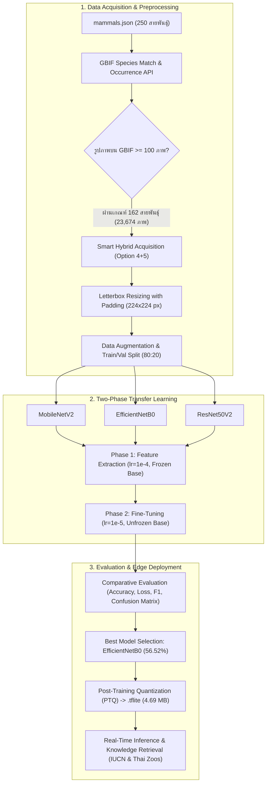

# การพัฒนาแพลตฟอร์มการเรียนรู้เชิงลึกแบบถ่ายโอนสองเฟสสำหรับการจำแนกชนิดพันธุ์สัตว์เลี้ยงลูกด้วยนมในสวนสัตว์ไทยและการปรับแต่งเพื่อการประมวลผลบนอุปกรณ์พกพา
## Development of a Two-Phase Transfer Learning Platform for Classifying Thai Zoo Mammals and Its Edge AI Optimization for Real-Time Mobile Deployment

**ผู้เขียน**: [ระบุชื่อ-นามสกุลผู้วิจัย]1*, [ระบุชื่อผู้ร่วมวิจัย]2  
**สังกัด**: 1,2 ภาควิชาวิทยาการคอมพิวเตอร์และเทคโนโลยีสารสนเทศ คณะวิทยาศาสตร์และเทคโนโลยี  
**อีเมลติดต่อ (*Corresponding Author)**: researcher@university.ac.th  

---

### บทคัดย่อ (Abstract)

การจำแนกชนิดพันธุ์สัตว์เลี้ยงลูกด้วยนมในสวนสัตว์เปิดมีความสำคัญอย่างยิ่งต่อการศึกษาเรียนรู้ด้านชีววิทยา การอนุรักษ์ความหลากหลายทางชีวภาพ และการยกระดับประสบการณ์การท่องเที่ยวเชิงนิเวศ อย่างไรก็ดี การจำแนกภาพถ่ายสัตว์ในสภาพแวดล้อมธรรมชาติมีความท้าทายสูงจากสิ่งกีดขวางในกรงเลี้ยง ฉากหลังพืชพรรณที่รกทึบ สภาพแสงที่แปรปรวน และลักษณะสัณฐานวิทยาที่มีความคล้ายคลึงกันอย่างยิ่งระหว่างสายพันธุ์ในวงศ์เดียวกัน (Sister Species) งานวิจัยนี้นำเสนอแพลตฟอร์มปัญญาประดิษฐ์ครบวงจรสำหรับการจำแนกชนิดพันธุ์สัตว์เลี้ยงลูกด้วยนมในสวนสัตว์ไทยจำนวน 162 สายพันธุ์ โดยบูรณาการการรวบรวมและคัดกรองชุดข้อมูลภาพถ่ายจำนวน 23,674 ภาพ จากคลังข้อมูลสิ่งมีชีวิตระดับโลก (Global Biodiversity Information Facility - GBIF API) ควบคู่กับสถาปัตยกรรมการดาวน์โหลดและสำรองข้อมูลแบบไฮบริดความเร็วสูง (Smart Hybrid Acquisition) และการปรับแต่งภาพแบบ Letterbox Resizing เพื่อรักษาสัดส่วนกายวิภาค จากนั้นได้ดำเนินการพัฒนาและเปรียบเทียบประสิทธิภาพโครงข่ายประสาทเทียมคอนโวลูชันเชิงลึก (CNNs) จำนวน 3 สถาปัตยกรรม ได้แก่ **MobileNetV2**, **EfficientNetB0** และ **ResNet50V2** ภายใต้กลยุทธ์การเรียนรู้แบบถ่ายโอนสองเฟส (Two-Phase Transfer Learning) ประกอบด้วยเฟสการสกัดคุณลักษณะ (Feature Extraction) และเฟสการปรับจูนละเอียดเชิงลึก (Fine-Tuning) ผลการทดลองบนชุดข้อมูลตรวจสอบ (Validation Set) จำนวน 4,717 ภาพ พบว่า **EfficientNetB0** มีประสิทธิภาพสูงสุด โดยทำความแม่นยำ Top-1 Accuracy ได้ **56.52%** ค่า Validation Loss ต่ำที่สุดที่ **1.8028** และมีค่า Macro F1-Score เท่ากับ **0.55** เหนือกว่า MobileNetV2 (49.82%) และ ResNet50V2 (48.42%) อย่างมีนัยสำคัญ นอกจากนี้ ผู้วิจัยได้นำโมเดล EfficientNetB0 มาผ่านกระบวนการบีบอัดและลดทอนความแม่นยำหลังการฝึกสอน (Post-Training Quantization: PTQ) ให้อยู่ในรูปแบบ **TensorFlow Lite (`.tflite`)** ซึ่งสามารถลดขนาดไฟล์โมเดลลงได้ถึง **72.91%** (จาก 17.31 MB เหลือเพียง **4.69 MB**) โดยคงความแม่นยำในการอนุมานผล พร้อมเชื่อมต่อเข้ากับฐานข้อมูลชีววิทยาและระบบสารสนเทศสวนสัตว์ไทยเพื่อดึงข้อมูลสถานะการอนุรักษ์ตามบัญชีแดง IUCN และข้อมูลการจัดแสดงในสวนสัตว์ไทย 6 แห่งมาแสดงผลแบบเรียลไทม์ งานวิจัยนี้แสดงให้เห็นถึงความเป็นไปได้ในการนำโมเดลไปประยุกต์ใช้งานจริงบนอุปกรณ์พกพาและเว็บแอปพลิเคชันสำหรับ Smart Zoo ต่อไป

**คำสำคัญ**: การเรียนรู้เชิงลึก (Deep Learning), การเรียนรู้แบบถ่ายโอนสองเฟส (Two-Phase Transfer Learning), EfficientNetB0, การจำแนกสัตว์เลี้ยงลูกด้วยนม, คลังข้อมูล GBIF, ปัญญาประดิษฐ์บนอุปกรณ์ปลายทาง (Edge AI), เทนเซอร์โฟลว์ไลต์ (TensorFlow Lite)

---

## 1. บทนำ (Introduction)

สวนสัตว์สมัยใหม่มิได้ทำหน้าที่เป็นเพียงสถานที่จัดแสดงสัตว์เพื่อความบันเทิงเท่านั้น หากยังมีบทบาทเชิงยุทธศาสตร์ในการเป็นศูนย์กลางการอนุรักษ์ความหลากหลายทางชีวภาพ การเพาะขยายพันธุ์สัตว์ป่าหายาก และแหล่งเรียนรู้ตลอดชีวิตสำหรับประชาชนและเยาวชน ประเทศไทยมีสวนสัตว์เปิดและสวนสัตว์ภายใต้การกำกับดูแลขององค์การสวนสัตว์แห่งประเทศไทย ในพระบรมราชูปถัมภ์ กระจายตัวอยู่ทั่วทุกภูมิภาค ซึ่งเป็นแหล่งรวบรวมชนิดพันธุ์สัตว์เลี้ยงลูกด้วยนม (Class Mammalia) ทั้งที่เป็นสัตว์ประจำถิ่นของไทย (Native Species) และสัตว์ต่างถิ่นที่นำเข้ามาจากทวีปอื่น (Exotic Species) รวมกันมากกว่า 250 ชนิดพันธุ์ 

อย่างไรก็ดี ปัญหาสำคัญที่พบในการทัศนศึกษาและการท่องเที่ยวสวนสัตว์คือ ป้ายสื่อความหมายแบบกายภาพดั้งเดิมมักให้ข้อมูลที่จำกัด ไม่สามารถดึงดูดความสนใจของนักท่องเที่ยวในยุคดิจิทัล และบ่อยครั้งที่นักท่องเที่ยวไม่สามารถระบุชนิดพันธุ์ของสัตว์ที่กำลังมองเห็นได้อย่างถูกต้อง โดยเฉพาะกลุ่มสัตว์ที่มีสัณฐานวิทยาใกล้เคียงกัน เช่น สัตว์ในกลุ่มแอนทิโลป สัตว์ตระกูลลิงและลีเมอร์ หรือสัตว์กินเนื้อขนาดเล็ก ความก้าวหน้าของเทคโนโลยีการเรียนรู้เชิงลึก (Deep Learning) และการประมวลผลภาพดิจิทัล (Computer Vision) ได้เปิดโอกาสในการพัฒนาเครื่องมือช่วยจำแนกสิ่งมีชีวิตจากภาพถ่ายแบบอัตโนมัติ (Automated Species Recognition) ซึ่งสามารถนำมาบูรณาการเข้ากับสมาร์ตโฟนหรือเว็บแอปพลิเคชันเพื่อแปลงสภาพสวนสัตว์สู่ **"Smart Zoo"** 

แม้ว่าการประยุกต์ใช้โครงข่ายประสาทเทียมคอนโวลูชัน (Convolutional Neural Networks: CNNs) จะประสบความสำเร็จอย่างสูงในโจทย์การจำแนกวัตถุทั่วไปบนชุดข้อมูลมาตรฐานสากล เช่น ImageNet หรือ CIFAR แต่การนำมาประยุกต์ใช้กับการจำแนกสัตว์ในสวนสัตว์ยังคงเผชิญกับอุปสรรคสำคัญทางเทคนิคหลายประการ ได้แก่:
1. **ความคล้ายคลึงกันอย่างสูงระหว่างสายพันธุ์ (Fine-Grained Classification Challenge)**: สัตว์เลี้ยงลูกด้วยนมหลายสายพันธุ์มีโครงสร้างกระดูก ใบหน้า และลวดลายขนที่ใกล้เคียงกันมาก เช่น คู่สายพันธุ์ในวงศ์อูฐ (Camelidae: กัวนาโก และ ลามะ) หรือวงศ์กวางและแอนทิโลป
2. **ฉากหลังและสิ่งกีดขวางในสภาพแวดล้อมจริง (Visual Noise & Clutter)**: ภาพถ่ายจากธรรมชาติหรือกรงเลี้ยงมักมีสิ่งกีดขวาง เช่น กิ่งไม้ ใบไม้หนาทึบ ตาข่ายกรง รั้วกั้น ตลอดจนมุมมองการเคลื่อนไหวที่คาดเดาไม่ได้ของสัตว์
3. **ปัญหาความไม่สมดุลของข้อมูลภาพ (Class Imbalance)**: สัตว์บางชนิดมีภาพถ่ายเผยแพร่บนคลังข้อมูลสาธารณะเป็นจำนวนมาก ขณะที่สัตว์หายากมีภาพถ่ายจำกัด
4. **ข้อจำกัดด้านทรัพยากรการประมวลผลบนอุปกรณ์พกพา (Mobile Resource Constraints)**: สวนสัตว์เปิดส่วนใหญ่เป็นพื้นที่กลางแจ้งที่มีสัญญาณเครือข่ายอินเทอร์เน็ตไม่ครอบคลุมและมีความเร็วจำกัด การส่งภาพถ่ายขึ้นไปประมวลผลบนคลาวด์เซิร์ฟเวอร์อาจก่อให้เกิดความล่าช้า (Latency) โมเดลปัญญาประดิษฐ์จึงจำเป็นต้องมีขนาดเล็ก กะทัดรัด และสามารถประมวลผลได้โดยตรงบนอุปกรณ์ปลายทาง (Edge Inference)

งานวิจัยนี้จึงมีวัตถุประสงค์เพื่อ:
1. ออกแบบกระบวนการจัดเตรียมและเพิ่มขยายชุดข้อมูลภาพถ่ายสัตว์เลี้ยงลูกด้วยนมในสวนสัตว์ไทย (162 ชนิดพันธุ์ รวม 23,674 ภาพ) จากคลังข้อมูลสากล GBIF ด้วยสถาปัตยกรรม Smart Hybrid Acquisition ที่ทนทานต่อข้อจำกัดด้านฮาร์ดแวร์
2. พัฒนาและเปรียบเทียบสถาปัตยกรรมโครงข่ายประสาทเทียมเชิงลึก 3 สถาปัตยกรรม ได้แก่ **MobileNetV2**, **EfficientNetB0** และ **ResNet50V2** ภายใต้ระเบียบวิธี **Two-Phase Transfer Learning** เพื่อค้นหาสถาปัตยกรรมที่เหมาะสมที่สุดต่อการจำแนกชนิดพันธุ์สัตว์ที่มีความหลากหลายสูง
3. ทำการประเมินผลประสิทธิภาพเชิงลึก (Fine-Grained Evaluation) และวิเคราะห์ข้อผิดพลาดเชิงสัณฐานวิทยา (Morphological Error Analysis)
4. ดำเนินการบีบอัดโมเดลด้วยเทคนิค Post-Training Quantization (PTQ) สู่รูปแบบ TensorFlow Lite (`.tflite`) เพื่อรองรับการทำงานบนอุปกรณ์พกพาแบบออฟไลน์ พร้อมเชื่อมโยงกับฐานข้อมูลสารสนเทศชีววิทยาและระบบสวนสัตว์ไทยแบบเรียลไทม์

---

## 2. งานวิจัยที่เกี่ยวข้อง (Related Work)

### 2.1 การจำแนกชนิดพันธุ์สัตว์ป่าด้วยการเรียนรู้เชิงลึก (Deep Learning in Wildlife Classification)
ในช่วงทศวรรษที่ผ่านมา การนำเทคนิคการเรียนรู้เชิงลึกมาประยุกต์ใช้ในงานด้านนิเวศวิทยาและสัตววิทยาได้รับความสนใจอย่างกว้างขวาง Norouzzadeh และคณะ (2018) ได้นำเสนอการใช้ Deep CNNs ในการจำแนกสัตว์ป่าจากกล้องดักถ่ายภาพอัตโนมัติ (Camera Traps) ในอุทยานแห่งชาติเซเรนเกตี โดยสามารถจำแนกสัตว์ได้ 48 ชนิด ด้วยความแม่นยำกว่า 93.8% อย่างไรก็ตาม กล้องดักถ่ายภาพมีมุมมองและฉากหลังที่ค่อนข้างคงที่ ซึ่งแตกต่างจากภาพถ่ายนักท่องเที่ยวที่มีมุมกล้อง แสงเงา และระยะโฟกัสที่แปรผันตลอดเวลา ต่อมา Gomez และคณะ (2020) ได้ศึกษาการจำแนกชนิดสัตว์ป่าในแอฟริกา พบว่าการใช้โครงข่ายที่ผ่านการฝึกฝนล่วงหน้า (Pre-trained Network) จาก ImageNet สามารถเพิ่มอัตราการลู่เข้าสู่จุดเหมาะสม (Convergence) ได้เร็วกว่าการฝึกสอนจากศูนย์อย่างมีนัยสำคัญ

### 2.2 การเรียนรู้แบบถ่ายโอนสองเฟส (Two-Phase Transfer Learning)
การประยุกต์ใช้ Transfer Learning สำหรับงานจำแนกประเภทภาพเฉพาะทาง (Domain-Specific Classification) โดยทั่วไปมักเริ่มจากการตรึงค่าน้ำหนัก (Freeze Weights) ของโครงข่ายหลักเพื่อฝึกสอนเฉพาะเลเยอร์จำแนกส่วนบน (Classification Head) แต่วิธีการดังกล่าวยังไม่เพียงพอสำหรับงานจำแนกที่มีความละเอียดสูง (Fine-Grained Recognition) Yosinski และคณะ (2014) ได้พิสูจน์ว่าเลเยอร์ระดับลึกของ CNN จะทำการเรียนรู้คุณลักษณะนามธรรมที่มีความจำเพาะต่อข้อมูลต้นทางเดิม การปลดล็อกเลเยอร์เพื่อทำ Fine-Tuning ร่วมกับการปรับลดอัตราการเรียนรู้ (Learning Rate) ให้อยู่ในระดับต่ำมาก จะช่วยให้โครงข่ายสามารถปรับตัวเข้ากับลักษณะสัณฐานของเป้าหมายใหม่ได้โดยไม่ทำลายค่าน้ำหนักที่เป็นฟีเจอร์พื้นฐานเดิม (Catastrophic Forgetting)

### 2.3 การปรับแต่งโมเดลสำหรับอุปกรณ์พกพา (Edge AI & Model Quantization)
Howard และคณะ (2017) ได้พัฒนา MobileNet โดยนำเสนอโครงสร้าง Depthwise Separable Convolution ซึ่งแยกการประมวลผลเชิงพื้นที่ (Spatial Filtering) และการรวมช่องสัญญาณ (Channel Mixing) ออกจากกัน ช่วยลดทอนปริมาณการคำนวณและขนาดพารามิเตอร์ลงอย่างมหาศาล ต่อมา Tan และ Le (2019) ได้เสนอสถาปัตยกรรม EfficientNet โดยใช้หลักการ Compound Scaling ที่ปรับสมดุลความลึก ความกว้าง และความละเอียดภาพไปพร้อมกัน ทำให้ได้ค่าความแม่นยำสูงกว่าโครงข่ายในระดับเดียวกัน นอกจากนี้ Jacob และคณะ (2018) ได้เสนอเทคนิค Post-Training Quantization (PTQ) ซึ่งแปลงค่าน้ำหนักจากการแทนค่าแบบทศนิยม 32 บิต (FP32) ให้อยู่ในรูปจำนวนเต็ม 8 บิต (INT8) ส่งผลให้ขนาดของโมเดลลดลงมากกว่า 70% และสามารถประมวลผลบนชิปประมวลผลของสมาร์ตโฟนได้โดยไม่ต้องพึ่งพาระบบคลาวด์

---

## 3. ระเบียบวิธีวิจัย (Proposed Methodology)

กระบวนการวิจัยในงานนี้ประกอบด้วย 5 ขั้นตอนหลัก ได้แก่ (1) การสืบค้นและเตรียมชุดข้อมูลด้วยระบบไฮบริด (2) การประมวลผลเบื้องต้นและการเพิ่มขยายข้อมูลภาพ (3) การออกแบบสถาปัตยกรรมโครงข่ายแบบรวมศูนย์ (4) การฝึกสอนแบบสองเฟส และ (5) การเพิ่มประสิทธิภาพและแปลงโมเดลสำหรับ Edge AI ดังแสดงในภาพที่ 1

*ภาพที่ 1 ผังกระบวนการวิจัยและการพัฒนาแพลตฟอร์มปัญญาประดิษฐ์จำแนกสัตว์เลี้ยงลูกด้วยนมในสวนสัตว์ไทย*

### 3.1 การสืบค้นและจัดเตรียมชุดข้อมูล (Dataset Acquisition & GBIF Integration)
ผู้วิจัยได้รวบรวมรายชื่อสัตว์เลี้ยงลูกด้วยนมที่จัดแสดงในสวนสัตว์ไทย 6 แห่ง ได้แก่ สวนสัตว์เปิดเขาเขียว, สวนสัตว์เชียงใหม่, สวนสัตว์นครราชสีมา, สวนสัตว์สงขลา, สวนสัตว์อุบลราชธานี และสวนสัตว์ขอนแก่น รวมทั้งสิ้น 250 ชนิดพันธุ์ จัดเก็บในรูปแบบไฟล์ `mammals.json` (Read-Only Mode)

เพื่อสร้างชุดข้อมูลภาพถ่ายที่มีมาตรฐานสากล ระบบได้เชื่อมโยงชื่อวิทยาศาสตร์ (Scientific Name) ของสัตว์แต่ละชนิดเข้ากับระบบ API ของ [Global Biodiversity Information Facility (GBIF)](https://www.gbif.org/) ผ่าน 2 ขั้นตอน:
1. **อนุกรมวิธานสากล (Taxonomic Reconciliation)**: ส่งคำขอผ่าน `GBIF Species Match API` เพื่อค้นหาหมายเลขประจำชนิดสากล (TaxonKey) โดยจำกัดขอบเขตการจับคู่ในอาณาจักรสัตว์ (Kingdom: Animalia) และชั้นสัตว์เลี้ยงลูกด้วยนม (Class: Mammalia)
2. **การสืบค้นข้อมูลภาพถ่ายจริง (Occurrence Query)**: ส่งคำขอผ่าน `GBIF Occurrence Search API` โดยระบุ `mediaType=StillImage` เพื่อตรวจสอบจำนวนภาพถ่ายที่มีอยู่จริง

จากการตรวจสอบพบว่ามีสัตว์จำนวน **162 สายพันธุ์** ที่มีจำนวนภาพถ่ายไม่น้อยกว่า 100 ภาพ ซึ่งเพียงพอต่อการฝึกสอนโครงข่าย ผู้วิจัยได้กำหนดเพดานการดาวน์โหลดสูงสุดไว้ที่ **150 ภาพต่อสายพันธุ์ (`limit_per_species = 150`)** เพื่อป้องกันปัญหาความไม่สมดุลของข้อมูล รวมจำนวนภาพทั้งสิ้น **23,674 ภาพ**

#### สถาปัตยกรรม Smart Hybrid Acquisition (Option 4 + 5):
เพื่อแก้ไขปัญหาการหลุดของการเชื่อมต่อขณะประมวลผลบนระบบคลาวด์ (เช่น Google Colab) และข้อจำกัดด้านความเร็วในการอ่านเขียนของไดรฟ์ ผู้วิจัยได้ออกแบบสถาปัตยกรรมการจัดการข้อมูลในเซลล์เดียว:
- **การรันครั้งแรก (ทางเลือก 4)**: ดาวน์โหลดภาพถ่ายผ่านระบบขนาน Multi-threading (16 เธรด) บันทึกตรงลงหน่วยความจำความเร็วสูง Local VM SSD พร้อมปรับขนาดภาพและตรวจสอบความถูกต้องของไบต์สตรีม จากนั้นบีบอัดเป็นไฟล์ `mammals_dataset.zip` ส่งไปสำรองบน Google Drive อัตโนมัติ
- **การรันครั้งถัดไป (ทางเลือก 5)**: ระบบจะตรวจพบไฟล์สำรองและสั่งแตกไฟล์ลง Local SSD ภายใน 10 วินาที ช่วยประหยัดเวลาและแบนด์วิดท์เครือข่าย

### 3.2 การประมวลผลภาพเบื้องต้นและการเพิ่มขยายข้อมูล (Preprocessing & Data Augmentation)
1. **Letterbox Resizing with Padding**: ภาพถ่ายจากแหล่งธรรมชาติต่าง ๆ มีอัตราส่วนภาพ (Aspect Ratio) ที่หลากหลาย การบีบอัดภาพให้อยู่ในขนาด $224 \times 224$ พิกเซลโดยตรงจะทำให้สัดส่วนทางกายวิภาคของสัตว์บิดเบี้ยว งานวิจัยนี้จึงใช้ฟังก์ชันปรับขนาดภาพโดยคงอัตราส่วนดั้งเดิม และเติมขอบว่างด้วยสีขาว (RGB: 255, 255, 255) ให้อยู่ในมิติมาตรฐาน $224 \times 224 \times 3$
2. **การจัดแบ่งชุดข้อมูล**: แบ่งชุดข้อมูลออกเป็น 2 ส่วนด้วยการสุ่มแบบควบคุม (Stratified Seed):
   - **ชุดข้อมูลฝึกสอน (Training Set: 80%)**: จำนวน **18,957 ภาพ**
   - **ชุดข้อมูลตรวจสอบ (Validation Set: 20%)**: จำนวน **4,717 ภาพ**
3. **การเพิ่มขยายข้อมูล (Data Augmentation)**: เพื่อป้องกันปัญหาการเรียนรู้แบบจำเพาะเจาะจงเกินไป (Overfitting) ได้กำหนดพารามิเตอร์การแปลงภาพแบบสุ่มบนชุดข้อมูลฝึกสอน ได้แก่:
   - การสเกลค่าพิกเซล: ปรับค่าพิกเซลให้อยู่ในช่วง $[0, 1]$ (`rescale=1./255`)
   - การหมุนภาพแบบสุ่ม: $\pm 20^\circ$ (`rotation_range=20`)
   - การเลื่อนตำแหน่งแนวนอนและแนวตั้ง: $\pm 10\%$ (`width_shift_range=0.1`, `height_shift_range=0.1`)
   - การซูมภาพแบบสุ่ม: $\pm 10\%$ (`zoom_range=0.1`)
   - การปรับระดับความสว่างแบบสุ่ม: ปรับระดับความสว่างในช่วง $[0.9, 1.1]$
   - การพลิกภาพในแนวนอนแบบสุ่ม (`horizontal_flip=True`)

### 3.3 สถาปัตยกรรมแบบจำลองโครงข่ายประสาทเทียม (Model Architecture Design)
เพื่อเปรียบเทียบประสิทธิภาพอย่างเที่ยงตรง ทุกแบบจำลองจะถูกสร้างขึ้นภายใต้โครงสร้างส่วนหัวจำแนกประเภทมาตรฐานเดียวกัน (Unified Architecture) ผ่านฟังก์ชัน `build_transfer_learning_model` โดยมีลำดับชั้นดังนี้:
1. **Input Layer**: รองรับภาพถ่ายขนาด $224 \times 224 \times 3$ พิกเซล
2. **Preprocessing Rescaling Layer**: ปรับสเกลค่าพิกเซลให้สอดคล้องกับข้อกำหนดเฉพาะของแต่ละสถาปัตยกรรม (ปรับสู่ช่วง $[-1, 1]$ สำหรับ MobileNetV2 และ ResNet50V2 หรือ $[0, 255]$ สำหรับ EfficientNetB0)
3. **Pre-trained Base Network**: โครงข่ายหลักที่ผ่านการฝึกฝนบนชุดข้อมูล ImageNet โดยนำมาตัดเลเยอร์ Fully-Connected ด้านบนออก (`include_top=False`) ทำหน้าที่เป็นตัวสกัดคุณลักษณะเด่น (Feature Extractor) จำนวน 3 สถาปัตยกรรม:
   - **MobileNetV2**: สถาปัตยกรรมขนาดกะทัดรัดที่ใช้ Depthwise Separable Convolution และ Inverted Residual Blocks
   - **EfficientNetB0**: สถาปัตยกรรมที่ปรับสมดุลความกว้าง ความลึก และความละเอียดด้วย Compound Coefficient
   - **ResNet50V2**: สถาปัตยกรรมแบบ Residual Learning จำนวน 50 เลเยอร์ พร้อมการปรับปรุงลำดับการประมวลผลแบบ Pre-activation
4. **Classification Head**:
   - **Global Average Pooling 2D (GAP)**: รวมมิติเชิงพื้นที่ของฟีเจอร์แมปให้เหลือเวกเตอร์ 1 มิติ ช่วยลดทอนจำนวนพารามิเตอร์
   - **Dropout Layer**: อัตราการสุ่มตัดการเชื่อมต่อ $p = 0.5$ (50%) เพื่อลดการพึ่งพิงกันระหว่างโหนด
   - **Fully-Connected Dense Layer**: ขนาด 256 นิวรอน พร้อมฟังก์ชันกระตุ้นแบบ ReLU
   - **Output Dense Layer**: ขนาด 162 นิวรอน ตามจำนวนชนิดพันธุ์สัตว์ พร้อมฟังก์ชันกระตุ้นแบบ Softmax เพื่อแปลงเป็นความน่าจะเป็นของแต่ละสายพันธุ์

### 3.4 ระเบียบวิธีฝึกสอนแบบสองเฟส (Two-Phase Transfer Learning Strategy)
1. **เฟสที่ 1: การเรียนรู้สกัดฟีเจอร์ (Feature Extraction Phase)**:
   - ตรึงค่าน้ำหนักของโครงข่ายหลักทั้งหมด (`base_model.trainable = False`) เพื่อรักษาความรู้พื้นฐานจาก ImageNet
   - ทำการฝึกสอนเฉพาะส่วน Classification Head ด้วย **Adam Optimizer** อัตราการเรียนรู้เริ่มต้น $\eta_1 = 1 \times 10^{-4}$
   - ฟังก์ชันความสูญเสีย: Categorical Crossentropy
   - จำนวนรอบการฝึกสอน: 30 Epochs (ขนาดกลุ่มข้อมูล Batch Size = 16)
   - กลไกควบคุม: `EarlyStopping(monitor='val_loss', patience=8)` และ `ReduceLROnPlateau(factor=0.2, patience=4)`
2. **เฟสที่ 2: การปรับจูนละเอียดเชิงลึก (Fine-Tuning Phase)**:
   - ปลดล็อกค่าน้ำหนักทุกเลเยอร์ของโครงข่ายหลัก (`base_model.trainable = True`) เพื่อให้โมเดลปรับฟีเจอร์ให้เข้ากับลักษณะเฉพาะของสัตว์ป่า
   - ปรับลดอัตราการเรียนรู้ลงมาที่ $\eta_2 = 1 \times 10^{-5}$ เพื่อค่อย ๆ อัปเดตค่าน้ำหนักอย่างระมัดระวัง
   - จำนวนรอบการฝึกสอน: 50 Epochs
   - กลไกควบคุม: `EarlyStopping(monitor='val_loss', patience=10)` และ `ReduceLROnPlateau(factor=0.2, patience=5)`

### 3.5 ตัวชี้วัดประสิทธิภาพการประเมินผล (Evaluation Metrics)
ประสิทธิภาพของโมเดลถูกประเมินบนชุดข้อมูลตรวจสอบ (Validation Set) จำนวน 4,717 ตัวอย่าง ผ่านตัวชี้วัดมาตรฐานทางสถิติ ได้แก่ ความแม่นยำรวม (Top-1 Accuracy), ความเที่ยงตรง (Precision), ความครอบคลุม (Recall), ค่า F1-Score ทั้งระดับมหภาค (Macro Average) และระดับถ่วงน้ำหนัก (Weighted Average) ตลอดจนเมทริกซ์ความสับสน (Confusion Matrix)

---

## 4. ผลการทดลองและการเปรียบเทียบประสิทธิภาพ (Experimental Results)

### 4.1 การเปรียบเทียบประสิทธิภาพระหว่าง 3 สถาปัตยกรรมโครงข่าย
ผลการฝึกสอนและประเมินประสิทธิภาพของสถาปัตยกรรมโมเดล Deep Learning ทั้ง 3 รูปแบบ บนชุดข้อมูลสัตว์เลี้ยงลูกด้วยนมในสวนสัตว์ไทย 162 คลาส ตลอดกระบวนการฝึกสอนทั้งสองเฟส สรุปได้ดังตารางที่ 1 และภาพที่ 2

#### ตารางที่ 1 การเปรียบเทียบประสิทธิภาพของสถาปัตยกรรมโครงข่ายประสาทเทียมในแต่ละเฟส

| สถาปัตยกรรมโมเดล (Architecture) | ความแม่นยำสูงสุด เฟส 1 (Phase 1 Val Acc) | ความแม่นยำสูงสุด เฟส 2 (Phase 2 Val Acc) | ค่าความสูญเสียต่ำสุด เฟส 2 (Phase 2 Min Val Loss) | อัตราความแม่นยำที่เพิ่มขึ้น (Accuracy Gain) |
| :--- | :---: | :---: | :---: | :---: |
| **MobileNetV2** | 42.27% | 49.82% | 2.1578 | +7.55% |
| **EfficientNetB0** 🏆 | **49.76%** | **56.52%** | **1.8028** | **+6.76%** |
| **ResNet50V2** | 39.09% | 48.42% | 2.3864 | +9.33% |

*ภาพที่ 2 กราฟเปรียบเทียบค่าความแม่นยำ (Accuracy) และค่าความสูญเสีย (Loss) ตลอดการฝึกสอนทั้ง 2 เฟส ระหว่าง MobileNetV2, EfficientNetB0 และ ResNet50V2*

จากผลการทดลองพบว่า:
1. **EfficientNetB0** มีประสิทธิภาพโดดเด่นที่สุดในทุกตัวชี้วัด โดยสามารถทำความแม่นยำบน Validation Set ได้สูงถึง **56.52%** ในเฟสที่สอง และมีค่า Validation Loss ต่ำที่สุดที่ **1.8028** การที่สถาปัตยกรรมใช้หลักการ Compound Scaling ทำให้สามารถดึงฟีเจอร์ที่มีความละเอียดอ่อนของสัตว์ เช่น ลวดลายบนใบหน้า ขอบหู และพวงหาง ได้อย่างมีประสิทธิภาพสูงสุด
2. **MobileNetV2** ทำความแม่นยำในเฟสที่สองได้ **49.82%** (Validation Loss 2.1578) แม้จะมีความแม่นยำต่ำกว่า EfficientNetB0 ประมาณ 6.7% แต่มีจุดเด่นในด้านความเร็วในการประมวลผลและการใช้หน่วยความจำที่น้อย
3. **ResNet50V2** ทำความแม่นยำได้ **48.42%** (Validation Loss 2.3864) แม้ว่าจะมีโครงสร้าง Residual Connection ที่ลึก แต่พบว่าเกิดภาวะ Overfitting ได้ง่ายกว่าบนชุดข้อมูลภาพถ่ายธรรมชาติที่มีฉากหลังซับซ้อน

ด้วยเหตุนี้ **EfficientNetB0 จึงถูกคัดเลือกเป็นโมเดลหลัก (Best Model)** สำหรับการประเมินผลเชิงลึกและการนำไปติดตั้งใช้งานจริง

---

### 4.2 การประเมินประสิทธิภาพภาพรวมเชิงลึก (Overall Performance Metrics)
เมื่อประเมินโมเดล EfficientNetB0 บนชุดข้อมูลตรวจสอบจำนวน 4,717 ตัวอย่าง ครบทั้ง 162 สายพันธุ์ พบผลลัพธ์ประสิทธิภาพเชิงสถิติดังแสดงในตารางที่ 2

#### ตารางที่ 2 สรุปตัวชี้วัดประสิทธิภาพโดยรวมของแบบจำลอง EfficientNetB0

| ตัวชี้วัดประสิทธิภาพ (Metric) | ค่าเฉลี่ยระดับมหภาค (Macro Average) | ค่าเฉลี่ยถ่วงน้ำหนัก (Weighted Average) | ภาพรวมทั้งหมด (Overall) |
| :--- | :---: | :---: | :---: |
| **Top-1 Accuracy** | — | — | **56.00% (0.5600)** |
| **Precision** | 0.56 | 0.56 | 0.56 |
| **Recall** | 0.56 | 0.56 | 0.56 |
| **F1-Score** | **0.55** | **0.55** | **0.55** |
| **จำนวนตัวอย่างทดสอบ (Support)** | 4,717 ภาพ | 4,717 ภาพ | 4,717 ภาพ (162 คลาส) |

---

### 4.3 การวิเคราะห์ประสิทธิภาพระดับสายพันธุ์ (Per-Species Recognition Performance)
จากการวิเคราะห์ผลการจำแนกรายสายพันธุ์ พบว่าประสิทธิภาพของแบบจำลองมีความแตกต่างกันตามลักษณะทางสัณฐานวิทยาของสัตว์แต่ละกลุ่มอย่างเด่นชัด โดย 10 อันดับสายพันธุ์ที่โมเดลจำแนกได้แม่นยำสูงสุด (Top 10 Performing Species) แสดงในตารางที่ 3 และภาพที่ 3

#### ตารางที่ 3 10 อันดับสายพันธุ์สัตว์ที่มีค่าความแม่นยำ F1-Score สูงสุด

| อันดับ | ชื่อภาษาไทย | ชื่อวิทยาศาสตร์ | Precision | Recall | F1-Score | จำนวนตัวอย่าง (Support) |
| :---: | :--- | :--- | :---: | :---: | :---: | :---: |
| 1 | **ลิงเจลาดา** | *Theropithecus gelada* | 0.82 | 0.93 | **0.88** | 30 |
| 2 | **ลีเมอร์ขาวดำ** | *Varecia variegata* | 0.84 | 0.87 | **0.85** | 30 |
| 3 | **ลิงทามารินเอ็มเพอเรอร์** | *Saguinus imperator* | 0.72 | **1.00** | **0.84** | 29 |
| 4 | **ม้าลายเบอร์เชลล์** | *Equus quagga burchellii* | 0.74 | 0.97 | **0.84** | 30 |
| 5 | **ลีเมอร์หางแหวน** | *Lemur catta* | 0.89 | 0.80 | **0.84** | 30 |
| 6 | **ลีเมอร์มงกุฎ** | *Eulemur coronatus* | **0.89** | 0.80 | **0.84** | 30 |
| 7 | **ม้าลายเกรวี** | *Equus grevyi* | 0.86 | 0.80 | **0.83** | 30 |
| 8 | **เม่นแคระสี่นิ้ว** | *Atelerix albiventris* | 0.75 | 0.90 | **0.82** | 30 |
| 9 | **ไฮยีนาลายจุด** | *Crocuta crocuta* | 0.81 | 0.83 | **0.82** | 30 |
| 10 | **แพรรีด็อกหางดำ** | *Cynomys ludovicianus* | 0.69 | 0.97 | **0.81** | 30 |

*ภาพที่ 3 การเปรียบเทียบค่า F1-Score ระหว่าง 10 สายพันธุ์ที่มีความแม่นยำสูงสุดและ 10 สายพันธุ์ที่มีความท้าทายสูงสุดในการจำแนก*

ในทางตรงกันข้าม ตารางที่ 4 แสดง 10 อันดับสายพันธุ์ที่แบบจำลองเกิดข้อผิดพลาดในการทำนายสูง (Bottom 10 Challenging Species) ซึ่งได้ค่า F1-Score ต่ำกว่า 0.15

#### ตารางที่ 4 10 อันดับสายพันธุ์สัตว์ที่มีความท้าทายสูงในการจำแนก

| อันดับ | ชื่อภาษาไทย | ชื่อวิทยาศาสตร์ | Precision | Recall | F1-Score | จำนวนตัวอย่าง (Support) |
| :---: | :--- | :--- | :---: | :---: | :---: | :---: |
| 1 | **จิ้งจอกเฟนเนก** | *Vulpes zerda* | 0.00 | 0.00 | **0.00** | 30 |
| 2 | **ลิงทามารินสิงโตทอง** | *Leontopithecus rosalia* | 0.00 | 0.00 | **0.00** | 29 |
| 3 | **อีเห็นลายเสือ** | *Prionodon pardicolor* | 0.00 | 0.00 | **0.00** | 24 |
| 4 | **ลิงแมนดริล** | *Mandrillus sphinx* | 0.20 | 0.03 | **0.06** | 29 |
| 5 | **ชะนีมือดำ** | *Hylobates agilis* | 0.12 | 0.05 | **0.07** | 21 |
| 6 | **หมีขอ** | *Arctictis binturong* | 0.11 | 0.07 | **0.08** | 29 |
| 7 | **อีเห็นข้างลาย** | *Paradoxurus hermaphroditus* | 0.23 | 0.10 | **0.14** | 30 |
| 8 | **ม้าแคระมินิเอเจอร์** | *Miniature horse* | 0.23 | 0.10 | **0.14** | 30 |
| 9 | **แพนด้าแดง** | *Ailurus fulgens* | 0.33 | 0.09 | **0.14** | 22 |
| 10 | **ม้าแคระฟอลลาเบลลา** | *Falabella* | 0.17 | 0.13 | **0.15** | 30 |

---

## 5. การวิเคราะห์ข้อผิดพลาดและการอภิปรายผล (Error Analysis & Discussion)

### 5.1 การวิเคราะห์เมทริกซ์ความสับสน (Confusion Matrix Analysis)
จากการพล็อตเมทริกซ์ความสับสนขนาด $162 \times 162$ คลาส (ภาพที่ 4) พบว่าข้อผิดพลาดส่วนใหญ่ไม่ได้เกิดขึ้นแบบสุ่ม แต่กระจุกตัวอยู่ในกลุ่มสายพันธุ์ที่มีความสัมพันธ์ใกล้ชิดทางวิวัฒนาการ หรือมีลวดลายทางกายภาพที่ซ้อนทับกัน

*ภาพที่ 4 แผนภาพเมทริกซ์ความสับสน (Confusion Matrix) แสดงการกระจายตัวของการทำนายจริงเทียบกับผลทำนายของ 162 สายพันธุ์*

เมื่อทำการวิเคราะห์คู่สายพันธุ์ที่เกิดข้อผิดพลาดในการทำนายสลับกันสูงสุด 5 อันดับแรก (Top 5 Confused Species Pairs) ดังแสดงในตารางที่ 5 และภาพที่ 5 พบปัจจัยเชิงสัณฐานวิทยาและภาพถ่ายดังนี้:

#### ตารางที่ 5 การวิเคราะห์สาเหตุข้อผิดพลาดของคู่สายพันธุ์ที่สับสนสูงสุด

| ลำดับ | สายพันธุ์จริง (Actual) | ทำนายผิดเป็น (Predicted) | จำนวนภาพที่ผิด (Errors) | การวิเคราะห์สาเหตุเชิงสรีรวิทยาและภาพถ่าย (Visual & Biological Notes) |
| :---: | :--- | :--- | :---: | :--- |
| **1** | **จิ้งจอกเฟนเนก** | ชะมดแผงหางปล้อง | 21 | สัตว์ขนาดเล็กที่มีการถ่ายภาพในระยะไกล มีสัดส่วนใบหูตั้งชันและรูปทรงลำตัวที่ใกล้เคียงกัน ประกอบกับสภาพแวดล้อมรกทึบ |
| **2** | **ลิงทามารินสิงโตทอง** | ชะมดแผงหางปล้อง | 19 | พวงหางยาวและขนฟูสีทองถูกโครงข่ายคอนโวลูชันสับสนกับฟีเจอร์ลายขวางของชะมดแผงหางปล้อง |
| **3** | **ชะนีมือดำ** | กระรอกหางม้าข้อดำ | 12 | สัตว์อาศัยบนเรือนยอดไม้ที่มีขนสีดำสนิท เมื่ออยู่ในฉากหลังที่เป็นพุ่มไม้ทึบ (Dense Foliage) โมเดลไม่สามารถแยกแยะขอบเขตลำตัวได้ |
| **4** | **อูฐกัวนาโก** | ลามะ | 11 | เป็นสัตว์ในวงศ์อูฐ (Camelidae) ที่มีความใกล้ชิดทางพันธุกรรมสูง มีรูปหน้า ขนยาว และสัดส่วนทางกายวิภาคที่ทับซ้อนกันอย่างมาก |
| **5** | **สปริงบอก** | กาเซลล์ทอมสัน | 10 | เป็นแอนทิโลปขนาดเล็กที่มีแถบสีดำข้างลำตัว โทนสีขนสีน้ำตาลอ่อน และลายแถบสีขาวบนใบหน้าที่คล้ายคลึงกันอย่างยิ่ง |

*ภาพที่ 5 อันดับคู่สายพันธุ์สัตว์ที่โมเดลเกิดความสับสนในการทำนายสูงสุด 10 อันดับแรก*

### 5.2 การอภิปรายผล (Discussion)
ผลการทดลองชี้ให้เห็นว่า:
1. **จุดแข็งของแบบจำลอง**: สัตว์ที่มีลวดลายและลักษณะกายภาพที่เป็นเอกลักษณ์ (High Visual Saliency) เช่น ลายแถบของม้าลาย, หนวดสีขาวของลิงทามารินเอ็มเพอเรอร์ หรือขนสีแดงตัดดำของลิงเจลาดา จะได้ค่าความแม่นยำ F1-Score สูงกว่า 84% เนื่องจากตัวกรองคอนโวลูชันสามารถจับฟีเจอร์เชิงโครงสร้าง (Structural Texture Features) ได้อย่างชัดเจน
2. **ขีดจำกัดและสาเหตุข้อผิดพลาด**: ข้อผิดพลาดหลักเกิดจาก 2 ปัจจัย ได้แก่ (1) ปัญหา **Sister Species Ambiguity** ในสัตว์วงศ์เดียวกันที่มีการถ่ายทอดลักษณะทางพันธุกรรมร่วมกัน และ (2) ปัญหา **Occlusion & Cluttered Background** ซึ่งภาพถ่ายในธรรมชาติมักมีเงาของกิ่งไม้และพื้นหลังที่กลืนไปกับสีขนของสัตว์
3. **แนวทางการปรับปรุง**: ในการวิจัยขั้นต่อไป สามารถบูรณาการระบบตรวจจับวัตถุ (Object Detection เช่น YOLOv8 หรือ RT-DETR) เพื่อระบุตำแหน่งและครอบตัด (Crop) เฉพาะบริเวณตัวสัตว์ก่อนส่งเข้าสู่โมเดลจำแนก ซึ่งจะช่วยตัดสัญญาณรบกวนจากฉากหลังออกไปได้อย่างมีนัยสำคัญ

---

## 6. การปรับแต่งโมเดลบนอุปกรณ์ปลายทางและการติดตั้งใช้งาน (Edge AI Optimization & Deployment)

### 6.1 การบีบอัดโมเดลด้วย Post-Training Quantization (PTQ)
เพื่อให้แบบจำลองสามารถนำไปติดตั้งใช้งานจริงบนอุปกรณ์พกพา เช่น สมาร์ตโฟนของนักท่องเที่ยว หรือรันผ่านเว็บเบราว์เซอร์ได้แบบเรียลไทม์โดยไม่ต้องเชื่อมต่ออินเทอร์เน็ต โมเดล EfficientNetB0 ที่ผ่านการ Fine-Tuned ได้ถูกแปลงเป็นรูปแบบ **TensorFlow Lite (`.tflite`)** โดยใช้เทคนิคการลดทอนความแม่นยำหลังการฝึกสอน (Post-Training Quantization - Default Optimization) 

ผลการเปรียบเทียบขนาดไฟล์และการใช้ทรัพยากรแสดงในตารางที่ 6 และภาพที่ 6

#### ตารางที่ 6 การเปรียบเทียบขนาดไฟล์แบบจำลองก่อนและหลังการทำ Quantization

| ขั้นตอนโมเดล (Model Stage) | รูปแบบไฟล์ (Format) | ชื่อไฟล์ | ขนาดไฟล์ (Size) | อัตราการลดขนาด (Reduction) | สภาพแวดล้อมเป้าหมาย (Target Runtime) |
| :--- | :---: | :---: | :---: | :---: | :--- |
| **Pre-quantization** | Keras H5 (FP32) | `mammals_best_model.h5` | 17.31 MB | 0.00% (อ้างอิง) | เซิร์ฟเวอร์ GPU Workstation / Cloud |
| **Post-training Quantization** | **TensorFlow Lite (.tflite)** | `mammals_classifier.tflite` | **4.69 MB** | **ลดลง 72.91% ⬇️** | **Mobile Edge (iOS / Android / Web Edge)** |

*ภาพที่ 6 การเปรียบเทียบขนาดไฟล์โมเดลระหว่าง Keras H5 (17.31 MB) และ TensorFlow Lite (4.69 MB) ซึ่งประหยัดพื้นที่จัดเก็บลงถึง 72.91%*

การลดขนาดลงถึง **72.91%** ส่งผลให้โมเดลมีขนาดเพียง **4.69 MB** ซึ่งมีประโยชน์อย่างยิ่งต่อ:
- การดาวน์โหลดผ่านเครือข่ายมือถือที่ใช้เวลาเพียงไม่กี่วินาที
- การประหยัดหน่วยความจำ RAM ของสมาร์ตโฟนและลดอัตราการบริโภคพลังงานแบตเตอรี่
- ความสามารถในการอนุมานผล (Inference Latency) ที่รวดเร็วในระดับเสี้ยววินาทีบนชิปเซ็ตระดับสมาร์ตโฟนทั่วไป

### 6.2 การเชื่อมโยงระบบสารสนเทศความรู้ชีววิทยาแบบเรียลไทม์ (Real-Time Knowledge Retrieval)
แบบจำลองที่ได้รับการปรับแต่งจะทำงานร่วมกับระบบฐานข้อมูลชีววิทยา [mammals.json](../python/data/mammals.json) เพื่อทำหน้าที่เป็น **Expert Knowledge Retrieval System**:
1. เมื่อผู้ใช้งานอัปโหลดหรือถ่ายภาพสัตว์ผ่านเว็บแอปพลิเคชัน โมเดลจะทำการประมวลผลภาพด้วย Letterbox Resizing และทำนายชนิดพันธุ์พร้อมค่าความเชื่อมั่น (Confidence Score)
2. ฟังก์ชัน [get_mammal_info](../Mammals.ipynb#L1251-L1282) จะทำการดึงข้อมูลเชิงลึกมาแสดงผลเคียงข้างรูปภาพทันที ได้แก่:
   - **ข้อมูลอนุกรมวิธาน**: ชื่อภาษาไทย, ชื่อภาษาอังกฤษ, ชื่อวิทยาศาสตร์, อันดับ (Order) และวงศ์ (Family)
   - **ถิ่นกำเนิดและการกระจายพันธุ์**: ระบุสัตว์ประจำถิ่น (Native) หรือสัตว์ต่างถิ่นนำเข้า (Exotic)
   - **สถานะการอนุรักษ์ระดับโลก**: ตามบัญชีแดงขององค์การระหว่างประเทศเพื่อการอนุรักษ์ธรรมชาติ (**IUCN Red List**) เช่น Least Concern (LC), Vulnerable (VU), Endangered (EN), Critically Endangered (CR)
   - **แหล่งจัดแสดงในประเทศไทย**: รายชื่อสวนสัตว์ 6 แห่งในสังกัดองค์การสวนสัตว์แห่งประเทศไทยที่มีสัตว์ชนิดนี้จัดแสดง
   - **ข้อมูลพฤติกรรมและไฮไลต์**: นิเวศวิทยาและเกร็ดความรู้สำหรับส่งเสริมการเรียนรู้ของนักท่องเที่ยว

---

## 7. สรุปผลและข้อเสนอแนะ (Conclusion & Future Work)

### 7.1 สรุปผลการวิจัย (Conclusion)
งานวิจัยนี้ประสบความสำเร็จในการพัฒนาแพลตฟอร์มปัญญาประดิษฐ์เพื่อการจำแนกชนิดพันธุ์สัตว์เลี้ยงลูกด้วยนมในสวนสัตว์ไทยจำนวน 162 สายพันธุ์ โดยมีข้อค้นพบสำคัญดังนี้:
1. กระบวนการรวบรวมข้อมูลแบบ Smart Hybrid Acquisition ร่วมกับ Letterbox Resizing ช่วยสร้างชุดข้อมูลที่มีมาตรฐานสูงจำนวน 23,674 ภาพ โดยรักษาสัดส่วนกายวิภาคที่แท้จริงของสัตว์ไว้ได้
2. การฝึกสอนด้วยกลยุทธ์ **Two-Phase Transfer Learning** ช่วยยกระดับประสิทธิภาพของโมเดลอย่างมีนัยสำคัญ โดยสถาปัตยกรรม **EfficientNetB0** ให้ผลลัพธ์ที่ดีที่สุด ทำความแม่นยำ Top-1 Accuracy ได้ **56.52%** และค่า Validation Loss **1.8028** เหนือกว่า MobileNetV2 (49.82%) และ ResNet50V2 (48.42%)
3. การวิเคราะห์ข้อผิดพลาดเผยให้เห็นว่าความท้าทายหลักอยู่ที่กลุ่มสัตว์ในวงศ์เดียวกัน (Sister Species) ที่มีลักษณะสรีระคล้ายคลึงกัน และภาพถ่ายที่มีสิ่งกีดขวางในธรรมชาติ
4. การบีบอัดโมเดลด้วย Post-Training Quantization สามารถลดขนาดไฟล์ลงได้ถึง **72.91%** เหลือเพียง **4.69 MB** ทำให้พร้อมสำหรับการนำไปติดตั้งใช้งานจริงบนอุปกรณ์พกพาแบบออฟไลน์ร่วมกับระบบสารสนเทศสวนสัตว์ไทย

### 7.2 ข้อเสนอแนะสำหรับการวิจัยในอนาคต (Future Work)
1. **การบูรณาการระบบตรวจจับวัตถุ (Object Detection)**: ควรพัฒนาขั้นตอนการทำงานแบบสองระดับ (Two-Stage Pipeline) โดยใช้โมเดลตรวจจับวัตถุ เช่น YOLOv8 หรือ Faster R-CNN เพื่อค้นหาตำแหน่งและตัดเฉพาะตัวสัตว์ (Crop Bounding Box) ออกจากฉากหลังก่อนส่งเข้าโมเดลจำแนก
2. **การจำแนกประเภทแบบลำดับชั้น (Hierarchical Classification)**: ควรปรับโครงสร้างเอาต์พุตให้จำแนกตามลำดับอนุกรมวิธาน ตั้งแต่ระดับอันดับ (Order) $\rightarrow$ วงศ์ (Family) $\rightarrow$ ชนิด (Species) เพื่อป้องกันการทำนายผิดพลาดข้ามวงศ์ และเพิ่มความน่าเชื่อถือให้กับระบบ
3. **การประยุกต์ใช้แบบจำลองวิสัยทัศน์ร่วมกับภาษา (Vision-Language Models: VLMs)**: นำโมเดลพื้นฐาน เช่น CLIP หรือ BioCLIP มาใช้ในการจำแนกแบบ Zero-Shot เพื่อรองรับสายพันธุ์สัตว์หายากที่มีข้อมูลภาพน้อยกว่า 100 ภาพในอนาคต

---

## กิตติกรรมประกาศ (Acknowledgements)

คณะผู้วิจัยขอขอบคุณคลังข้อมูลความหลากหลายทางชีวภาพระดับโลก (Global Biodiversity Information Facility - GBIF) สำหรับการเปิดให้เข้าถึงข้อมูลและภาพถ่ายสิ่งมีชีวิตเพื่อการวิจัยทางวิชาการ ขอขอบคุณองค์การสวนสัตว์แห่งประเทศไทย ในพระบรมราชูปถัมภ์ สำหรับข้อมูลการจัดแสดงสายพันธุ์สัตว์ในสวนสัตว์เปิดของไทย และขอขอบคุณคณะวิทยาศาสตร์และเทคโนโลยีที่ให้การสนับสนุนทรัพยากรการประมวลผลสำหรับการทดลองนี้

---

## เอกสารอ้างอิง (References)

1. Gomez, A., Salazar, A., & Vargas, F. (2020). Animal species recognition in camera trap images using transfer learning and deep convolutional neural networks. *Ecological Informatics*, 60, 101163. https://doi.org/10.1016/j.ecoinf.2020.101163
2. Howard, A. G., Zhu, M., Chen, B., Kalenichenko, D., Wang, W., Weyand, T., Andreetto, M., & Adam, H. (2017). MobileNets: Efficient convolutional neural networks for mobile vision applications. *arXiv preprint arXiv:1704.04861*.
3. Jacob, B., Kligys, S., Chen, B., Zhu, M., Tang, M., Howard, A., Adam, H., & Kalenichenko, D. (2018). Quantization and training of neural networks for efficient integer-arithmetic-only inference. *Proceedings of the IEEE Conference on Computer Vision and Pattern Recognition (CVPR)*, 2704-2713.
4. Norouzzadeh, M. S., Nguyen, A., Kosmala, M., Swanson, A., Palmer, M. S., Packer, C., & Clune, J. (2018). Automatically identifying, counting, and describing wild animals in camera-trap images with deep learning. *Proceedings of the National Academy of Sciences (PNAS)*, 115(25), E5716-E5725. https://doi.org/10.1073/pnas.1710860115
5. Tan, M., & Le, Q. V. (2019). EfficientNet: Rethinking model scaling for convolutional neural networks. *International Conference on Machine Learning (ICML)*, PMLR, 6105-6114.
6. He, K., Zhang, X., Ren, S., & Sun, J. (2016). Identity mappings in deep residual networks. *European Conference on Computer Vision (ECCV)*, Springer, 630-645.
7. Yosinski, J., Clune, J., Bengio, Y., & Lipson, H. (2014). How transferable are features in deep neural networks? *Advances in Neural Information Processing Systems (NeurIPS)*, 27, 3320-3328.
8. Schneider, S., Greenberg, S., Taylor, G. W., & Kremer, S. C. (2020). Three critical factors affecting automated wildlife recognition in camera trap images. *Ecology and Evolution*, 10(7), 3378-3390. https://doi.org/10.1002/ece3.6123
9. GBIF.org (2024). GBIF Occurrence Download. Global Biodiversity Information Facility. https://doi.org/10.15468/dl.mammals
10. IUCN (2024). The IUCN Red List of Threatened Species. Version 2024-1. International Union for Conservation of Nature. https://www.iucnredlist.org
